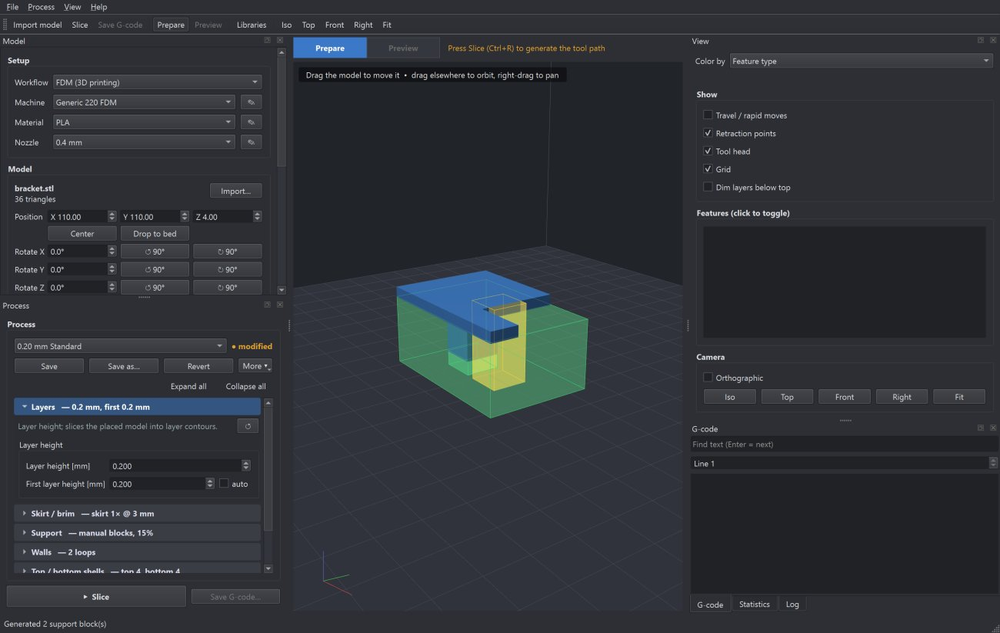
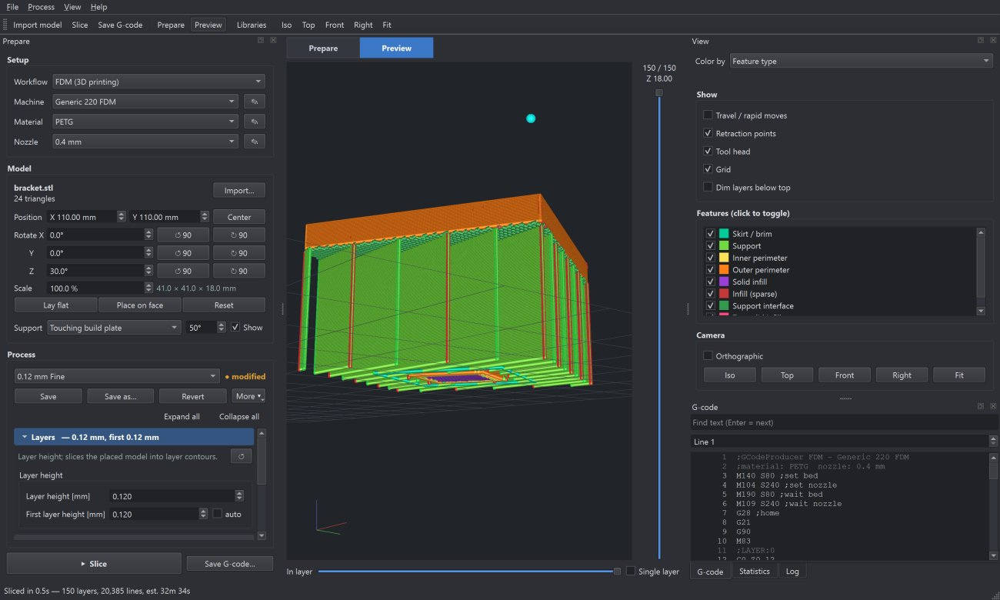
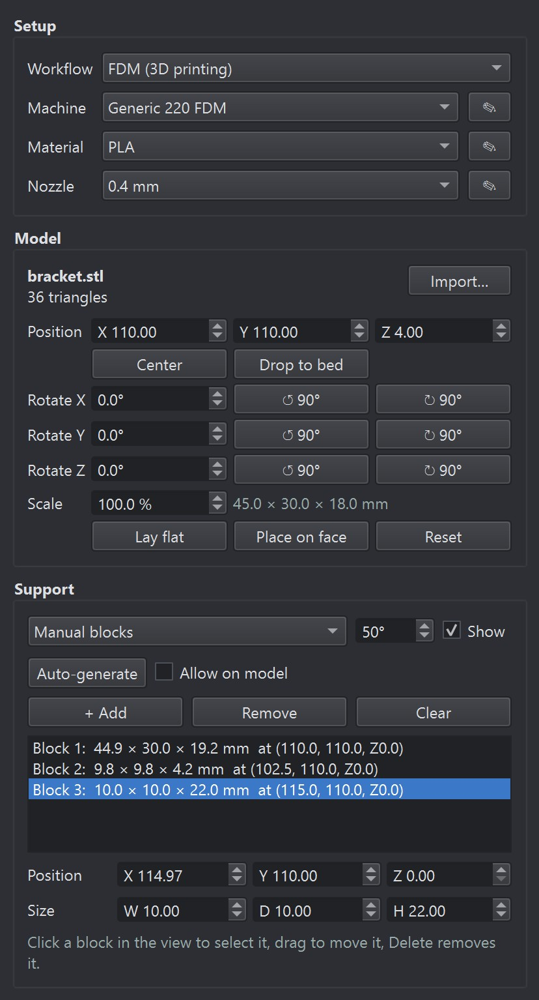

# GCodeProducer

GCodeProducer is a Python / Qt6 desktop and command-line app that **produces
G-code** from geometry. Where its sibling project
[GCodeTools](../GCodeTools) *reads and post-processes* existing G-code,
GCodeProducer runs a **slice pipeline** that turns a model into G-code for
either 3D printing (FDM) or subtractive machining (CAM). It shares GCodeTools'
3D viewer, G-code model, machine simulation and declarative-parameter system,
so produced jobs can be inspected with the same interactive viewer.

> **Status:** early (v0.1.0). The library/profile system, the FDM and CAM slice
> pipelines, the CLI and a Qt6 GUI work and have tests. The geometry kernel is
> minimal (good for prismatic / convex-ish parts); expect rough edges.

---

## Concept

Everything hangs off a **workflow**, a **machine** and the machine's
**consumable libraries**:

```
FDM workflow  ->  machine profile  ->  material library + nozzle library
CAM workflow  ->  machine profile  ->  tool library
```

- **Speeds and feeds live on the machine profile.** A machine runs every
  material / tool at *its* rates.
- **Libraries are stored separately** as folders of JSON files, so materials,
  nozzles and tools can be shared and versioned independently.
- **The machine selects which consumables are available.** Each machine has
  `allowed_materials` / `allowed_nozzles` (FDM) or `allowed_tools` (CAM); the
  slice UI only offers consumables the chosen machine allows.

Libraries live under `~/.gcodeproducer/` by default (override with the
`GCODEPRODUCER_LIBRARY` environment variable):

```
~/.gcodeproducer/
  machines/*.json      machine profiles (each tagged fdm or cam)
  materials/*.json     FDM filaments
  nozzles/*.json       FDM hot-end orifices
  tools/*.json         CAM cutters
  processes/*.json     process presets (saveable workflow options)
```

### Process presets (workflow options)

A **process preset** bundles a whole slice pipeline — which stages run, in what
order, with which parameters (layer height, perimeters, top/bottom layers,
infill density/pattern, …) — for one workflow. Presets are saved / loaded
independently of the machine and consumables, so you can keep e.g. *0.20 mm
Standard*, *0.30 mm Draft*, *0.12 mm Fine* and *Strong (cubic 40%)* and switch
between them. In the GUI the **Process** box has Save / Save As / Delete /
Reset; on the CLI use `--process NAME` (and `gcodeproducer processes` to list).

## The slice pipeline

A pipeline is an ordered list of **stages** — the GCodeProducer analogue of
GCodeTools' processing *modules*. Each stage declares the workflow(s) it
belongs to, has a declarative parameter schema (which generates both the GUI
form and the CLI options), and mutates a shared `Job` as it flows down the
pipeline. A stage never runs in a workflow it doesn't target, so FDM operations
(perimeters, infill, temperature) can't leak into a machining job and vice
versa.

| Workflow | Default stages                                                                     |
|----------|------------------------------------------------------------------------------------|
| FDM      | `fdm_slice` → `fdm_skirt_brim` → `fdm_support` (off by default) → `fdm_perimeters` → `fdm_top_bottom` → `fdm_infill` → `fdm_emit` |
| CAM      | `cam_profile` → `cam_emit`                                                          |

- **`fdm_slice`**: slices the *placed* mesh into per-layer closed contours.
  Placement (position, rotation, scale, drop to bed) belongs to the model, not
  the process. It is applied just before the pipeline runs (the CLI default
  is the bed centre).
- **`fdm_skirt_brim`**: skirt around the first-layer convex hull (distance,
  loops, number of layers) and / or a brim attached to the part outline (width,
  gap). Holes are not brimmed.
- **`fdm_support`**: automatic or manual support. On a raster shared by all layers,
  a cell of layer *i* is an overhang when it lies more than
  `layer_height × tan(overhang_angle)` beyond layer *i-1*. Columns grow
  down from the overhangs, leave a Z gap under the part, and stay
  `xy_distance` away from the model. *Touching build plate* keeps only columns
  with no model underneath. *Everywhere* lets them stand on the model (with a
  one-layer gap). **Holes and edges** (all modes):
  - Holes in the model up to *Support under holes up to* (default 100 mm²)
    count as solid. Support runs on under them, so the hole and its
    perimeters are supported, and it never climbs up inside the hole. Larger
    openings (e.g. a pocket opening downward) stay open and are supported as
    overhangs.
  - *Extend past model edge* (default **1.0 mm**, also in the Model dock's
    Support box) sets how far the support reaches past the model's edges and
    into holes too large to fill, so the perimeters along every edge sit fully
    on support. It is measured to the outside of the printed support and
    rounded to the support grid (about ±0.3 mm). 0 stops the support at the
    edge. It keeps the XY distance, the Z gap and the build-plate rule, and it
    never creates support on its own.

  *Manual blocks* uses the job's support blocks instead
  (`core/support.py`; `--support-blocks` on the CLI). The top
  `interface_layers` are printed denser as `support_interface`.
- **`fdm_perimeters`** — offsets each contour inward into wall loops
  (outer + inner). The innermost loop bounds the infill region.
- **`fdm_top_bottom`** — top / bottom **solid** surfaces. A cell is sparse only
  if the part covers it in all `top_layers` above *and* all `bottom_layers`
  below; otherwise it is a solid surface (`top_infill` / `solid_infill`).
  Detection uses shared-grid rasters, so interior top shells (e.g. the top of a
  wide base under a narrow tower) are found, not just the first/last N layers.
- **`fdm_infill`** — fills the remaining interior with a pattern (rectilinear,
  grid, triangles, cubic, lines) at a chosen density, with perimeter overlap,
  angle, min line length and travel-connection options, reusing GCodeTools'
  infill generator. Sparse infill never overlaps the solid shells.
- **`fdm_emit`** — walks the toolpaths into G-code with travels, retraction,
  temperatures (from the material), cooling and start/end blocks.
- **`cam_profile`** — 2.5D contour/profile cut around the part silhouette,
  offset by the tool radius, stepping down by the tool's depth of cut.
- **`cam_emit`** — rapids at safe Z, plunges and cuts with spindle control.

## Install

```bash
pip install -r requirements.txt   # PyQt6, PyOpenGL, numpy
# or
pip install -e .
```

## GUI

| Prepare: place the model | Preview: the sliced tool path |
|---|---|
|  |  |

```bash
python -m gcodeproducer gui                    # start the GUI
python -m gcodeproducer gui part.stl           # start and import a model
```

On Windows you can double-click `GCodeProducer.bat`. The layout follows
GCodeTools: a toolbar, the **Model** (setup, placement, support) and
**Process** docks on the left, the 3D area in the centre, and **View / G-code /
Statistics / Log** docks on the right.

The 3D area has **two views** (switch with the buttons above it, the toolbar,
or Ctrl+1 / Ctrl+2). Both use the same camera:

- **Prepare** shows the build plate and the model. Drag the model to move it
  across the bed. Drag elsewhere to orbit, right-drag to pan and use the wheel
  to zoom. Overhangs that need support are tinted red. A model outside the
  build volume turns orange and a warning appears. Seen from below, the bed
  turns see-through so you can inspect the underside.
- **Preview** shows the sliced tool path. Slicing switches to it automatically.
  Changing the model, its placement, the process, the machine or the
  consumables marks the preview *out of date* until you slice again. Editing
  the placement switches back to Prepare. Docks can
be moved, floated and hidden (View menu); the layout, last machine,
consumables, process and recent models are remembered.

**Model and Process docks** (top to bottom):

1. **Setup**: workflow (FDM / CAM), machine and the consumables that machine
   allows (material + nozzle, or tool). The ✎ buttons open the library
   editor on that profile.
2. **Model**: import an STL (or drop it on the window). Recent models are under
   *File → Recent models*. Placement:
   - **Position X / Y / Z**: X / Y is the centre of the model on the bed
     (*Center* puts it back in the middle; you can also drag the model in the
     Prepare view). **Z** lifts the model's lowest point off the bed. A lifted
     model is sliced with empty layers underneath, its underside shows as an
     overhang, and support can be built up to it. *Drop to bed* sets Z back to 0.
   - **Rotate X / Y / Z**: type an angle, or use ↺ 90 / ↻ 90 to turn it about a
     world axis.
   - **Scale** in %, with the resulting size shown next to it.
   - **Lay flat** rests the largest flat face on the bed. **Place on face**:
     click it, then click any face of the model and that face goes down.
   - **Reset** clears rotation, scale and Z and re-centres the model.

   Each model's placement is remembered, so re-opening the file restores it.

   **Support** (its own box below Model): *None*, *Touching build plate*,
   *Everywhere* or **Manual blocks**, plus the overhang angle (*Show* tints
   overhangs red) and **Extend past edge** (how far the support reaches past
   the model's edges, default 1 mm). The mode is the same setting as the process's *Support*
   section, so it is saved with the process.

   

   **Manual support blocks** are boxes on the plate: support is generated
   **only inside the blocks, wherever the model is above them** (with the
   usual Z gap and XY distance).
   - **Auto-generate** runs the automatic support and covers it with a grid of
     blocks of the **Block size** (each tile gets its own height, from the
     lowest to the highest support inside it). *Allow on model* also lets
     support stand on the model. Smaller blocks give finer control, larger
     ones fewer blocks to manage. For a model on the bed, the result slices the
     same as automatic support. Then delete, move or resize individual tiles.
   - **Place blocks** (pick and place): set the **Block size** (width = depth,
     mm; also used by Auto-generate), switch *Place blocks* on, then click in
     the Prepare view:
     - on the **bed** or a surface facing **up**: a block from that height
       straight up to the next face of the model above;
     - on a surface facing **down** (an overhang seen from below): a block from
       the next surface below (model or bed) up to that face.

     Clicking where nothing is above (e.g. the top of the part) places nothing.
     Keep clicking to place more; *Esc* or the button again ends the mode.
   - **Remove blocks** (toggle, next to *Place blocks*): the block under the
     cursor turns red and clicking deletes it. Keep clicking to remove more;
     *Esc* or the button again ends the mode. *Place blocks*, *Remove blocks*
     and *Place on face* are exclusive: switching one on switches the others off.
   - **+ Add** puts a 10 × 10 mm block under the model. **Delete selected**
     (or the *Delete* key in the view) and **Clear** remove blocks.
   - Select a block in the list or click it in the Prepare view (it turns
     yellow), then drag it to move it, or type its position (X / Y centre,
     bottom Z) and size (W / D / H).
   - Blocks belong to the model, like its placement: they move with it when
     you change X / Y / Z, are saved per model, and are removed if you rotate
     or scale the model (Auto-generate them again).
3. **Process**: the *workflow options*, i.e. everything that is **not** machine,
   material or nozzle specific. Pick a saved process from the list and edit it
   in collapsible sections, each showing a summary when closed:

   | Section             | Settings                                                              |
   |---------------------|-----------------------------------------------------------------------|
   | Layers              | layer height, first layer height, centre on bed                       |
   | Skirt / brim        | none / skirt / brim / both, skirt loops, distance, height, brim width & gap |
   | Support             | build plate / everywhere / manual blocks, overhang angle, density, pattern, XY distance, top Z gap, interface layers & density, min area, support under holes up to (mm²), extend past model edge (mm) |
   | Walls               | wall loops, wall line width                                           |
   | Top / bottom shells | top / bottom solid layers, solid pattern, angle, overlap              |
   | Infill              | density, pattern (rectilinear, grid, triangles, cubic, lines), angle, line width, overlap, min length, travel order |
   | Travel & output     | retract on travel, min travel to retract, seam position               |

   Changes show **● modified**. **Save** writes them to the selected process,
   **Save as…** creates a new one, **Revert** discards them. *More ▾* has
   **Import / Export** (share a process as a `.json` file), **Rename**,
   **Delete**, and *Edit pipeline stages…* (advanced: add, remove, reorder or
   duplicate stages). Switching process with unsaved changes asks first, and
   unsaved edits survive a restart.
4. **Slice** (Ctrl+R), then **Save G-code** (Ctrl+S).

**Viewer**: the vertical slider picks the top layer (PgUp / PgDn, Home /
End), *In layer* scrubs through it, *Single layer* isolates it. Colour by
feature, move type, speed or layer, and toggle features in the View dock.
Double-click a move to jump to its G-code line; double-click a G-code line to
jump to it in 3D. *Statistics* shows layers, estimated time, filament length
and weight, and more.

Speeds and feeds are set on the **machine**; temperatures, flow, cooling and
retraction on the **material**; diameter and line width on the **nozzle**.
Edit them with *Libraries…* (toolbar) or the ✎ buttons.

## CLI

```bash
python -m gcodeproducer workflows               # list workflows
python -m gcodeproducer stages -v               # list slice stages + params
python -m gcodeproducer libraries               # list every profile
python -m gcodeproducer processes -v            # list process presets
python -m gcodeproducer describe fdm_infill     # one stage's parameters

# slice with a saved process preset (workflow options)
python -m gcodeproducer slice part.stl -w fdm -o part.gcode \
    --machine "Generic 220 FDM" --material PLA --nozzle "0.4 mm" \
    --process "0.12 mm Fine"

# ...or build the pipeline from scratch and tune stages
python -m gcodeproducer slice part.stl -w fdm -o part.gcode \
    --machine "Generic 220 FDM" --material PLA --nozzle "0.4 mm" \
    --layer-height 0.2 \
    -m "fdm_perimeters:perimeters=3" \
    -m "fdm_top_bottom:top_layers=5,bottom_layers=4" \
    -m "fdm_infill:density=25,pattern=cubic"

# placement and support from the command line (-m on a stage also switches it on)
python -m gcodeproducer slice bracket.stl -o bracket.gcode --rotate-x 90 --x 80 --y 100 \
    --lay-flat -m "fdm_support:placement=everywhere,overhang_angle=45"

# lift the part 3 mm off the bed and support it with manual blocks
# (blocks.json: [{"x0": 95, "y0": 95, "z0": 0, "x1": 125, "y1": 125, "z1": 20}, ...] in bed mm)
python -m gcodeproducer slice bracket.stl --z 3 --support-blocks blocks.json \
    -m "fdm_support:placement=blocks"

# machining
python -m gcodeproducer slice part.stl -w cam -o part.nc \
    --machine "Generic 300 Router" --tool "6 mm flat endmill" \
    -m "cam_profile:side=outside,stepdown=1.5"
```

A pipeline can be saved / loaded as JSON (`--config pipeline.json`).

## Writing a stage (plugin)

Drop a `.py` file in `plugins/`, `~/.gcodeproducer/plugins`, or a directory in
`GCODEPRODUCER_PLUGINS`. Any `SliceStage` subclass with an `id` is registered.

```python
from gcodeproducer.stages.base import SliceStage, Param, FDM

class Brim(SliceStage):
    id = "brim"
    name = "Brim"
    description = "Add N loops around the first layer."
    workflows = (FDM,)                # REQUIRED
    params = [Param("loops", "int", 5)]

    def run(self, job, params, ctx):
        ...                           # read/append job.layers[0].paths
        return f"{params['loops']} brim loops"
```

## Project layout

```
gcodeproducer/
  core/        gcode model + emitter (builder.py), geometry kernel (slicing,
               polygon offset, RegionMask, raster helpers), model placement
               (placement.py), support maths and blocks (support.py), state
               simulation, toolpath/features
               (shared with GCodeTools), the profile/library system
               (profiles.py), process presets (process.py), job model, stage
               pipeline, plugin discovery, session driver, starter profiles
  importers/   geometry importers (stl)
  stages/      slice stages (fdm_slice/skirt_brim/support/perimeters/top_bottom/
               infill/emit, cam_profile/emit)
  gui/         Qt6 main window, Prepare view (model_viewer.py), Preview view
               (viewer.py), process editor (process_editor.py), library editor
               (library_dialog.py), widgets
  cli.py       command-line interface
plugins/       drop-in user stages / importers
examples/      sample model (cube20.stl)
tests/         pytest suite
```

## License

GPL-3.0-or-later. See [LICENSE](LICENSE). Uses PyQt6 (GPL v3).
