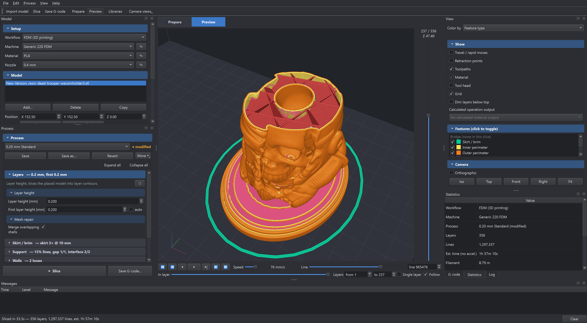

# GCodeProducer

Python/PyQt6 application that produces **FDM and 2.5D / basic 3-axis CAM G-code from STL models**,
with a desktop interface and command-line tools.



## Features

- **Prepare and Preview:** shared camera and machine dimensions, model placement,
  rotation/scaling, layer inspection, feature colours, linked G-code selection,
  and a playback bar (play/pause, step by move or layer, speed) shared by FDM and CAM.
- **Consistent panels:** every dock is built from the same collapsible panes,
  which remember whether they are open; a compact Messages dock records all warnings.
- **Editing:** shared FDM/CAM undo/redo, including control values and selections;
  Ctrl+L aligns a chosen face to the bed or CAM cutting surface.
- **FDM:** walls, top/bottom shells, sparse infill, skirt/brim, automatic support,
  editable support blocks, and reusable process presets.
- **CAM:** ordered tool-change trees with Pocket, Profile, Slot, Drill, and Engrave
  operations, plus model-surface-limited 3D Waterfall full-area clearing
  and depth-limited 3D Contour (surface-following) passes; part/material picking, drawn reference circles/rectangles,
  geometry-linked depths and wall-parallel, raster, or trochoidal clearing,
  machine-default climb/conventional/meander direction, and Slot/High/Cut/HSM feeds.
- **CAM stock:** editable material/blank properties, margin-based Auto allocation,
  top-at-Z0 placement, current-material checks, leads, per-operation material outputs,
  and side-placed holding tabs that retain rails to the material's XY edges.
- **CAM cutting data:** six machining materials, per-tool SFM/chip load and axial
  defaults, constrained RPM calculation, and independent manual feed unlocks.
- **Libraries:** separate machines, FDM materials/nozzles, and CAM tools.
- **Custom G-code:** multi-line start/end templates, reset, variable insertion,
  expressions, conditionals, validation, and example preview.
- **Background computation:** slicing, CAM selection/path generation, and support
  auto-generation run outside the UI process.
- **Extensible:** declarative settings, workflow-specific stages, importer plugins,
  and a CLI.

## Run

Requires **Python 3.10+** and an OpenGL-capable desktop for the GUI.

```bash
python -m pip install -e .
python -m gcodeproducer gui
```

On Windows, you can also launch `GCodeProducer.bat`.
For setup and first-job instructions, see [Getting started](docs/getting-started.md).

## Documentation

**[Open the documentation index →](docs/README.md)**

All detailed instructions live in the **`docs/` folder**. Follow the links on
GitHub, or open `docs/README.md` in a Markdown viewer/editor locally. No website
build or network connection is required to read the local files.

| Topic | Guide |
|---|---|
| Interface, placement, preview, shortcuts | [Using the GUI](docs/gui.md) |
| Libraries, settings ownership, saved state | [Profiles and persistence](docs/profiles-and-state.md) |
| FDM processes and settings | [FDM guide](docs/fdm/README.md) |
| CAM tools, operations, selections, depths | [CAM guide](docs/cam/README.md) |
| Stock allocation and collision-check limits | [Stock and safety](docs/cam/stock-and-safety.md) |
| Start/end G-code and variables | [Templates](docs/gcode-templates.md) |
| Commands and examples | [CLI](docs/cli.md) |
| Exact defaults, ranges, and choices | [Settings reference](docs/reference/README.md) |
| Problems and current limitations | [Troubleshooting](docs/troubleshooting.md) |
| Architecture, plugins, documentation maintenance | [Development](docs/development.md) |

## License

[GPL-3.0-or-later](LICENSE). Uses PyQt6 (GPL v3).
