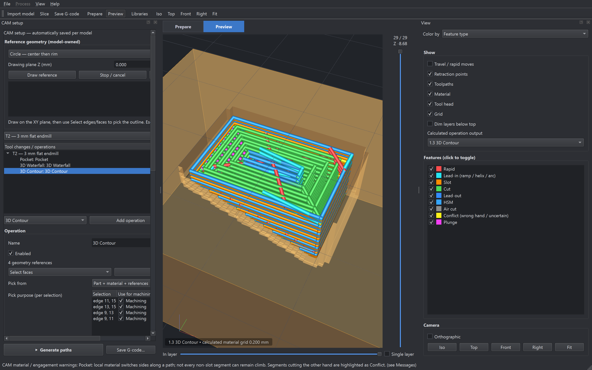
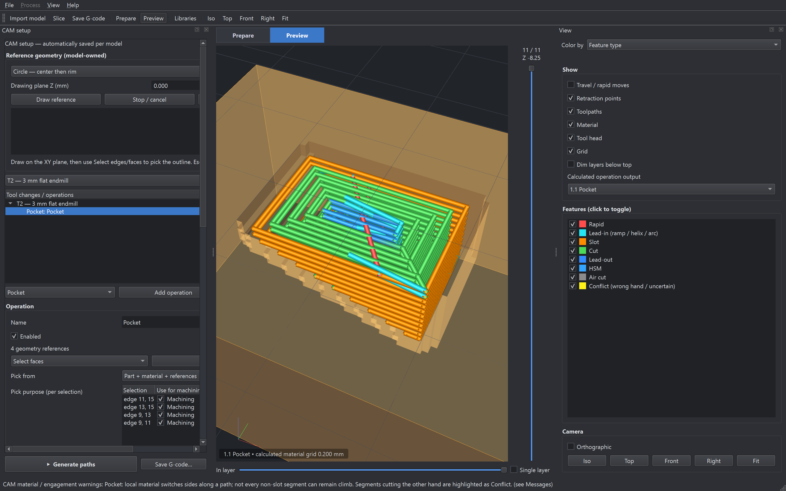
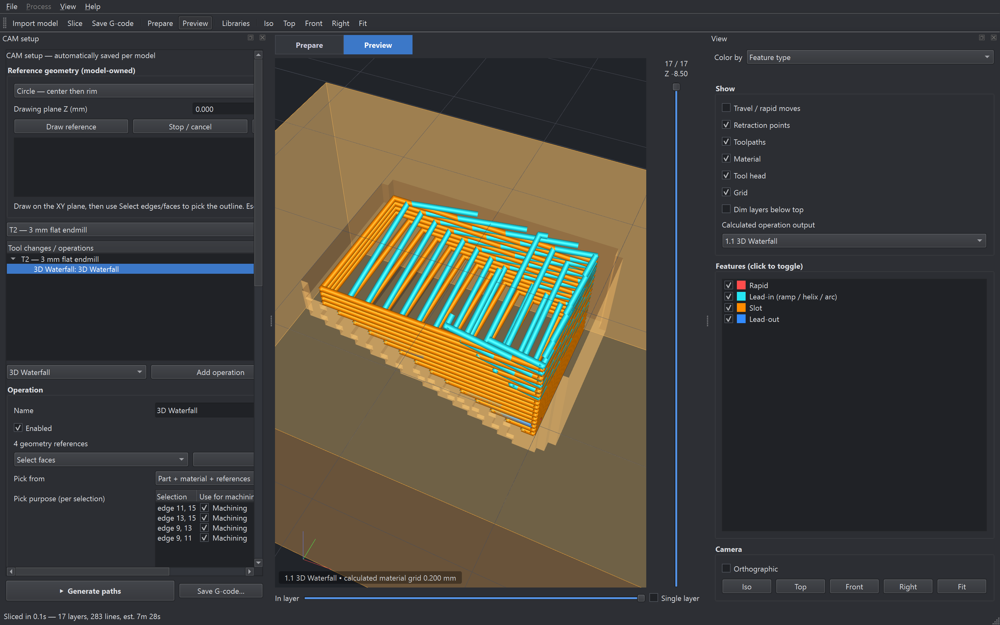
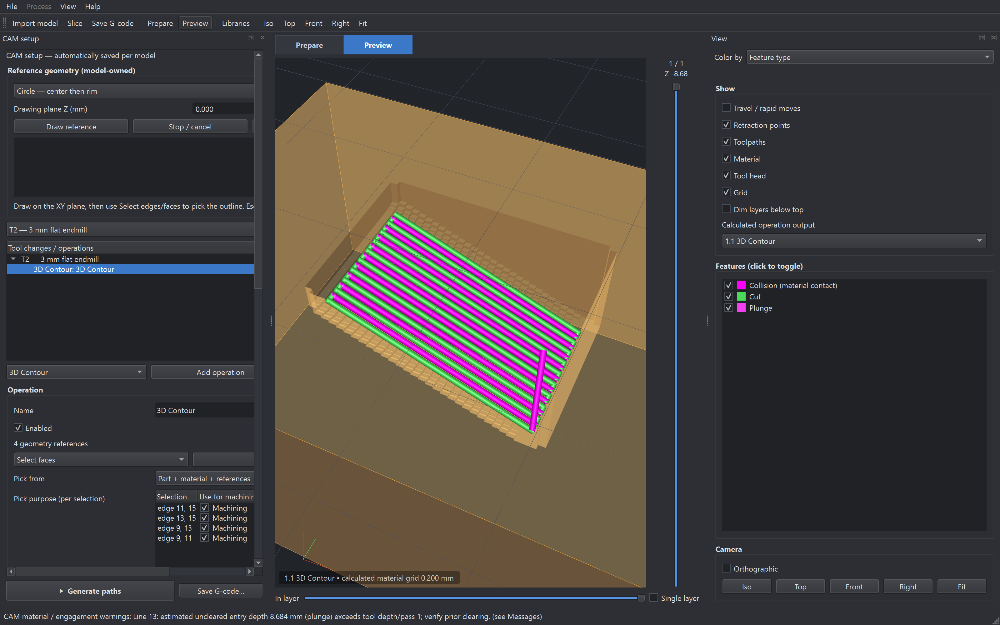

[Documentation](../README.md) / [CAM](README.md)

# 3-axis surface operations: sloped-floor Pocket, 3D Waterfall, 3D Contour

These operations are limited by the **model surface** instead of a single flat
end depth. They are 3-axis (vertical cutter, no undercuts) and treat every tool
as a **flat endmill** of its diameter.

| Operation | What it produces | Typical use |
|---|---|---|
| **Pocket** on a non-flat bottom | Clearing passes at each depth, each stopping where the model stands above that depth: terraces | Roughing a pocket whose floor slopes, steps or curves |
| **3D Waterfall** | One cutter-radius contour around everything standing above each Z level, level by level (Z-level / "waterline" passes) | Finishing steep walls and the risers of roughing terraces |
| **3D Contour** | Parallel zigzag passes whose Z follows the surface under the cutter | Finishing sloped and gently curved floors |

A common sequence in one tool group is **Pocket → 3D Waterfall → 3D Contour**.

All captures on this page are actual Preview output for `examples/wedge-pocket.stl`
(a 20 × 14 mm pocket whose floor falls from Z-2 to Z-10) with the starter 3 mm
tool. They illustrate behaviour; they are not qualified cutting recipes.

## How the model limits the cut

At a level Z the cutter may not enter the **XY shadow of all model material
above Z**. The shadow is computed exactly from the upward-facing triangles of
the mesh (not from sampled slices), so material overhanging a lower cavity also
blocks the cutter: undercuts are never entered, and are simply left uncut.
Model material within 0.001 mm above a level counts as that level's floor.

Because a sloped surface is approached in flat levels, roughing leaves a
staircase whose step height is the depth per pass. Reduce the depth of cut or
finish with 3D Waterfall / 3D Contour.

Holding tabs standing above a level are treated like model material at that
level, for all three operations. No extra pass is inserted at a tab roof here;
up to one depth of cut can remain over a tab.

## Pocket with a bottom that is not flat

Earlier versions rejected a Pocket whose selected edges were not all at one Z
(*"2.5D operations require constant-Z edges"*). Such a pocket is now generated:

- If any selected boundary edge is **not level**, the Pocket is automatically
  limited by the model surface. The log says *limited by the model surface*.
- For a pocket selected by a **flat rim** whose floor is nevertheless contoured,
  tick **Stop at model surface (3D floor)** on the operation. Unticked (the
  default, and the behaviour of saved setups) a flat-rim Pocket still cuts a
  flat floor at End Z through whatever is there.

Behaviour in this mode:

- The selected outlines are projected to XY. Nested outlines alternate as for
  any Pocket (outer boundary, island, …). **Partly overlapping outlines are
  merged** into one area instead of raising the *overlap without nesting*
  error, for example a drawn rectangle crossing a selected pocket outline.
  The model surface, not the outline, then decides where material is removed.
- Start and End resolve as usual. With *Machining selection* sources they are
  the highest and lowest selected points, so selecting the sloped edges
  themselves gives End = the deepest point of the floor.
- Strategy, stepover, roughing clearance, cutting direction, stay-down links,
  leads, material boundary limit and air-cut removal apply per level. Roughing
  clearance is left on the model's walls and terrace edges.
- The reachable area changes with depth, so **Area order** is always *each
  depth across all areas* here; the log notes this.
- A level with no area the cutter fits into is skipped and logged. The deepest
  point of a slope is normally narrower than the cutter and is left for the
  finishing operations.
- Pocket **overcut into void** is not applied in this mode.

## 3D Waterfall

**Purpose:** follow the walls level by level. At each depth the cutter centre
runs exactly one cutter radius (plus stock to leave) outside everything that
stands above that depth.

1. Add a **3D Waterfall** operation and select closed outlines around the area
   to finish: a pocket rim, a face, a drawn rectangle/circle, or the outline of
   the part. Contours are kept where the cutter centre is within the selection
   grown by the cutter radius, so both inside walls and the outside of a
   selected outline are reachable; contours leaving that area are clipped into
   open passes.
2. Set Start and End. New operations use the selection's highest and lowest Z.
   A flat selection gives Start = End: link End to a lower edge or face.
3. Depth per pass is the vertical spacing of the levels. Automatic depth uses
   the tool's **Slot** axial percentage for the active material (15 % of the
   diameter in the starter data); unlock *depth of cut* for finer levels.
4. Cutting direction (machine default or unlocked) orients each contour;
   lead-in/out behave as for Profile.

One contour is cut per wall per level; there are no additional radial passes.
On shallow surfaces the levels are far apart in XY: use 3D Contour there.

## 3D Contour

**Purpose:** a single finishing pass over the surface. The cutter moves in
parallel lines and its tip height at every point is the highest model point
under its footprint, plus stock to leave, never below End Z.

- **Area:** the selected closed outlines (merged like the Pocket above). The
  cutter centre stays inside them.
- **Stepover:** distance between passes as a percentage of the diameter (the
  Pocket stepover field). Smaller values leave smaller scallops/steps.
- **Direction of passes:** along the longer side of the selected area,
  alternating (zigzag); neighbouring passes are joined along the surface when
  the joining move stays inside the area. Climb/conventional is therefore mixed.
- **Start Z** is the ceiling: stretches where the cutter would sit at or above
  Start (resting on the top face beside a wall, for example) are not traced.
- **End Z** is the floor: where no model lies under the cutter it runs at End Z.
- **Feeds:** the normal cutting feed; descents steeper than 10° use the
  lead/plunge feed. Engagement-based feed factors are not applied.
- **One pass only.** There are no depth levels: rough first. If the pass meets
  more material than the tool's depth per pass, the usual *uncleared entry
  depth* stock warnings are raised and the moves are coloured as Collision.

### Accuracy

Heights come from a grid of the model's upper surface. The grid cell is the
smaller of the global *Material grid resolution* and 1/40 of the tool diameter,
not finer than 0.05 mm, and is coarsened (with a warning) if the area would
exceed *Maximum grid cells*. Every approximation is upward: the cutter is never
placed below the true surface, and on a slope it stays above it by up to about
one to four cells times the slope. Paths are simplified to 0.005 mm.

## Settings summary

| Field | Pocket (3D floor) | 3D Waterfall | 3D Contour |
|---|---|---|---|
| Geometry | Closed outlines; sloped edges allowed | Closed outlines | Closed outlines |
| Start / End | Depth range of the levels | Depth range of the levels | Ceiling / lowest allowed Z |
| Depth of cut | Level spacing | Level spacing (auto: Slot axial %) | Not used for levels; still the limit for stock warnings |
| Stepover | Between clearing contours | Not used | Between passes |
| Roughing clearance / stock to leave | Left on walls and terrace edges (radial) | Left on walls (radial) | Left above the surface (axial) |
| Cutting direction | Yes | Yes | No (zigzag) |
| Strategy, stay down, material limit | Yes | No | No |
| Lead-in / lead-out | Yes | Yes | No (plunge at the pass start) |
| Engagement feeds | Yes | Yes | No |
| Holding tabs | Avoided below their top | Contoured around below their top | Cutter stays at or above the tab top |

## Limitations

- 3-axis only; undercut regions are left uncut without a separate warning.
- Flat-endmill geometry for every tool. A ball or bull-nose cutter is placed as
  if it were flat, which never gouges but leaves more material on slopes; tool
  type and V angle remain descriptive.
- No rest machining: 3D Waterfall and 3D Contour do not know what the roughing
  left and retrace the whole selected area. Air-cut removal applies to the
  Pocket levels only.
- No constant-scallop, spiral, pencil or adaptive strategies; no arc fitting.
- The remaining-material planner is depth-tagged and planar: a 3D Contour pass
  is not recorded in it, so later operations do not treat that material as
  removed. The height-field Material display and stock checks do include it.
- Preview and the stock checks remain approximate and do not model holders,
  shanks, fixtures or clamps. Verify reach on deep walls: the cutter's shank
  passes beside everything above the level being cut.

## Messages

| Message | Meaning |
|---|---|
| *… needs constant-Z edges; Pocket, 3D Waterfall and 3D Contour accept sloped boundaries* | Profile, Slot, Engrave and Drill still need level geometry. |
| *overlapping boundaries merged into one machining area* | Informational: partly overlapping outlines were combined. |
| *Z… has no area the cutter can reach above the model surface; pass skipped* | The free area at that level is narrower than the cutter. |
| *no machinable paths between the selection and the model surface … Check that End Z is below the surface* | No level produced a path: usually Start = End (flat selection) or a cutter larger than the feature. |
| *no model surface below Start Z… that the cutter can reach* | 3D Contour found nothing under the cutter below Start. |
| *surface height grid coarsened* | The area exceeded the cell limit; more material is left on slopes. |
