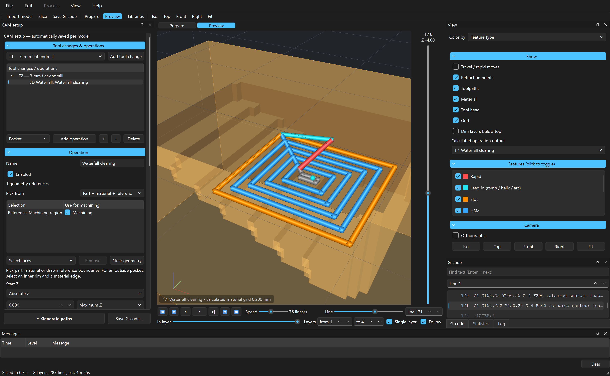
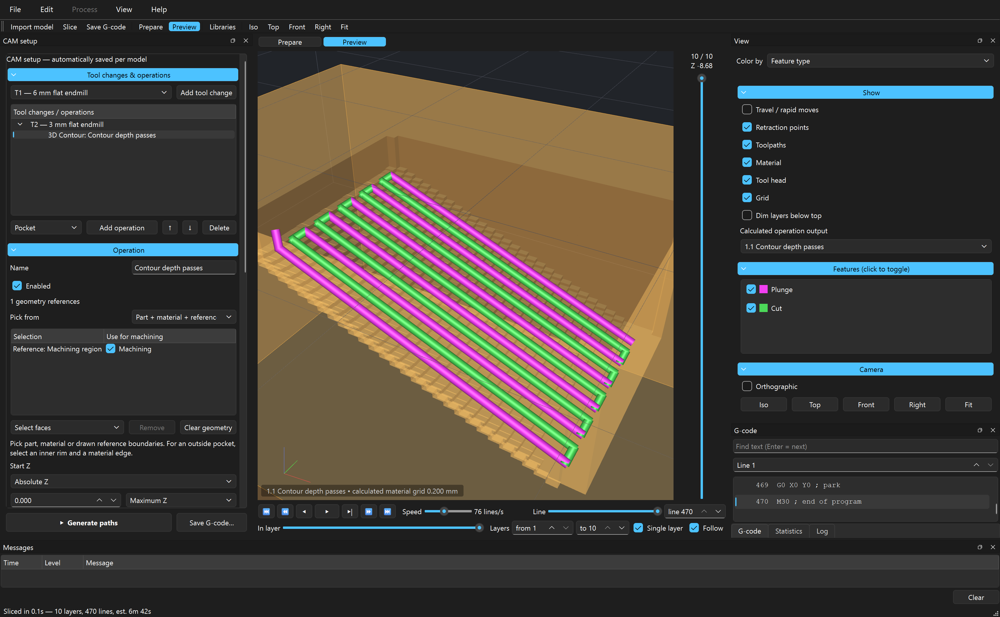
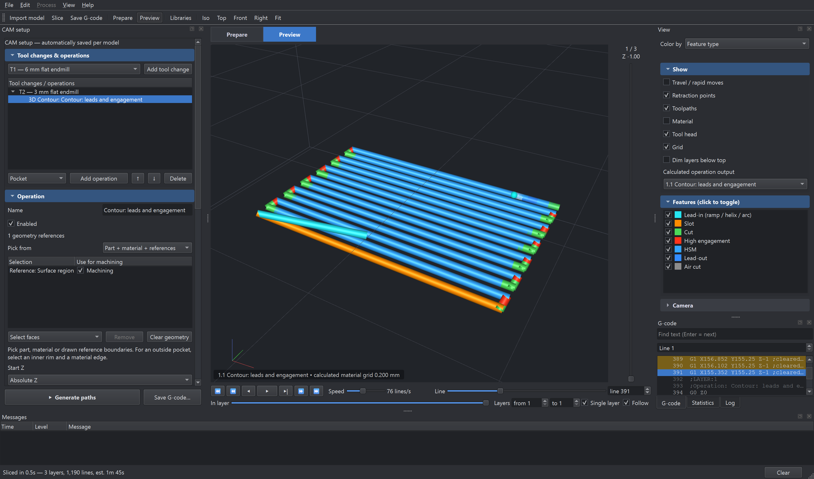

[Documentation](../README.md) / [CAM](README.md)

# 3-axis surface operations: 3D Waterfall and 3D Contour

Both operations clear material in **depth-limited passes**, stopping at the
model surface. They use a vertical flat-endmill footprint: no undercuts,
ball-nose compensation, fixtures or holder simulation.

| Operation | What it produces | Typical use |
|---|---|---|
| **Pocket** | Planar clearing to a flat End Z; level boundaries required | Ordinary 2.5D pockets |
| **3D Waterfall** | Full-area clearing at successive Z levels, with the model protected at each level | Roughing sloped, stepped or curved floors and walls |
| **3D Contour** | Successive surface-following raster passes, each limited to the next depth band | Clearing and refining sloped or gently curved surfaces |

A useful sequence is **3D Waterfall → 3D Contour**: Waterfall clears terraces;
Contour refines the surface. Contour also works on its own: it no longer makes
a single finishing pass straight through uncleared material.

## Depth of cut and material above Start

Both kinds use the resolved **depth of cut**, including the operation unlock
and the tool's positive **Max depth/pass** cap. Waterfall automatic depth uses
the active material's **Pocket** axial percentage; Contour uses **Slot**.

If the selected Start is below the original stock/model surface, clearing
begins at that surface so the material above Start is not skipped. For example,
Start −4, End −10, stock top 0 and depth/pass 1 require passes starting at −1,
not a first entry at −5. Waterfall can omit passes already cleared by earlier
operations when **Remove air cutting** is enabled. Contour still plans every
depth band, but with **Remove air cutting** on the motion planner checks each
measured sub-move against the current material left by all earlier passes and
tools. Stretches that touch nothing are not written: air gaps longer than two
cutter diameters become a retract and re-entry, shorter ones are fed through,
and paths entirely in air are dropped. The remaining pieces of each depth band
are visited nearest-first (each keeps its cutting direction) instead of in
raster order, which would rapid back and forth across cleared areas. The log
reports the skipped length.
Material only decreases, so skipping cannot leave material uncut. The usual
rapid-clearance and entry checks apply to the new travels.

Every depth is visited across all reachable areas before descending: the
reachable area changes with depth, so surface operations do not use
*each area to full depth* ordering. Safe Z must still clear the stock/model.

## 3D Waterfall

**Full-area surface-limited clearing.**

At each depth, Waterfall subtracts the XY shadow of all model material above
that depth from the selected area. It then clears the **whole remaining
cutter-accessible region**, not just one contour along its wall.

1. Add **3D Waterfall** and select closed part/material/reference outlines.
   Sloped edge boundaries are allowed. A selected horizontal material edge
   identifies its complete stock rim, as in Pocket.
2. Set Start/End. Selection-linked defaults use the selection's extrema. A
   flat rim needs End linked to a lower feature or set explicitly.
3. Choose **Cutting strategy → Wall-parallel contours / Raster lines X / Raster lines Y / Adaptive clearing**, stepover, radial
   stock to leave and depth of cut. Stay-down links, lead ramps, cutting hand,
   engagement feeds and the material boundary limit work as for clearing.
   Stock to leave is kept on the part only: where the selection reaches the
   blank edge, the cutter edge still meets that edge (plus the material boundary
   limit), so roughing leaves no wall of raw stock around the blank.
4. Optionally tick **Follow the surface within each depth** (below). Generate
   and inspect each depth and the calculated material outputs.

### Follow the surface within each depth

A flat depth stops at the model's shadow and leaves the slope above it as a
step; on the first depth that is the whole slope between the top of the
material and that depth. With **Follow the surface within each depth**
ticked, each depth also works the area that was free at the depth above (the
material top for the first one). Its paths are planned as usual, then every
point rides at the model's height (plus stock to leave) under the cutter
where that is above the current depth, up to the depth above: never below
the current depth, never above the one before. Paths that stay flat are
unchanged; a lifted closed contour is opened at its highest point so its
lead ramps in down the slope. A lifted path follows the surface by the same
rule as 3D Contour (see *Surface heights* below). Lifted paths are 3D moves, so they are entered
and linked like 3D Contour paths rather than with stay-down links. On the
Mini Yoda (4 mm endmill, 2 mm depths, 1 mm stock to leave, wall-parallel
contours) the material left above the model after the Waterfall fell from
3,205 to 1,931 mm³, for 147 s more machining (622 to 769 s estimated) and
18 s more compute. A wall that is vertical or overhangs is unchanged: a flat
cutter cannot reach it from above.

Nested selected outlines alternate between boundary and island. Overlapping
outlines merge. Exact projected upper triangles protect overhangs; undercuts
are left uncut. Model material within 0.001 mm above a level counts as floor.
Tabs are protected below their roofs; up to one depth of cut may remain over
a tab because this planner does not insert an extra tab-roof pass.

A cutter-sized region may disappear before End on a slope; those levels are
skipped. A smaller tool or Contour can reach more of the surface, but neither
can reach below an overhang or into corners tighter than the cutter.
**Overcut** extends the selected removal region into surrounding stock, just
as in Pocket. The added area respects the sampled part sections and the
material boundary limit; each pass still protects the model shadow and tabs.
See [Overcut](operations.md#overcut-into-void-material).

## Pocket migration

The **Stop at model surface** checkbox has been removed from Pocket. Its old
behaviour is now **3D Waterfall**, with full-area depth-limited clearing.
Saved Pocket operations with that flag enabled reopen as Waterfall, preserving
their name, selections, depths and other settings. Pocket without the flag
remains a flat-floor operation; old nonlevel Pocket boundaries must be changed
to Waterfall explicitly rather than silently choosing a different strategy.

## 3D Contour

**Depth-limited surface passes.**

The final reachable tool-tip height is the highest model point under its
footprint, plus axial stock to leave, never below End. Intermediate passes
clamp that height upward to each successive depth floor. With 0.5 mm depth/pass,
no intermediate band starts directly at a surface several millimetres below
uncleared stock.

- **Area:** selected closed XY outlines; the cutter centre stays inside them.
- **Stepover:** raster spacing as a percentage of cutter diameter.
- **Cutting strategy:** **Meander** zigzags along the longer side with short
  in-region surface links. **Raster lines X / Y** cuts separate single-direction
  lines along the chosen work-coordinate axis, with retract/travel between them.
  Climb/conventional is not a selectable hand for these XYZ paths.
- **Surface heights:** the safe-height grid holds one height per cell, which a
  path crossing a slope would follow as a staircase of tiny plunges. 3D Contour
  and Waterfall's *Follow the surface* share one rule (`follow_heights`):
  heights are interpolated between cells of the grid raised to each cell's
  neighbourhood, so never below the grid, on slopes up to about 50°; across a
  steeper step (a wall) the cell height is kept, so the path does not climb
  the wall early. Dips narrower than 0.5 mm are filled by up to 0.05 mm, so
  grid noise does not saw the cutter up and down while real corners are kept.
- **Ceiling:** stretches resting at or above the original material surface
  are omitted. Raised model surfaces and tabs still constrain every band.
- **Feeds:** XYZ moves are classified from current height-field material as
  **Slot / High engagement / Cut / HSM / Air**. Machine thresholds and the
  operation/tool/machine feed modifiers apply. A descent into material is fed by its angle,
  blending from the level rate to the lead-in rate at the lead-in angle and on
  to the plunge feed straight down; steeper than the lead-in angle it shows as
  *Plunge*. Every feed remains machine-capped. Feeds are then smoothed along
  each continuous cut (Settings → *Feed smoothing length*, below).
- **Entries:** with **Lead-in ramp along contour** checked, an entry which
  meets remaining material ramps along the validated XYZ path within the operation’s lead-in angle. Short
  usable prefixes zigzag as needed. Already-clear entries skip the ramp and
  descend through verified air. Unchecking retains an explicit plunge entry.
- **Exits:** with **Lead-out along cleared contour** checked, a path that cut
  material follows a short already-cut XYZ section back out. An uncertain exit
  is omitted in favour of retracting; an entirely air-only path has no lead-out.

Leads never extend an arbitrary tangent through a retained wall. If the usable
surface rises too steeply to fit a protected entry at the configured angle, generation reports an
error instead of silently plunging. Choose another entry/direction or explicitly
turn lead-in off only after checking plunge capability. A shorter requested lead
can help where an unnecessarily long lead crosses a raised surface.

Classification samples the current tip height and newly swept cutter footprint,
subdividing long XYZ moves so their feed/type can change along the path. It
includes emitted leads, earlier paths/depths and tool changes. Preview feature
colours and radial-engagement colours use this metadata; it is a **grid estimate**,
not measured tooth load. Without allocated stock, the emitter assumes a
conservative model-bounds blank and logs that limitation.

Heights use a conservative upper-surface grid. By default (**3D surface grid**
= 0) it is the smaller of global material resolution and diameter/40, no finer
than 0.05 mm; an explicit value overrides that. The cell cap may coarsen it
with a warning. Slopes retain extra stock (roughly one to four cells times
slope); paths are simplified to **3D path tolerance** (default 0.005 mm).
Smaller stepover/resolution improves surface detail but increases computation
and output size. See [CAM planner resolution](../settings.md#cam-planner-resolution)
for the speed/size trade-offs.

## Limits and safety

These are not adaptive or rest-machining algorithms. Waterfall uses planar
removal history across operations for air removal and engagement; Contour XYZ
removal updates emitted height-field material but not planar history. Later
operations therefore cannot assume a Contour pass cleared their planar region.
Contour may repeat already-cleared passes, including when roughing precedes it.

All tools are treated as flat cutters of their diameter. Tool type and V angle
do not provide cutter-shape compensation. Preview, grid checks and warnings
remain approximate; independently verify reach, shanks, holders, fixtures and
workholding. A warning-free program is not collision certification.

Older captures `cam-3d-pocket-terraces.png`, `cam-3d-waterfall.png`,
`cam-3d-contour.png` and `cam-3d-rough-and-finish.png` predate this change:
they show the old Pocket toggle, wall-only Waterfall or single-pass Contour,
and are retained as historical pictures, not current workflow instructions.
