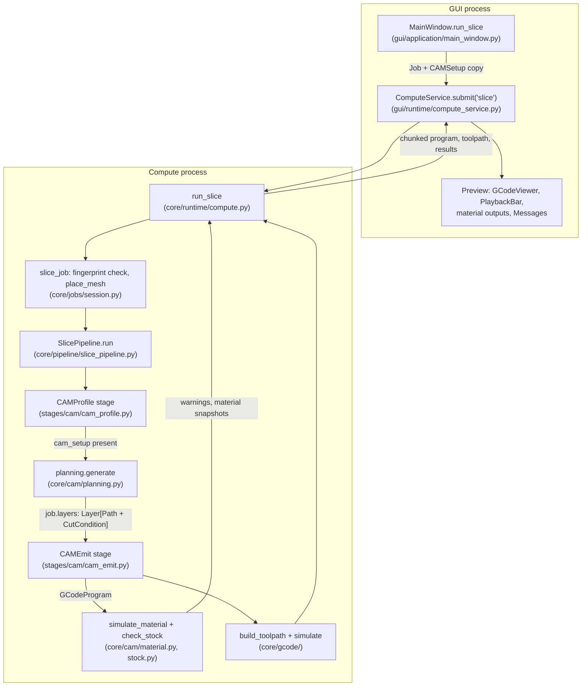
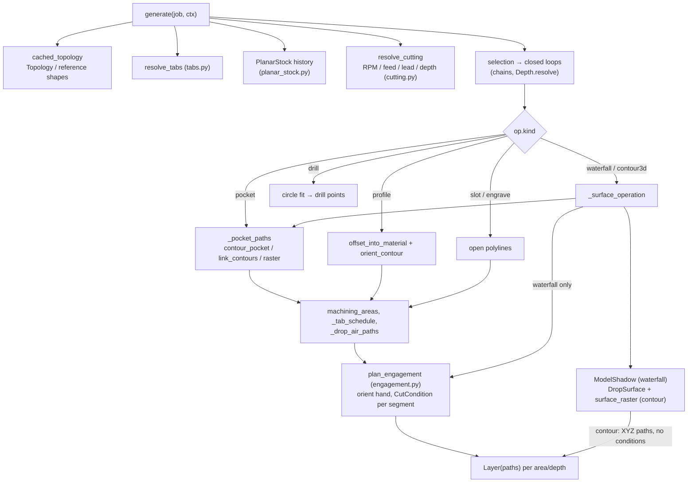
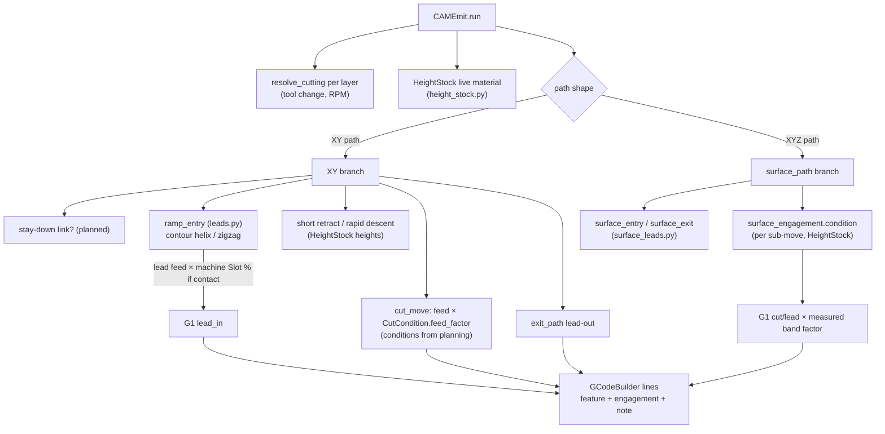

[Documentation](../README.md) / [CAM](README.md) / [Development](../development.md)

# CAM pipeline architecture: current interactions and proposed planner

This page maps how a CAM job travels through the code today, where the
cutting-type decisions are made, and a proposed structure in which one
**motion planner** owns those decisions for every operation. Nothing on this
page changes machining behaviour; it is the design basis for the refactor.

The diagrams use Mermaid, which GitHub renders. In an offline Markdown viewer
without Mermaid support, read them as plain text graphs (`A --> B` means
*A calls / passes data to B*).

## 1. Current end-to-end flow



`CAMProfile` is a legacy silhouette stage that, when a tree setup exists,
simply delegates to `planning.generate`. The real work happens in two places:
**planning** (geometry, depth passes, planar engagement) and **emission**
(entries, exits, XYZ engagement, feeds, G-code text).

## 2. Inside planning today



Planning produces **geometry plus planar engagement** for XY paths. It does
**not** decide entries, exits, links between passes or feeds; and it attaches
no cutting conditions to 3D Contour XYZ paths.

## 3. Inside emission today



## 4. Where cutting types are decided today

| Decision | Planar XY operations | 3D Contour (XYZ) |
|---|---|---|
| Slot / High / Cut / HSM / Air thresholds | `engagement_band` (shared) | `engagement_band` (shared) |
| Feed factor per band | `feed_factor` (shared) | `feed_factor` (shared) |
| Climb / conventional / neutral hand | `_hand` + path reversal in `plan_engagement` | `_hand` (no reversal) |
| Material model used | `PlanarStock` depth-tagged polygons, **at planning time** | `HeightStock` grid, **at emission time** |
| Lead-in contact feed | lead base × **machine Slot %** (fixed policy) | lead base × **measured band factor** |
| Lead-in needed? | always, when switched on | only when the entry contacts material |
| Plunge feature | emitter, when lead-in is off | emitter, when lead-in is off |
| Lead-out safety | `HeightStock.contact` → retract | `HeightStock.contact` → retract |
| Feature colour mapping | `ENGAGEMENT_FEATURES` (shared) | `ENGAGEMENT_FEATURES` (shared) |

So the *vocabulary* is shared, but **two different code paths decide what a
move is and how fast it runs**, at two different times, against two different
material models. That is the root of inconsistencies such as the lead-in feed.

## 5. Two concepts, kept separate

A move has two independent attributes; the planner must produce both:

- **Motion phase** — *why* the tool moves: `rapid`, `retract`, `plunge`,
  `lead_in`, `link` (stay-down), `cut`, `lead_out`, `drill`.
- **Engagement** — *how much material* it meets: `air`, `hsm`, `cut`, `high`,
  `slot`, with hand `climb` / `conventional` / `neutral` / `mixed`.

A lead-in is normally *phase = lead_in, engagement = slot*: the cutter is
burying itself at full width. Treating phase and engagement as one enum loses
exactly that information.

The feed rule then becomes uniform for every operation:

```
feed = base(phase) × factor(engagement band, operation overrides, tool, machine)
       → capped by machine max_feed
base(phase) = lead/plunge base for plunge, lead_in, lead_out; cut base otherwise
```

## 6. Proposed structure: the planner as its own section

```mermaid
flowchart LR
    subgraph OPS["Operation generators (per kind)"]
        direction TB
        PK[Pocket]
        WF["3D Waterfall"]
        CT["3D Contour"]
        PF[Profile]
        SL["Slot / Engrave"]
        DR[Drill]
    end
    subgraph PLANNER["CAM motion planner (core/cam/planner/)"]
        direction TB
        ORD["Sequencer<br/>tool groups, area/depth order, tabs"]
        MAT["MaterialModel<br/>one current state: planar + height field"]
        ENT["EntryExitPlanner<br/>ramp / helix / zigzag / plunge / lead-out"]
        LNK["LinkPlanner<br/>stay-down vs retract, clearance"]
        ENGM["EngagementModel<br/>band + hand (XY and XYZ samplers)"]
        POL["FeedPolicy<br/>phase × band → rate, caps"]
        MP["MotionPlan<br/>Segment(phase, xyz, CutCondition, rate)"]
        ORD --> MAT --> ENT --> LNK --> ENGM --> POL --> MP
    end
    subgraph POST["Post / outputs"]
        direction TB
        EM["Emitter: MotionPlan → G-code text"]
        CHK["Checks & material snapshots"]
        PRE["Preview metadata"]
    end
    OPS -->|"CutPass intents"| PLANNER
    PLANNER -->|"PlanningContext services"| OPS
    MP --> EM --> CHK
    MP --> PRE
```



### Who calls whom

The planner **drives**; operations are **strategies** it calls. Material
must flow across operations and tool changes in execution order, so the one
object that holds current material has to own the loop. Operations do not
loop over depth themselves:

1. The **sequencer** walks tool groups → operations → depth bands → areas
   (respecting Area order and holding-tab roofs).
2. For each step it asks the operation for **cut intent** through a small API,
   passing a read-only `PlanningContext` (current material, model shadow,
   drop surface, stock limits, tabs, resolved cutting data):

   ```python
   class OperationGenerator(Protocol):
       kind: str
       def validate(self, op, selection, ctx) -> None: ...
       def depth_bands(self, op, start, end, step, ctx) -> list[DepthBand]: ...
       def passes(self, op, band, ctx) -> list[CutPass]: ...   # geometry only
   ```

   A `CutPass` is pure geometry plus intent: polyline (XY at a band Z, or
   XYZ), closed/open, allowed entry style (ramp along path, vertical only for
   Drill), link permissions, retained boundaries. No feeds, no phases.
3. The planner turns every `CutPass` into **segments** with the same
   machinery for all kinds: entry/exit, links, engagement, feed, material
   update, collision/clearance checks.
4. The **emitter** only serializes `MotionPlan` segments (G0/G1, F words,
   comments, features). It makes no decisions.

So operations *use the planner as an API* (`PlanningContext` services) to
build geometry, while the planner *uses operations as strategies* to obtain
geometry. Neither knows the other's internals.

### Engagement sampling stays pluggable, policy does not

Planar and surface material genuinely need different measurements, so the
`EngagementModel` keeps two **samplers** behind one interface:

```python
class EngagementSampler(Protocol):
    def measure(self, a, b, radius) -> Measurement   # left/right width, fresh area
    def remove(self, a, b, radius) -> None
```

- `PlanarSampler`: depth-tagged Shapely sweeps (today's `measure_segments`).
- `HeightSampler`: height-field chords + fresh swept area (today's
  `surface_engagement.condition`).

Everything after the measurement — band, hand, feed factor, phase-based base
feed, cap, feature colour, conflict marking — is **one code path**.

### What moves where

| Today | Proposed home |
|---|---|
| `planning.generate` loop, `_tab_schedule`, area order | `planner/sequencer.py` |
| `_pocket_paths`, `contour_pocket`, `link_contours` geometry | `operations/pocket.py` (and Waterfall reuse) |
| `_surface_operation` (waterfall/contour geometry) | `operations/waterfall.py`, `operations/contour3d.py` |
| profile / slot / engrave / drill branches | one module each under `operations/` |
| `plan_engagement`, `surface_engagement.condition` | `planner/engagement_model.py` + two samplers |
| `ramp_entry`, `exit_path`, `surface_entry`, `surface_exit` | `planner/entry_exit.py` (same validated rules) |
| stay-down + short-retract logic in `CAMEmit` | `planner/links.py` |
| feed arithmetic in `cut_move`, `move3`, `surface_path` | `planner/feed_policy.py` |
| `CAMEmit` decisions | removed; `CAMEmit` serializes `MotionPlan` |
| `PlanarStock` + `HeightStock` | `planner/material_model.py` (one facade, two representations) |

### Consistency this buys

- Every lead-in that contacts material is classified by the same rule
  (normally Slot) and fed with the same formula in every operation.
- Lead-in only when entering material, for **all** operations — not only 3D.
- One material state at planning time, so air removal, stay-down, reach and
  engagement agree with what the emitter actually cuts.
- New operations add geometry only; they inherit entries, links, engagement,
  feeds and checks automatically.
- The emitter becomes testable as a pure function of `MotionPlan`.

## 7. Suggested migration order

Each step keeps output identical (or deliberately and visibly changed) and is
covered by the existing CAM tests before the next begins.

1. **Introduce `MotionSegment` / `MotionPlan` records and `FeedPolicy`.** Route
   both emitter branches' feed arithmetic through `FeedPolicy`; decide the
   lead-in rule once (contacting lead-in = measured band, normally Slot).
2. **Extract `EntryExitPlanner` and `LinkPlanner`** from `CAMEmit`, still
   called by the emitter; make "lead-in only when contacting material" common.
3. **Create `MaterialModel`** wrapping `PlanarStock` + `HeightStock`, and the
   two samplers behind `EngagementModel`.
4. **Move sequencing into the planner**; the emitter consumes `MotionPlan`.
5. **Split operation kinds into `OperationGenerator` modules**; delete the
   `op.kind` branches from the sequencer. Keep `planning.generate` as a
   compatibility facade that builds and runs the planner.

Steps 1–2 resolve today's visible inconsistencies with little risk; 3–5 are
the structural part.
