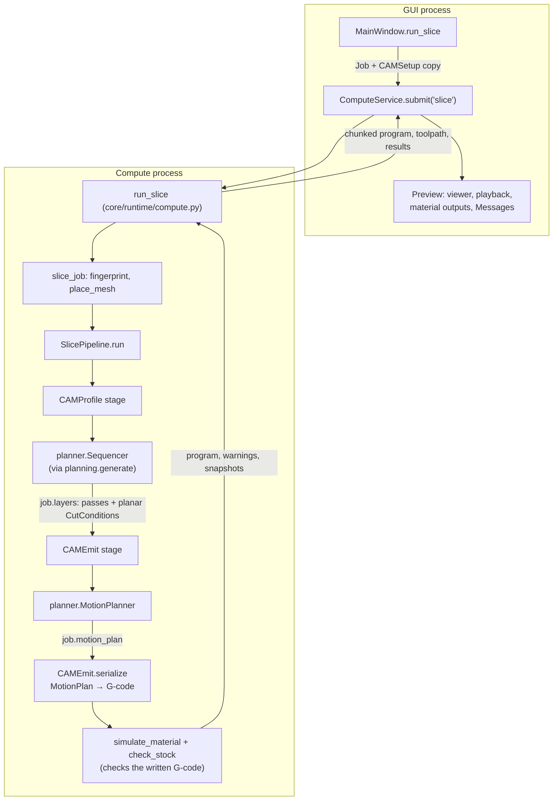
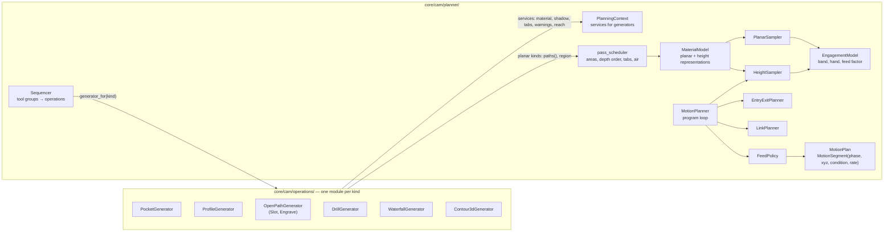

[Documentation](../README.md) / [CAM](README.md) / [Development](../development.md)

# CAM pipeline architecture: the planner section

Since 0.1.10 every CAM job runs through one **planner** section
(`core/cam/planner/`). Operations are small per-kind **generators**
(`core/cam/operations/`) that only produce geometry; the planner owns the job
loop, the material state, entries, links, engagement, feeds and the complete
motion program. G-code output only serializes the planner's result.

The diagrams use Mermaid, which GitHub renders. In an offline Markdown viewer
without Mermaid support, read them as plain text graphs (`A --> B` means
*A calls / passes data to B*).

## 1. End-to-end flow



## 2. The planner section and the operation generators



### Who calls whom

- The **Sequencer** drives: for each enabled operation in execution order it
  resolves tool, cutting data, depths and the picked selection (`Selection`),
  builds an `OperationRun` and calls the kind's generator.
- **Generators** implement a small API (`OperationGenerator`):
  `validate(run, selection)`, `paths(run, selection, planning)` for planar
  kinds, or a full `generate(...)` for surface kinds whose reachable region
  changes with depth. They use the planner as an API through
  `PlanningContext` (current material, model shadow, holding tabs, warnings,
  reach check) and never touch material representations directly.
- **pass_scheduler.schedule_planar** gives every planar kind the same
  scheduling: reach against current material, air-depth skipping, machining
  areas, area/depth order, holding-tab bands, air-path removal, engagement on
  the planar sampler and the planar-history update.
- The **MotionPlanner** owns the program loop: tool changes and spindle
  speeds, links, entries (lead-in only into material), leads, cuts and exits.
  Every feed move goes through one `feed_move`: measure on the height sampler
  (or use the planned condition), `FeedPolicy` rate and feature, material
  update. It produces `job.motion_plan`, including non-motion segments
  (layer/operation markers, M5/T/M6/M3).
- **CAMEmit.serialize** writes segments: axis words, modal F, comments and
  line metadata. It makes no machining decisions. Start/end templates and the
  output checks remain in the stage.

### One material interface, two measurement plug-ins

`MaterialModel` holds both representations behind one interface and hands
out samplers sharing the `EngagementSampler` API
(`measure_path` / `measure_move`, `remove_path` / `remove_move`):

| Sampler | Representation | Used for |
|---|---|---|
| `PlanarSampler` | depth-tagged exact XY sweeps (`PlanarStock`, Shapely) | pass engagement, cutting hand, air removal, reach |
| `HeightSampler` | height field (`HeightStock`) at the moving tip | entries, leads, plunges, exits, XYZ cuts |

Everything after the measurement — band, hand, feed factor — is the shared
`EngagementModel`; phase base feed, cap and feature are `FeedPolicy`.

## 3. Two concepts, kept separate

A move has two independent attributes; the planner produces both:

- **Motion phase** — *why* the tool moves: `rapid`, `travel`, `approach`,
  `plunge`, `lead_in`, `link`, `cut`, `lead_out` (plus non-motion `comment`
  and `command` segments).
- **Engagement** — *how much material* it meets: `air`, `hsm`, `cut`,
  `high`, `slot`, with hand `climb` / `conventional` / `neutral` / `mixed`.

A lead-in is normally *phase = lead_in, engagement = slot*. The feed rule is
one function for every operation:

```
rate = base(phase) × factor(engagement band, operation / tool / machine overrides)
       → capped by machine max_feed
base(phase) = lead/plunge base for approach, plunge, lead_in, lead_out; cut base otherwise
(factor not applied to plunge and approach)
```

## 4. Module map

| Responsibility | Module |
|---|---|
| Job loop over groups/operations | `planner/sequencer.py` |
| Generator services | `planner/planning_context.py`, `planner/operation_run.py`, `planner/selection.py` |
| Shared planar scheduling, air paths, tab bands | `planner/pass_scheduler.py` |
| Material interface + samplers | `planner/material_model.py`, `planar_sampler.py`, `height_sampler.py`, `engagement_sampler.py` |
| Engagement classification | `planner/engagement_model.py` |
| Program loop | `planner/motion_planner.py` |
| Entries/exits, links, feeds | `planner/entry_exit_planner.py`, `link_planner.py`, `feed_policy.py` |
| Records | `planner/motion_segment.py`, `motion_plan.py`, `planner_constants.py` |
| Kind registry | `operations/__init__.py` (`generator_for`), `operations/operations_constants.py` |
| Per-kind geometry | `operations/pocket_generator.py`, `profile_generator.py`, `open_path_generator.py`, `drill_generator.py`, `waterfall_generator.py`, `contour3d_generator.py`, `surface_common.py` |
| Serialization, templates, output checks | `stages/cam/cam_emit.py` |

Compatibility: `planning.generate`, `_pocket_paths`, `_drop_air_paths`,
`_tab_schedule`, `engagement.plan_engagement` / `_conditions` /
`measure_segments` and `surface_engagement.condition` / `split_move` remain
available and delegate to the new modules.

## 5. Migration status

All five steps are complete. Steps 3–5 (0.1.10) changed structure only: seven
reference programs (Pocket, raster Pocket, Profile, Slot, Engrave, Waterfall,
Contour) and the operator's tail-top part (40,335 lines) are byte-identical to
0.1.9.

1. ✅ `MotionSegment` / `MotionPlan` and `FeedPolicy` (0.1.9).
2. ✅ `EntryExitPlanner` and `LinkPlanner`; lead-in only into material (0.1.9).
3. ✅ `MaterialModel` with `PlanarSampler` / `HeightSampler` behind the
   `EngagementSampler` interface and one `EngagementModel` (0.1.10).
4. ✅ `Sequencer` and `MotionPlanner` own the loops; `CAMEmit` serializes
   `MotionPlan` (0.1.10).
5. ✅ One generator module per kind; `planning.generate` kept as the
   compatibility entry point (0.1.10).

## 6. Performance and parallelism

Profile of the operator's tail-top part (3D Waterfall, 50 depth passes,
40,335 lines, 39 s single-threaded, Python 3.14 with the GIL enabled, 24 CPUs):

| Work | Time | Share |
|---|---:|---:|
| Output check: `simulate_material` re-runs the whole program on a fresh height field | 15.1 s | 38 % |
| Motion planning (height-field contact/cut for entries, leads, exits, cuts) | 11.8 s | 30 % |
| Pass planning: planar engagement chords (Shapely `intersection` 6.3 s) | 9.2 s | 24 % |
| `Profile.get` → `resolved()` per call (40,717 calls) | 1.5 s | 4 % |
| Geometry (shadow levels, offsets), serialization, check_stock | ~1.5 s | 4 % |

Within those, `HeightStock._patch` alone is 20 s (109,411 calls), mostly
`meshgrid`/`clip` overhead on small grids.

**Can multithreading help?** Only a little, for structural reasons:

- **The planner is an ordered state machine.** Each move's engagement, entry
  decision and feed depend on the material left by every previous move, across
  passes, operations and tool changes. Those steps cannot run concurrently
  without changing results.
- **The GIL.** The hot paths are many small NumPy calls (a few cells each),
  dominated by Python overhead that holds the interpreter lock. Threads would
  serialize on it. Shapely 2 releases the GIL in vectorized operations, but the
  planar engagement calls are per pass and must run in pass order.
- **Processes** avoid the GIL but would pickle large material states per task.
  The whole job already runs in a separate compute process, so the GUI stays
  responsive.

Where parallel work is genuinely independent:

- **Geometry that does not read material history**: generator `paths()` of
  different operations, Waterfall level geometry (`level_paths`) and Contour
  depth-band rasters. Shapely/NumPy releases the GIL here, but on this part it
  is under 1 s.
- **The output check** (`simulate_material`) could run beside serialization
  but needs the finished program; it is better removed than parallelized.

Larger, deterministic wins come from removing duplicated or overhead-bound work:

1. **Snapshot material during motion planning** instead of re-simulating the
   written program (about −15 s here). The motion planner already advances the
   identical height field move by move. A lightweight check of the written
   G-code (formatting, tool numbers, rapids) can remain.
2. **Vectorize `HeightStock._patch`** with precomputed cell coordinates and
   window slicing instead of `meshgrid` per call (a large part of 20 s).
3. **Cache `Profile.resolved()`** per planning run (−1.5 s).

These keep results identical and are expected to roughly halve this job;
threading would add complexity for a small fraction of that. Item 1 changes
what the output check verifies, so it needs an explicit decision.
