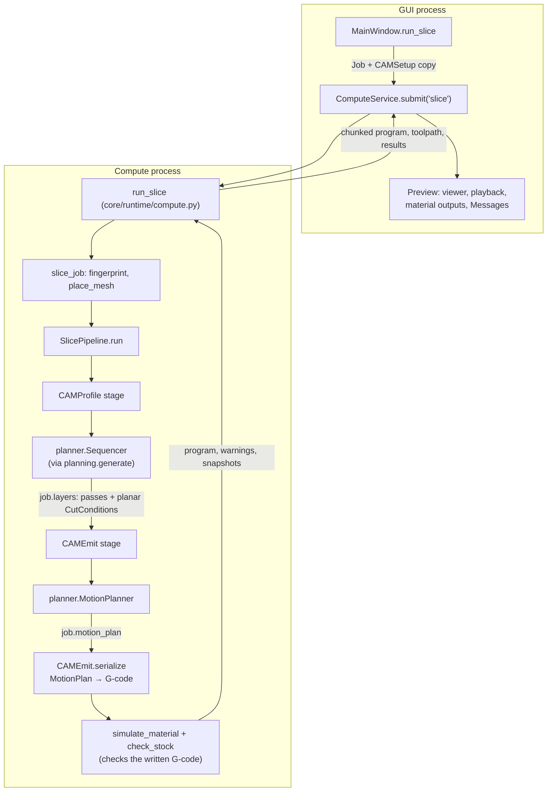
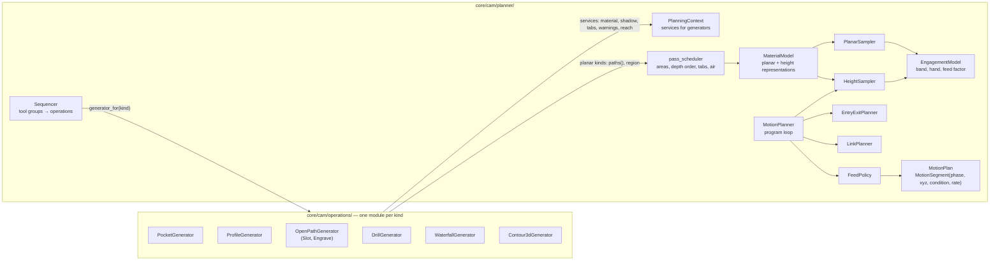

[Documentation](../README.md) / [CAM](README.md) / [Development](../development.md)

# CAM pipeline architecture: the planner section

Since 0.1.10 every CAM job runs through one **planner** section
(`core/cam/planner/`). Operations are small per-kind **generators**
(`core/cam/operations/`) that only produce geometry; the planner owns the job
loop, the material state, entries, links, engagement, feeds and the complete
motion program. G-code output only serializes the planner's result.

The diagrams use Mermaid, which GitHub renders. In an offline Markdown viewer
without Mermaid support, read them as plain text graphs (`A --> B` means
*A calls / passes data to B*).

## 1. End-to-end flow



## 2. The planner section and the operation generators



### Who calls whom

- The **Sequencer** drives: for each enabled operation in execution order it
  resolves tool, cutting data, depths and the picked selection (`Selection`),
  builds an `OperationRun` and calls the kind's generator.
- **Generators** implement a small API (`OperationGenerator`):
  `validate(run, selection)`, `paths(run, selection, planning)` for planar
  kinds, or a full `generate(...)` for surface kinds whose reachable region
  changes with depth. They use the planner as an API through
  `PlanningContext` (current material, model shadow, holding tabs, warnings,
  reach check) and never touch material representations directly.
- **pass_scheduler.schedule_planar** gives every planar kind the same
  scheduling: reach against current material, air-depth skipping, machining
  areas, area/depth order, holding-tab bands, air-path removal, engagement on
  the planar sampler and the planar-history update.
- The **MotionPlanner** owns the program loop: tool changes and spindle
  speeds, links, entries (lead-in only into material), leads, cuts and exits.
  Every feed move goes through one `feed_move`: measure on the height sampler
  (or use the planned condition), `FeedPolicy` rate and feature, material
  update. It logs a cut-segment estimate after path geometry is available and
  before motion checks, then streams motion and non-motion segments (layer and
  operation markers, M5/T/M6/M3) in batches of 4,096. The total segment count and
  first batch remain in `job.motion_plan` for inspection; `complete` identifies
  whether that prefix is the entire plan.
- **CAMEmit** serializes each batch, carrying modal feed and engagement comments
  across batches. It makes no machining decisions. Start/end templates and the
  independent replay of emitted G-code remain in the stage. There is no total
  job-wide engagement segment cap; the emitted program, simulation trace, and
  Preview still use memory proportional to job size. Geometry sampling retains
  its separate per-band guard.

### One material interface, two measurement plug-ins

`MaterialModel` holds both representations behind one interface and hands
out samplers sharing the `EngagementSampler` API
(`measure_path` / `measure_move`, `remove_path` / `remove_move`):

| Sampler | Representation | Used for |
|---|---|---|
| `PlanarSampler` | depth-tagged exact XY sweeps (`PlanarStock`, Shapely) | pass engagement, cutting hand, air removal, reach |
| `HeightSampler` | height field (`HeightStock`) at the moving tip | entries, leads, plunges, exits, XYZ cuts |

Everything after the measurement — band, hand, feed factor — is the shared
`EngagementModel`; phase base feed, cap and feature are `FeedPolicy`.

## 3. Two concepts, kept separate

A move has two independent attributes; the planner produces both:

- **Motion phase** — *why* the tool moves: `rapid`, `travel`, `approach`,
  `plunge`, `lead_in`, `link`, `cut`, `lead_out` (plus non-motion `comment`
  and `command` segments).
- **Engagement** — *how much material* it meets: `air`, `hsm`, `cut`,
  `high`, `slot`, with hand `climb` / `conventional` / `neutral` / `mixed`.

A lead-in is normally *phase = lead_in, engagement = slot*. The feed rule is
one function for every operation:

```
rate = base(phase) × factor(engagement band, operation / tool / machine overrides)
       → capped by machine max_feed
base(phase) = lead/plunge base for approach, plunge, lead_in, lead_out; cut base otherwise
(factor not applied to plunge and approach)
```

## 4. Module map

| Responsibility | Module |
|---|---|
| Job loop over groups/operations | `planner/sequencer.py` |
| Generator services | `planner/planning_context.py`, `planner/operation_run.py`, `planner/selection.py` |
| Shared planar scheduling, air paths, tab bands | `planner/pass_scheduler.py` |
| Material interface + samplers | `planner/material_model.py`, `planar_sampler.py`, `height_sampler.py`, `engagement_sampler.py` |
| Engagement classification | `planner/engagement_model.py` |
| Program loop | `planner/motion_planner.py` |
| Entries/exits, links, feeds | `planner/entry_exit_planner.py`, `link_planner.py`, `feed_policy.py` |
| Records | `planner/motion_segment.py`, `motion_plan.py`, `planner_constants.py` |
| Kind registry | `operations/__init__.py` (`generator_for`), `operations/operations_constants.py` |
| Per-kind geometry | `operations/pocket_generator.py`, `profile_generator.py`, `open_path_generator.py`, `drill_generator.py`, `waterfall_generator.py`, `contour3d_generator.py`, `surface_common.py` |
| Serialization, templates, output checks | `stages/cam/cam_emit.py` |

Compatibility: `planning.generate`, `_pocket_paths`, `_drop_air_paths`,
`_tab_schedule`, `engagement.plan_engagement` / `_conditions` /
`measure_segments` and `surface_engagement.condition` / `split_move` remain
available and delegate to the new modules.

## 5. Migration status

All five steps are complete. Steps 3–5 (0.1.10) changed structure only: seven
reference programs (Pocket, raster Pocket, Profile, Slot, Engrave, 3D Pocket,
Contour) and the operator's tail-top part (40,335 lines) are byte-identical to
0.1.9.

1. ✅ `MotionSegment` / `MotionPlan` and `FeedPolicy` (0.1.9).
2. ✅ `EntryExitPlanner` and `LinkPlanner`; lead-in only into material (0.1.9).
3. ✅ `MaterialModel` with `PlanarSampler` / `HeightSampler` behind the
   `EngagementSampler` interface and one `EngagementModel` (0.1.10).
4. ✅ `Sequencer` and `MotionPlanner` own the loops; `CAMEmit` serializes
   `MotionPlan` (0.1.10).
5. ✅ One generator module per kind; `planning.generate` kept as the
   compatibility entry point (0.1.10).

## 6. Performance and parallelism

3D Contour reuses simplification results from the previous depth band when
sampled XYZ coordinates are exactly unchanged. It can reuse a whole path or
an unchanged subspan of the same simplification tree. The 0.005 mm tolerance
and the flat-cutter surface sampling are unchanged. On the 182-band Baby Yoda
job, path generation dropped from 154 s to 79 s with identical XYZ paths.
This timing excludes motion planning and the independent output replay.

A profile on the tail-top 3D Pocket job identified repeated height-grid sweep
construction as a hot spot. In 0.1.12 the grid uses broadcast coordinate slices
and caches the last move's sweep geometry per grid. Contact, engagement and
removal reuse that geometry but always read current material heights. Flat
moves skip the ramp-tip calculation. The stock checks share one decoded motion
trace and skip the original-blank intersection test when progressive contact
checking is active. The progressive check still independently replays the
emitted G-code on a fresh grid.

Single-run local `slice_job` timings (seconds; same inputs before and after):

| Job | G-code lines | 0.1.11 | 0.1.12 |
|---|---:|---:|---:|
| Dragon Head — 3D Contour | 119,995 | 71.14 | 31.55 |
| Tail-top — 3D Pocket | 38,553 | 39.87 | 22.08 |

G-code line data, warnings, and material height grids and display meshes
matched exactly. These timings cover generation and its output checks, not GUI
rendering. Each job retained its saved tool and machine settings; tail-top's
sloped Pocket was switched to 3D Pocket in memory for both runs.

**Why not thread the motion loop?** A move's entry, engagement and feed depend
on the material left by preceding moves. Independent geometry, such as some
surface-band construction, can potentially run in parallel; profile each
workload before adding concurrency. On tail-top, planar pass planning still
takes roughly 12 seconds and is a better next profiling target. The GUI
continues to use its separate compute process.

In 0.1.13, planar engagement batches the two sides' chord predicates and
intersections while preserving each side's original clip. A single larger clip
changed tail-top's output fingerprint, so that variant was not kept. Preview
uses one decoded motion trace for both toolpath and filament totals. The XYZ
sampler also reuses cutter-dependent chord offsets. Both benchmark jobs still
match 0.1.12's G-code line data, warnings and material snapshots; the wall-clock
runs did not establish a repeatable speedup over 0.1.12.

A 0.1.13 Dragon Head CPU profile (31 s including profiler overhead) attributes
11.3 s to height-field engagement sampling, 8.6 s to independent material replay,
and 1.4 s to serialization. These are inclusive costs: the first two include
some of the 9.9 s spent constructing sweeps. The next target is sweep/engagement
work, not G-code formatting or weakening the replay checks.
