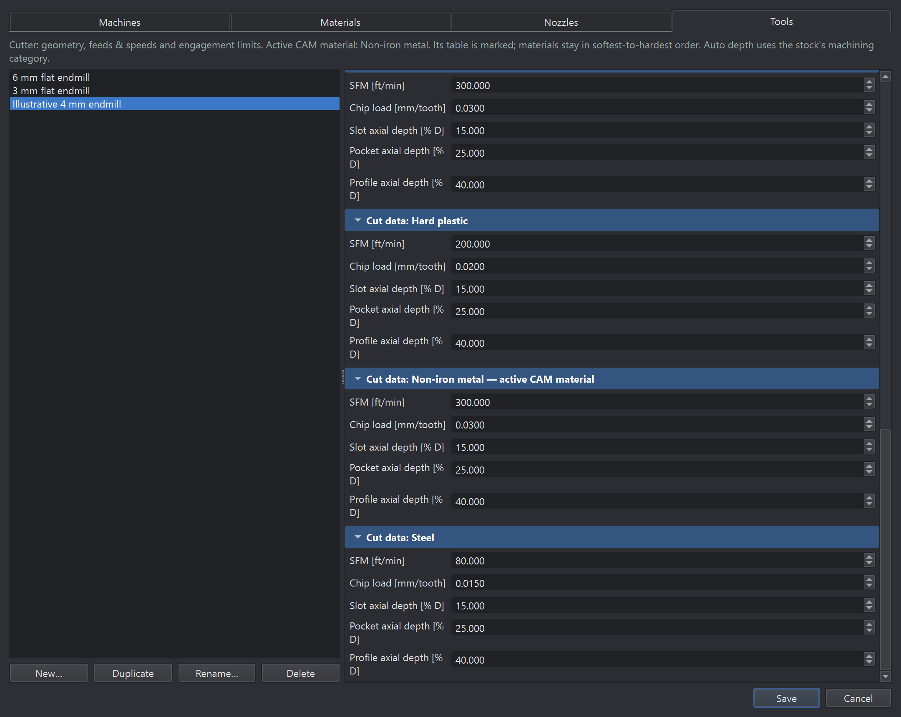
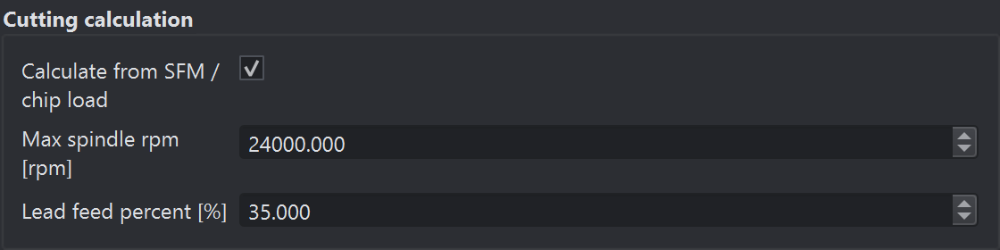
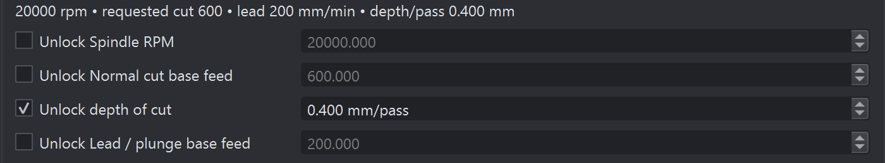

[Documentation](../README.md) / [CAM](README.md)

# Machining materials, SFM, chip load and axial depth

Machining-material data is **not the FDM filament library**. Select a category
in **Model → Material / stock → Machining material**:

- Soft wood
- Hard wood
- Soft plastic
- Hard plastic
- Non-iron metal
- Steel

The free-text material description and density remain available. The category
selects the relevant row of each tool's cutting-data table; density does not
calculate feeds or RPM.

## Per-tool, per-material table

In **Libraries → Tool**, each material category has its own:

| Setting | Unit | Purpose |
|---|---|---|
| SFM | feet/minute | Requested surface-speed ceiling |
| Chip load | mm/tooth | Nominal linear feed per flute revolution |
| Slot axial depth | % of tool diameter | Default depth/pass for Slot operations |
| Pocket axial depth | % of tool diameter | Default depth/pass for Pocket operations |
| Profile axial depth | % of tool diameter | Default depth/pass for Profile operations |

Illustrative axial defaults are **15% D Slot, 25% D Pocket, 40% D Profile**.
They can vary for every tool/material pair. For a 6 mm tool, these request
0.9, 1.5 and 2.4 mm respectively, before the tool's positive **Max depth/pass**
ceiling. Engrave/Drill use the Slot axial default when automatic depth is
selected. Do not confuse these axial percentages with radial engagement.

The initial SFM/chip-load values are **demonstration data**, not manufacturer
recommendations for arbitrary endmills or material grades. Review them against
actual tool geometry, coating, material, workholding and machine capability.



The actual editor capture shows one category's fields. Each of the six
categories has its own values on each tool. The numbers shown are illustrative.

## Automatic calculation

Enable **Calculate from SFM / chip load** on a tool after calibrating its table.
New tools created through Libraries start with this mode enabled. Existing
and starter tools retain fixed-rate mode by default so updating the program
does not silently replace previously configured speeds.



For automatic tools:

```text
SFM RPM ceiling = SFM × 304.8 / (π × diameter_mm)
selected RPM    = floor(min(SFM RPM ceiling, machine spindle_max, tool max_spindle_rpm))
normal feed    = chip_load_mm_per_tooth × flute_count × selected_RPM
lead base feed = calculated normal feed × tool lead_feed_percent / 100
```

This chooses the fastest RPM **within all those ceilings** (whole RPM, never rounding above SFM), not the machine's
maximum regardless of the material SFM. The conversion constant accounts for
feet-to-millimetres. Default tool RPM ceiling is 24,000 and automatic lead-feed
percentage is 35%; both need hardware-specific review.

If the chosen RPM is below the machine's minimum, generation fails instead of
silently overspeeding the material to reach that minimum. Configure a compatible
machine/tool/material combination. Nonpositive/invalid feeds and RPM are errors.

Example: 200 SFM and 6 mm diameter give about 3,234 RPM. With three flutes and
0.02 mm/tooth, nominal feed is about 194 mm/min. A tool ceiling below that RPM
reduces both RPM and calculated feed. A router whose minimum is 6,000 RPM
cannot safely satisfy this SFM ceiling merely by clamping upward.

## Manual unlocks and effective output

Each operation has independent checkboxes:

- **Unlock Spindle RPM:** request your own RPM, still bounded by tool/machine
  maximum and checked against machine minimum.
- **Unlock Normal cut base feed:** replace the calculated/fixed base cutting
  feed with your own mm/min value.
- **Unlock Lead / plunge base feed:** replace the independent entry feed.

The calculated summary displays effective RPM, requested base feeds and
resolved depth/pass. Positive machine `max_feed` caps emitted G1 rates.
Normal cuts and stay-down links additionally use their engagement modifiers.
Contacting lead-in segments use the machine Slot modifier on the lead base
feed; clear lead-out segments use lead base feed. Initial vertical approach
uses the lead/plunge base feed. Drill uses its plunge feed, not an XY band.

Unlocking one feed does not implicitly unlock/change the other. An automatic
lead base is derived from the calculated chip-load feed, not from a manual
normal-feed override. Inspect actual output F values and speed colouring.

Spindle selection is applied at startup, tool changes and operation RPM changes.
The emitter establishes the selected clockwise M3 RPM before cutting even if
custom start text left another spindle setting. Start/end template variables
see the selected base cutting values. Custom posts must still be controller-
qualified; this is not automatic work-offset/tool-length setup.

## Automatic versus explicit stepdown

**Unlock depth of cut** sits immediately below **Unlock Normal cut base
feed** on each operation, with a **mm/pass** field. It is unchecked for new
operations: the disabled field shows the tool/material axial default,
capped at tool Max depth/pass. Check it to request an independent operation
stepdown. It does not unlock or change cut feed, plunge/lead feed or RPM.



The capture requests 0.4 mm/pass while keeping the normal feed, RPM and lead
feed inherited. Values are illustrative, not a qualified cutting recipe.
A checked override is still capped by tool Max depth/pass; the requested
value stays editable while the summary shows the resolved depth. The old
*Tool/material axial depth default* checkbox and separate Stepdown row have
been replaced by this inverse checkbox, using the same saved operation
fields. Existing manual stepdowns reopen with the override checked; existing
automatic depths reopen unchecked.

If a saved Pocket axial percentage appears not to affect the cut, check:

- **Unlock depth of cut** is unchecked; a checked, saved explicit stepdown
  is intentionally independent of the tool table.
- You edited the table for the **machining material category selected in
  Material / stock** (each category has a separate Pocket axial value).
- Tool **Max depth/pass** may cap the result. For example, 35% of a 3 mm
  diameter requests 1.05 mm, but a 1 mm cap still yields 1 mm passes.

Library Save explicitly commits pending numeric input; you do not need to
press Enter or click another field before saving.

The selected process type controls this default. A Pocket operation can begin
with a full-width slot at the Pocket depth; radial Slot feed classification
does not silently replace that operation's axial request. Reduce depth or
choose a dedicated Slot operation if the entry requires a smaller axial load.

## Engagement settings and compatibility

The user-visible types are **Slot**, **High engagement**, **Cut**, and
**HSM** (the label is short; its tooltip explains low horizontal engagement). Machine settings own High/Slot thresholds
and feed modifiers. Tool profiles own the reusable HSM/Cut factors; operations
can override any factor. See [engagement and feeds](engagement-and-feeds.md).

Stored keys `low_engagement_feed` and `standard_engagement_feed` remain readable
for compatibility, but their current labels are HSM and Cut. Old tool-level
High/Slot fields remain readable but hidden in the tool editor (legacy in the
reference); move those choices to the machine or
explicit operation overrides. Do not assume legacy percentages override the
new machine defaults. Review rates when migrating calibrated projects.

[Exact tool fields](../reference/profile-settings.md#cam-tool) ·
[Material state and leads](material-state-and-leads.md)
