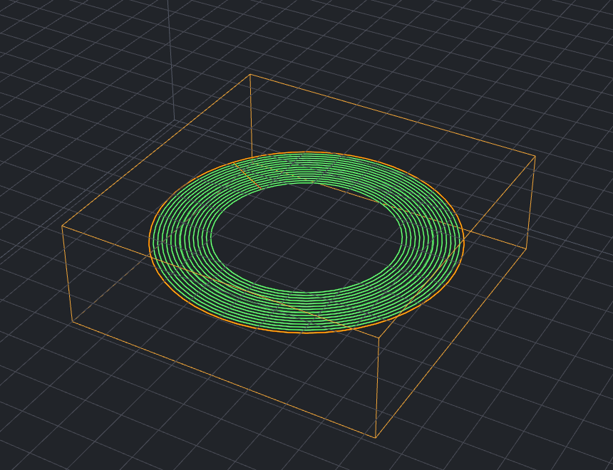
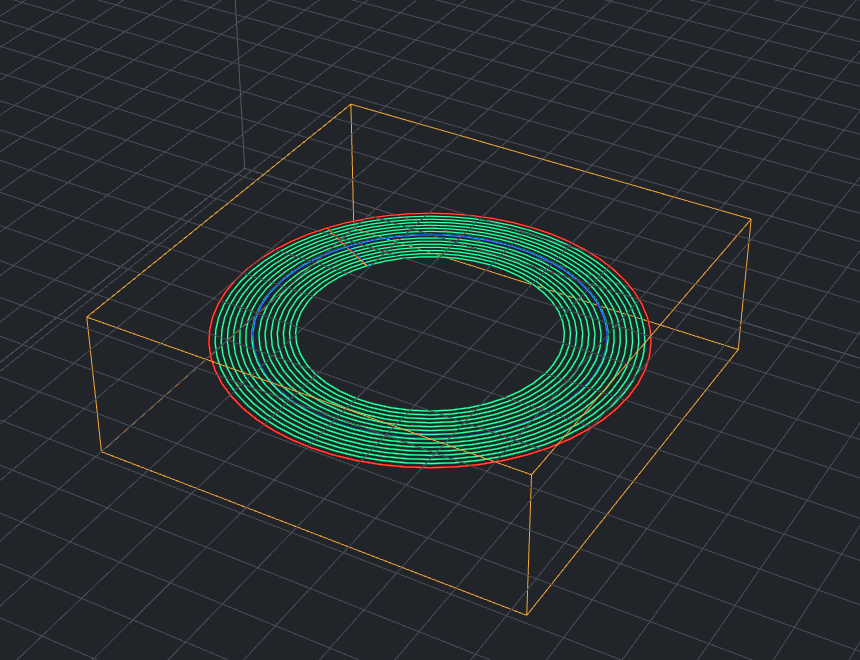

[Documentation](../README.md) / [CAM](README.md)

# Slot, High engagement, Cut and HSM

The current machining engagement types are:

| Type | Default estimated radial engagement | Default base-feed modifier |
|---|---|---:|
| **HSM** (low horizontal engagement) | Below 40% | Tool HSM factor, initially 100% |
| **Cut** | 40% through 80% | Tool Cut factor, initially 100% |
| **High engagement** | **Above 80%**, below Slot | Machine modifier, initially 75% |
| **Slot** | Approximately 95–100% | Machine modifier, initially 50% |

HSM here names low horizontal engagement (labels say only *HSM*; the tooltip
carries the explanation), not a new adaptive/trochoidal path
strategy. Air is a separate no-contact result, not a fifth cutting type.
The old user-facing names Low/Standard have been replaced by HSM/Cut. Stored
keys `low_engagement_feed` / `standard_engagement_feed` remain compatibility
aliases; the reference tables show their current labels.

## 3D Contour

Contour uses the same bands and feed modifiers, but measures current
**height-field** material at the moving tip height instead of a planar slice.
Short XYZ subdivisions use transverse cutter chords and newly swept area;
previous cutter-disc removal must not incorrectly turn a full slot into HSM.
This estimate includes actual emitted leads and prior operation removal.

The engagement feed controls are enabled for Contour. Normal cuts receive
the selected band factor; contacting lead-in moves use the lead base with that
factor. Lead-out follows cleared XYZ geometry only. Air-only entries/exits
skip the corresponding leads. Slot remains hand-neutral; the selected Contour
motion strategy is not reversed to force a climb/conventional hand.

Feature colours show the XYZ cutting band; lead moves keep Lead-in/Lead-out
colours and carry the engagement value/type in metadata. The engagement colour
mode uses that value. See [surface operations](3d-operations.md#3d-contour).

## Machine thresholds and modifiers

**Libraries → CAM machine → Engagement** sets:

- `hsm_engagement_threshold` (default 40%).
- `high_engagement_threshold` (default 80%; High is strictly above it).
- `slot_engagement_threshold` (default 95%; Slot starts at it).
- `high_engagement_feed` (default 75% of normal base feed).
- `slotting_feed` (default 50% of normal base feed).

Boundaries must satisfy `0 < HSM < High < Slot <= 100`. High is strictly
above its configured percentage (80.01% is High at the default), while Slot
starts at its configured threshold. Only floating-point roundoff is suppressed;
estimates near a boundary can vary along the path. Changing a boundary changes
classification, not physical engagement. Modifiers accept 1–300%, subject to machine maximum feed.

Tool profiles retain HSM/Cut modifiers. High/Slot defaults now belong to the
machine; old tool-level High/Slot fields are labelled legacy and do not override
the new machine default; they are hidden from the tool editor. Move calibrated legacy values to machine settings or
explicit operation overrides when migrating.

## Cutting hand follows uncut material

A full-width first slot cuts on both sides and has **no unique climb/conventional
hand**. It must not choose the direction of later clearing passes.

For the clockwise M3 convention, uncut material on the **right of travel** is
climb; on the left it is conventional. In an outside-to-inside annulus, after
the first neutral slot the uncut material lies inward, so subsequent climb
loops are **CW**, not the CCW winding used to finish against an outer wall.
A different remaining-material side can require the opposite winding.

The planner subtracts completed tool sweeps at their depths. Earlier operations
and tool changes do not reset this removal history. At a previously cleared
level, later operations see the removed material; deeper cuts see stock that
still exists below it. See [current material](material-state-and-leads.md).

Slot-dominated paths (at least 75% of their length near full engagement) are
neutral as a whole. Short closing/entry portions cannot establish their hand.
Meander alternates successive **one-sided** passes; neutral slots do not
advance it. Engrave estimates engagement/feed but has no requested-hand control;
Drill uses its lead/plunge feed instead of an XY engagement multiplier.

If uncut material switches sides inside one contour, reversing the whole loop
may not make every local segment climb. Significant mismatches produce an
**ENGAGEMENT WARNING** rather than silently claiming pure climb. There is no
general local curve-splitting/re-routing guarantee.

## Per-operation feed overrides and calculation

An operation's **Engagement feeds (% of tool feed)** can override each band:

- HSM and Cut at 0 inherit the tool.
- High engagement and Slot at 0 inherit the machine.
- Explicit values 1–300% override only that band.

The base feed comes from tool SFM/chip-load calculation or an unlocked manual
request. [Cutting data](cutting-data.md) explains units, material tables, RPM
ceilings, axial defaults and independent feed unlocks.

Example with base cut feed 800 mm/min: HSM 100%=800, Cut 150%=1,200,
High 75%=600, Slot 50%=400. Increasing Cut does not increase Slot. Contacting
planar lead-in uses the independent lead base and machine Slot modifier;
Contour lead-in uses its current estimated band and applicable operation
modifier. Normal cutting/link moves use their estimated band. Positive `max_feed` caps cutting,
link and plunge rates. Air remains at capped base feed, not G0.

These percentages are **not calibrated chip loads or safety limits**. There is
no automatic chip-thinning feed increase. Use manufacturer/material guidance
and controlled tests when increasing any band above 100%.

## Estimation method and links

The planner samples occupied cutter chords at multiple stations and forward
offsets along each move. Leading-edge samples catch heavy entry even when a
connector's centreline is in previously cleared space. A swept-area fallback
avoids treating a missed grazing contact as air.

Peak sampled contact is used conservatively. Balanced frontal entry is neutral
even when classified High rather than Slot. One-sided feed links opposing the
requested hand are replaced by retract/position/plunge; geometrically admissible
neutral entries remain eligible for stay-down, at the heavier-cut rate.

The planar planner uses depth-tagged sweeps. The emitted-motion pass separately
updates a height field for display and movement checking; Contour uses that
current height field for its XYZ engagement estimate as described above. These are **2.5D
estimates**, not tooth-level telemetry or a full 3D stock/fixture simulation.
Within-path overlap/re-tracing can be conservative; actual axial engagement,
V-bit/ballnose contact width, deflection and chatter are not predicted. M4
posts do not automatically invert the M3 hand convention.

## Inspecting output

- Feature colours distinguish Slot (orange), High engagement (red/orange),
  Cut (green), HSM (blue) and Air (grey). Leads have separate features.
- **Colour by Tool engagement (CAM)** shows normalized estimated contact.
- **Colour by speed** shows actual F after factors/caps.
- G-code comments/metadata identify conditions such as `slot 100% engagement;
  neutral` or `cut 40% engagement; climb`. Stay-down comments remain identifiable.
- Logs summarize estimated bands, neutral paths, reversals, rates and warnings.
- **Show → Material** and the operation-output selector show calculated stock
  after each operation; the path slider is not a per-move removal animation.

### Illustrated annular example

These earlier captures illustrate the classifier before the current HSM colour
and material-surface display; the outer first slot is neutral, not conventional.
They are generated-view examples, not measurements or calibrated recipes.
New material/lead examples are indexed in [pictures](../pictures/README.md).

## Existing projects

Review regenerated output: classification names, default High threshold and
machine ownership of High/Slot modifiers have changed. Existing tools retain
fixed-rate mode until their SFM/chip-load calculation is explicitly enabled;
newly created tools start in calculated mode. Existing operations retain their
saved explicit stepdown unless automatic axial depth is selected.

Legacy CLI silhouette generation does not have operation-level removal history
and therefore retains uniform machine-capped tool feed rather than pretending
to have measured engagement. Use operation-driven CAM for these classifications.

[Cutting data](cutting-data.md) · [Material state and leads](material-state-and-leads.md) ·
[Strategies/linking](toolpaths.md)
