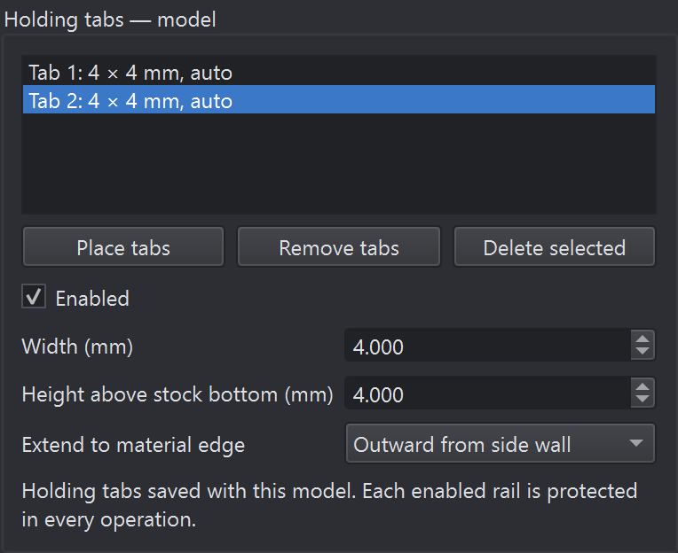
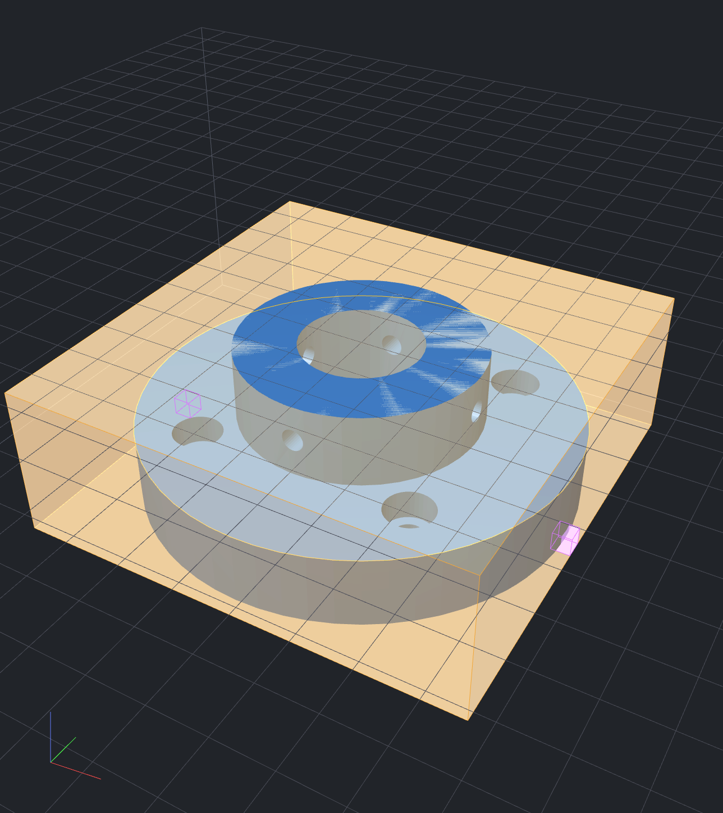
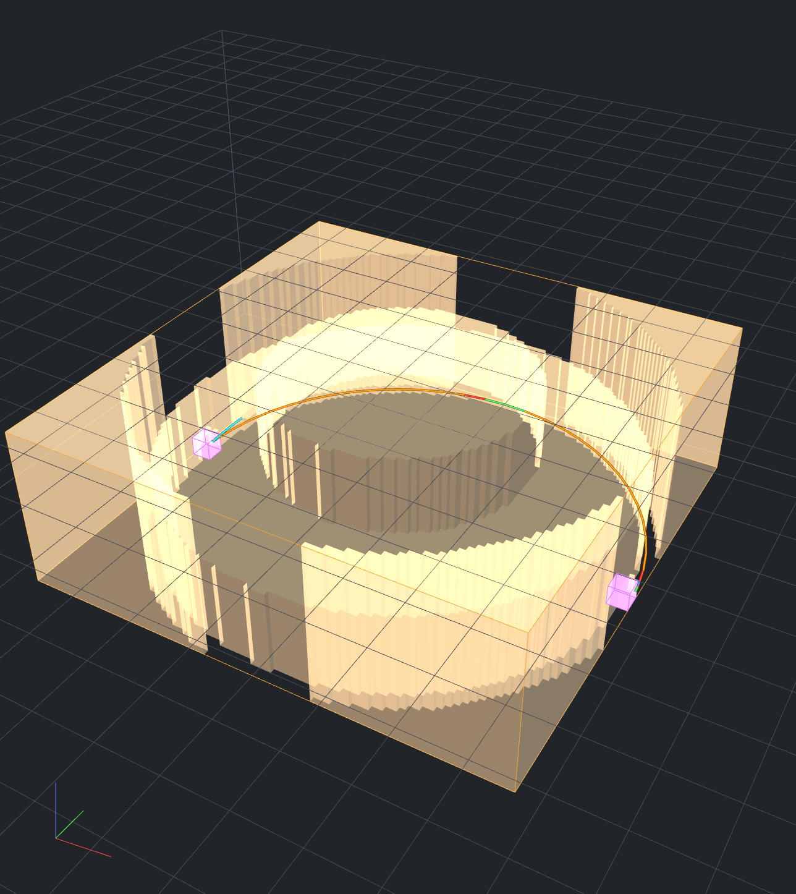

[Documentation](../README.md) / [CAM](README.md)

# Holding tabs: leave rails to the material edge

CAM holding tabs keep a part connected to its surrounding blank while it is
profiled or pocketed. They resemble manual FDM support placement, but are
**stock to retain**, not printed/additive material: rails run horizontally
to an **X or Y edge of the material**, not down to a printing bed.

Tabs belong to the **model's CAM setup**, alongside material/stock, and apply
to **every operation**. Changing a tool, operation or FDM process does not
move or remove them. They are saved automatically with that model. Existing
setups without tabs load unchanged.

## Place and edit tabs

1. Allocate material in **Material / stock** (Auto or explicit dimensions).
2. Expand **Holding tabs — model** beneath the stock controls.
3. Set **Width** and **Height above stock bottom** (both initially 4 mm), and
   optionally choose a direction. These values also set the next tab.
4. Click **Place tabs**, then click a visible **side wall**. Placement repeats;
   click another side to add another tab. No operation need be selected.
5. Press **Esc** to navigate again. **Remove tabs** repeatedly removes the
   clicked purple rail, or select a row and **Delete selected**.
6. Select an existing tab to change its width, height, direction or **Enabled**
   flag. Regenerate after any edit; an older CAM program is marked stale.

**Outward from side wall** chooses the nearest machine X/Y axis to that
wall's outward normal. Explicit **To +X / −X / +Y / −Y edge** choices let you
correct it or route to another edge. Top/bottom-face clicks are refused.
The anchor is stored on the clicked STL triangle, not as a fixed world
point: placement/rotation/scale re-evaluate it, while the rail still extends
to the current stock edge. After changing the blank, check the new rail.
Changed source-mesh fingerprints invalidate the whole CAM setup as before.

Each rail is rectangular in XY and starts half its width inside the anchor
so it overlaps the part. Its cross-section is constant: there are no ramps,
rounded ends, dogbones or freely angled rails. It is clipped to the blank's
XY rectangle and extends from **stock bottom** to **stock bottom + height**.
For a part bottom at Z-30 and a blank bottom at Z-32, a 4 mm tab has its top
at Z-28: 2 mm of it is above the part's bottom. Height must be positive,
within the blank thickness, and high enough to reach above the part's lowest
Z. It does not snap to the clicked height. Verify actual connection where the
part has steps, tapers or undercuts — lowest-Z validation alone is not a
solid-intersection or strength proof.

Purple boxes in Prepare and Preview show the retained rails. They are hidden
with **Show → Material**, but hiding them does not disable protection. The
calculated material result also retains them; the boxes are just overlays.

## How tabs split operations

Above a tab top, paths cut normally over it. Below that top, the planner
subtracts a **cutter-radius-expanded** tab rectangle from the cutter-centre
paths. A contour crossing a tab becomes open sections; no move cuts the rail
or jumps through the interruption. If a tab top falls between ordinary depth
passes, an extra pass at that top clears the roof to the requested height
before paths split below it. One-point drilling inside a tab is omitted
below its top as well.

The operation's [Area order](operations.md#multiple-machining-areas) controls
the resulting sections:

- **Each area to full depth:** finish uninterrupted upper passes first, then
  take one interrupted section to End before the next section.
- **Each depth across all areas:** visit every interrupted section at one
  depth before stepping down.

For pockets, all clipped offset/raster paths in the same connected sector
stay together as an area; a tab does not turn every offset contour into a
separate operation. A profile split by two opposite rails has two sections.
If more tabs become active lower down, the planner starts another depth band
and splits those lower paths again. Wholly tab-protected sections are omitted
and logged. Operation/tool order is never changed; calculated outputs remain
per operation, not per section.

### Leads and travel are preserved

Each interrupted path retains the operation's lead-in/out settings. Its entry
ramps **along the surviving section**, zigzagging along it if needed; it does
not follow the original unbroken contour through the tab. Lead-out follows
the cleared section before retracting; if that section is shorter than the
requested exit length, it uses the available length instead of dropping the
exit. Unsafe/uncertain exits still retract.
An excessive ramp (over 20,000 segments) fails generation rather than silently
replacing the lead with a plunge. Only a genuinely zero-length path cannot ramp.

Stay-down links broken by a path split or crossing a tab are reset; unchanged
paths can retain their checked links. A short/no-retract entry is still allowed if its full move is clear of both current material **and exact
tab rectangles**. Otherwise it retracts above the rail before crossing it.
All lead, cut and rapid moves are checked for protected-tab contact: a
`Line N: cutter motion intersects a protected holding tab` finding appears in
Messages/log and highlights that move as **Collision**. A coarse material
grid cannot erase this rectangular tab-contact guard. Display sampling can
still make a thin rail look jagged or invisible; use the purple outline to
inspect its intended volume.

Actual captures of the example flange part: two 4 × 4 mm rails to opposite X
edges, blank bottom Z-32, tab tops Z-28. An annular pocket clears to Z-15,
then an outside profile runs to the blank bottom Z-32. Upper profile loops
are continuous; below Z-28 there are two sections, each finished to depth.
The final single-section pass and its leads are shown with calculated
material. The central bore and other unprocessed features remain stock; this
is a staged setup, not the finished CAD part. The isolated example uses a
3 mm tool with an illustrative 40 mm cutting length and fixed rates, **not a
qualified machining recipe**. The example generated without warnings.

## Safety and limits

- Width/height/count, direction, grain, cutter forces, material brittleness,
  resonance and remaining-stock rigidity must be chosen and verified by the
  operator. Generic 4 mm defaults are not a workholding recommendation.
- A rail reaching the edge is not a clamp: the surrounding blank must itself
  be held securely. Fixtures/holders, non-cylindrical cutters and true 3D
  collisions are not simulated. Auto outward direction relies on consistent
  mesh winding; review it or choose an explicit axis.
- Tab protection applies to the ordered setup's generated G1 toolpaths.
  Custom cycles/arcs, offsets or external programs still need independent
  review. Known custom linear motion through a tab is warned, not rewritten.
  After a violation the material view conservatively keeps the protected tab
  volume; it is not a simulation of the damage that unsafe motion would cause.
- Clearance around tabs includes cutter-radius polygon tolerances and G-code
  rounding allowance, so it may leave slightly more stock than the nominal
  rail. Material below the rail is conservatively protected too (the cutter
  body extends above its tip).
- There is no automatic tab-removal/finishing operation. Plan safe removal
  after machining; disabling a tab permits the program to cut it and may
  release the part. Air-cut removal only knows earlier operations in this
  setup, not material already removed by hand or a previous program.
