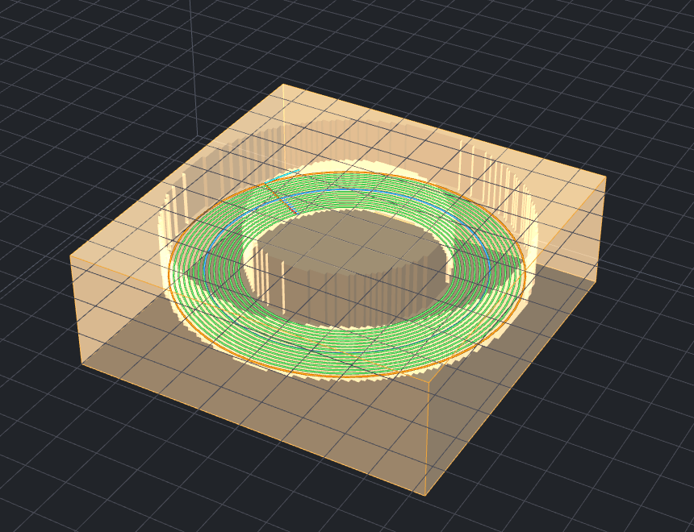

[Documentation](../README.md) / [CAM](README.md)

# Current material, operation outputs, leads and movement checks

The CAM workflow now carries **calculated material state forward**, rather
than treating every operation as starting in the original blank.

## Two related representations

1. **Planning history:** completed cutter sweeps are recorded with their cut
   depths. A later operation at a shallower/already-cleared level sees that
   removal; a deeper level still sees material below the previous cut. This
   planar history guides engagement, direction and feed planning across
   operations/tool changes. It is exact 2D polygon geometry at represented
   depth levels, not a general solid model. 3D Contour passes (varying Z) are
   not recorded in it.
2. **Emitted-motion simulation:** generated G1 movements remove material from
   a rectangular height field in execution order. Current-state rapid/contact
   checks and the material display use this representation, including lead
   movements. Tool changes do not reset the blank.

Neither representation models fixtures, holders, flute reach, undercuts,
ballnose/V-bit shape, deformation or actual machine offsets. Height-field
geometry is a **2.5D approximation**, not verified physical stock.

## Showing calculated material

**View → Show → Material** is checked **on by default**. It controls both the
translucent stock surface and its outline; switching it off does not disable
collision checks or remove saved stock data. **Toolpaths** is independently
selectable in the same Show group.

After generation, **Calculated operation output** offers:

- **Initial material** — the allocated blank before machining.
- An entry for each operation, in execution order — material after that
  operation has completed all its depth passes.

The latest output is selected initially. Selecting an earlier result shows
that material surface and limits visible path layers to its operation boundary.
Initial material hides generated paths/tool marker and disables the layer
slider and [playback bar](../gui.md#inspecting-generated-paths) until a machined
result is selected. For other results the layer slider and playback can
subsequently inspect different paths; they do **not** recompute material for
every cursor movement.
The displayed material is the selected operation snapshot, not a live per-line
removal animation. Snapshot labels include group/operation indices so repeated
operation names are distinguishable.

Prepare shows the original blank with the placed model. Preview shows the
selected calculated output. After model/material/setup edits, calculated
outputs are invalidated until regeneration; stale surfaces must not appear
as current machining results.

### Example: blank, then pocket output

The first result is the rectangular blank; the next shows the annulus removed
to Z-15. The boss, raw outside corners, central bore stock and bolt-hole stock
remain because this operation does not machine those later features. Toolpaths
are hidden in these two captures, not deleted from output.

This view adds one generated depth pass and its leads. The illustrated tool
uses demonstration non-iron-metal data (3 mm diameter, 200 SFM, 0.025 mm/tooth)
and automatic Pocket axial depth 25% D. It is not a manufacturer-qualified
recipe. All images are actual application captures with isolated settings;
the checking grid was 0.5 mm at capture time (the default is now 0.2 mm) and
the visible surface is display-decimated. This capture predates short retracts
and stay-down entries, so its entry/travel moves still rise to safe Z; current
output enters as described under [Lead-in](#lead-in).

## Resolution and display limits

The global **Material grid resolution** setting ([Settings](../settings.md))
requests the height-field cell size (default 0.2 mm). The **Maximum grid
cells** limit (default 2,000,000) coarsens larger blanks and warns when it
does. The previous machine `stock_resolution` field is ignored. The actual
resolution is logged and shown with the selected output. The display mesh is further bounded to roughly 100×100 cells;
its visual sampling is not the complete checking grid.

Sub-cell features can be missed or represented imperfectly. Centre-sampled
cylindrical cutter sweeps are not exact swept-volume collision tests. Use a
finer requested resolution for small tooling/features, review performance,
and independently verify actual tooling/fixtures. There is no safe inference
from a smooth-looking or warning-free display.

## Lead-in

Operations expose **Lead-in** and **Lead-out** (*Every entry*, *Layer
entry*, *None*), a lead length, the lead-in angle and the **lead-out angle**.
The lead-out carries on **forward** from the end of the cut, at the cutting
feed, climbing at the lead-out angle (default 10°, never above safe Z; 0
keeps it level), so the cutter neither stops nor slows where it leaves the
wall. A closed path carries on around past its start (already cut); an open
path carries on straight along its final direction. A lead-out only ever
passes over space already cut: if any of it would meet material — mostly a
slot, an open path ending at a wall, a tab or uncut stock — there is no
lead-out and the tool retracts straight up. (Pulling sideways away from the
wall would be the ideal exit; it is not attempted yet.) Zero length requests an automatic lead.
Drill/one-point paths keep their vertical drilling entry.

Every operation — Pocket, Profile, Slot, Engrave, 3D Pocket and 3D
Contour — uses the same entry/exit rules from the shared CAM motion planner
([architecture](architecture.md)):

- **A lead-in replaces a plunge only when the descent would enter material.**
  If the cutter column at the path start is already clear down to the cutting
  depth (for example a repeat pass in a cleared pocket), the tool descends
  through verified air as an **approach** move (lead-in base feed, Preview
  feature *Air cut*) and no ramp is emitted. Without allocated stock the
  material is unknown: the entry is treated as entering material.
- **One lead rule for flat and surface paths** (`leads.path_ramp`, used by
  `EntryExitPlanner.entry`): the ramp walks back along the path itself —
  around a closed path (a helix) or back and forth along an open one (a
  zigzag) — descending at the lead-in angle and never below the path, so a
  flat Pocket contour, a 3D Pocket path following the surface and a 3D
  Contour line all enter the same way. Exits (`EntryExitPlanner.exit`) follow
  the already-cut path back by the same rule.
- **Lead-in** and **Lead-out** are each *Every entry*, *Layer entry* (lead-in
  only on the first entry of each layer/depth, lead-out only on its last exit)
  or *None* (entries plunge at the plunge feed; exits retract). Files saved
  with the former checkboxes open as *Every entry* (checked) or *None*.
- Exits follow already-cut geometry only, and are skipped after a path that
  removed no material. See [Contour leads and engagement](3d-operations.md#3d-contour).

For each entry (start of a pass, or a path that cannot stay down), the emitter:

1. **Stays down when it can.** When a planar path starts at the current
   cutting depth, the planner checks the whole straight move against current
   stock. If the cutter sweep is already clear, it feeds straight to the next
   start without a lead-out, retract, or new ramp. For a deeper pass, it can
   similarly feed across the previous floor to a verified ramp start and ramp
   down from there. These travels use `G1` at the rapid XY feed to guarantee a
   straight line and carry the comment `stay at depth: cleared by the previous pass`.
2. Otherwise it retracts only as far as needed: to **Short retract clearance**
   (default 1 mm) above the highest current material under the cutter along
   the XY travel, never above safe Z; rapids across; then **rapids down** to
   the ramp start, **Lead-in start above material** (default 0.5 mm) above the
   local material. The first entry after start-up or a tool change comes from
   safe Z.

No feed move descends through air from safe Z or from a clearance plane. On
the example flange + counterbore setup, every depth pass after the first
of each operation (19 entries) now begins without any retract.
3. Follows the selected path down to cutting Z without exceeding the
   operation’s lead-in angle (10° by default). A closed loop is followed
   backwards from its seam so the ramp arrives moving in the cut direction;
   an open line is followed from its start.
4. Executes the normal path and eligible stay-down links.

The ramp is never skipped for lack of length. When the path is shorter than
the configured ramp needs, the entry keeps following the same path:

- **Closed contour — helix along the contour.** The ramp circles the loop
  as many times as needed, descending continuously. A 4 mm counterbore
  contour (≈12.5 mm around) needing ≈40 mm of ramp for a 7 mm drop circles it
  a little over three times.
- **Open path — zigzag.** The ramp goes to the end of the path and back,
  repeatedly, descending on every leg, and finishes at the path start.

Either way every XY point lies on the operation's own validated cut path:
the ramp never leaves the region the operation cuts and never invents a
tangent extension into a retained wall. It is a sequence of linear G1
segments, not a G2/G3 helix macro. Generation logs how many ramps needed a
helix or zigzag. The lead feed is independently calculated/unlocked. Ramp
segments are subdivided and each is classified against current material like
any other cut: a contacting lead-in is normally **Slot**, so it runs at
*lead base × Slot factor* (the operation's Slot override, or the machine's
Slot modifier). A ramp segment still in air runs at the plain lead base.
Every segment is checked against the current material.

Only a path with no length (a single point) cannot ramp; it reports a
**LEAD WARNING** and enters vertically. That warning still requires review:
the program cannot certify that the physical tool can plunge. Drill
operations plunge by design. A typed lead length longer than the slope needs
simply lengthens the ramp (more laps or legs); it never permits leaving the
selected path.

## Lead-out

Before a required retract at the end of a contour chain, lead-out carries on
forward for a short distance (around a closed contour, or straight on from an
open path where that is already clear), climbing at the lead-out angle at the
cutting feed, then retracts. Where carrying on would cut, the tool retracts
straight up instead. On a short
section (for example a path split by a holding tab), the exit is shortened to
its available length rather than silently omitted. It is omitted
between paths that will stay down. The current height field checks the exit
against remaining material; an uncertain/contacting exit is skipped and a
retract is used instead, with a log explanation.

Lead-out is not a workholding strategy, a tab generator, or a guarantee of
zero exit marks. Leads have their own Preview features and rate metadata.
Disable leads explicitly when using an alternative qualified entry/exit plan.

## Progressive collision checks

With allocated stock, the emitted-motion pass checks against **current**
remaining height-field material:

- A rapid through material already removed by an earlier path/operation is
  no longer automatically flagged merely because it crossed the original blank.
- A rapid into remaining material is reported with the program line number.
- Unexpected/unclassified feed contact, spindle-off contact, below-bottom
  motion and excessive uncleared entry depth are reported. Entry depth is
  measured for vertical plunges and over-steep ramps only, counting material
  the move itself descends through; a helix or zigzag within the configured lead-in angle beside an uncut
  wall is side cutting, not an axial plunge.
- Intended G1 cuts, plunges and leads remove material only while the spindle
  is on. A rapid never removes material in the model.
- Upward vertical withdrawals are treated as retracts, as previously; the
  system does not certify the initial unknown physical tool position.

General original-stock containment, safe-height, controller-state, tool-change
and unsupported arc/cycle checks still apply. Arbitrary custom arcs/controller
macros are not converted into accurate removed volumes. Stock checking and
engagement analysis are not a substitute for a controller-aware simulator.

Warnings are logged, shown after generation and retained for export
confirmation. Mixed-hand and lead warnings are not discarded when stock checks
run. Tool-number reuse across different profiles and cut depths beyond stored tool
cutting length are also warnings, not full holder/reach tests. The reach
check measures from the **current** material top within the operation's
sweep (material removed by earlier operations does not consume flute length),
but shank or holder contact with higher material next to the cut is not
modelled: validate
what tool is actually installed, not just the simulated requested tool.

[Stock allocation](stock-and-safety.md) · [Cutting data](cutting-data.md) ·
[Engagement controls](engagement-and-feeds.md)
