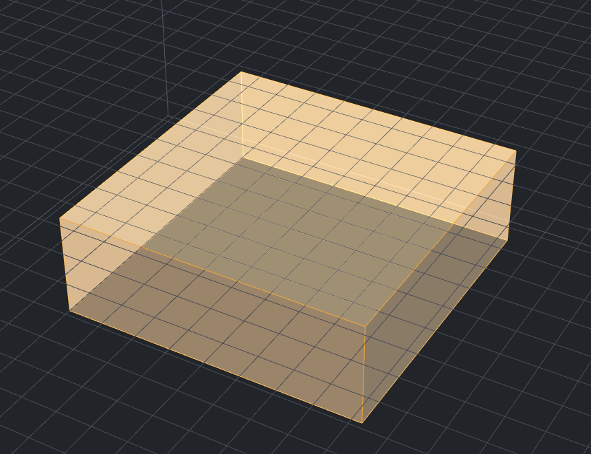
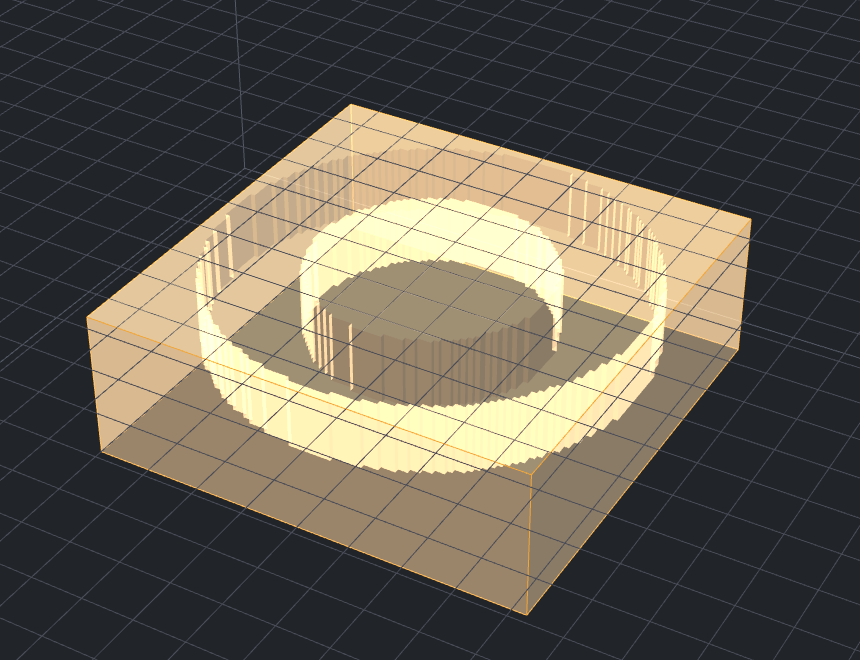

[Documentation](../README.md) / [CAM](README.md)

# Current material, operation outputs, leads and movement checks

The CAM workflow now carries **calculated material state forward**, rather
than treating every operation as starting in the original blank.

## Two related representations

1. **Planning history:** completed cutter sweeps are recorded with their cut
   depths. A later operation at a shallower/already-cleared level sees that
   removal; a deeper level still sees material below the previous cut. This
   planar history guides engagement, direction and feed planning across
   operations/tool changes. It is exact 2D polygon geometry at represented
   depth levels, not a general solid model.
2. **Emitted-motion simulation:** generated G1 movements remove material from
   a rectangular height field in execution order. Current-state rapid/contact
   checks and the material display use this representation, including lead
   movements. Tool changes do not reset the blank.

Neither representation models fixtures, holders, flute reach, undercuts,
ballnose/V-bit shape, deformation or actual machine offsets. Height-field
geometry is a **2.5D approximation**, not verified physical stock.

## Showing calculated material

**View → Show → Material** is checked **on by default**. It controls both the
translucent stock surface and its outline; switching it off does not disable
collision checks or remove saved stock data. **Toolpaths** is independently
selectable in the same Show group.

After generation, **Calculated operation output** offers:

- **Initial material** — the allocated blank before machining.
- An entry for each operation, in execution order — material after that
  operation has completed all its depth passes.

The latest output is selected initially. Selecting an earlier result shows
that material surface and limits visible path layers to its operation boundary.
Initial material hides generated paths/tool marker and disables the layer/line
sliders until a machined result is selected. For other results the standard
slider can subsequently inspect different paths; it does **not** recompute
material for every cursor movement.
The displayed material is the selected operation snapshot, not a live per-line
removal animation. Snapshot labels include group/operation indices so repeated
operation names are distinguishable.

Prepare shows the original blank with the placed model. Preview shows the
selected calculated output. After model/material/setup edits, calculated
outputs are invalidated until regeneration; stale surfaces must not appear
as current machining results.

### Example: blank, then pocket output

The first result is the rectangular blank; the next shows the annulus removed
to Z-15. The boss, raw outside corners, central bore stock and bolt-hole stock
remain because this operation does not machine those later features. Toolpaths
are hidden in these two captures, not deleted from output.

This view adds one generated depth pass and its leads. The illustrated tool
uses demonstration non-iron-metal data (3 mm diameter, 200 SFM, 0.025 mm/tooth)
and automatic Pocket axial depth 25% D. It is not a manufacturer-qualified
recipe. All images are actual application captures with isolated settings;
the checking grid is 0.5 mm and the visible surface is display-decimated.

## Resolution and display limits

The CAM machine's **Material simulation → stock_resolution** requests the
height-field cell size (default 0.5 mm). A memory guard coarsens large blanks
to about 160,000 cells. The actual resolution is logged and shown with the
selected output. The display mesh is further bounded to roughly 100×100 cells;
its visual sampling is not the complete checking grid.

Sub-cell features can be missed or represented imperfectly. Centre-sampled
cylindrical cutter sweeps are not exact swept-volume collision tests. Use a
finer requested resolution for small tooling/features, review performance,
and independently verify actual tooling/fixtures. There is no safe inference
from a smooth-looking or warning-free display.

## Lead-in

Operations expose **Lead-in ramp along selected contour**, **Lead-out along
cleared contour**, and a lead length. Zero length requests an automatic lead.
Drill/one-point paths keep their vertical drilling entry.

For an entry with enough selected-path length, the emitter:

1. Retracts to safe Z and positions above the lead start.
2. Feeds to an entry plane above the *current* local material, respecting
   machine clearance and the configured safe plane.
3. Follows a portion of the selected contour while ramping down to cutting Z.
   A closed loop uses its closing section leading into the seam; an open line
   uses a reversed portion of that line into its start.
4. Executes the normal path and eligible stay-down links.

The lead is a segmented linear ramp, not an arbitrary circular/helical macro.
Its XY centre follows the existing validated cut geometry, avoiding an
unverified tangent extension into a retained wall. Automatic length respects
an approximately 10° maximum ramp slope when the contour has enough length.
The lead feed is independently calculated/unlocked; contacting entry segments
also receive the machine Slot feed modifier.

If a lead cannot fit, generation reports a **LEAD WARNING** and falls back to
vertical entry. That warning requires review: the program cannot certify that
the physical tool can plunge. Use different geometry/entry settings or tooling
instead of blindly accepting the fallback. A typed length does not permit
leaving the selected contour or inventing extra clearance.

## Lead-out

Before a required retract at the end of a contour chain, lead-out follows a
short portion of the just-cut contour at depth, then retracts. It is omitted
between paths that will stay down. The current height field checks the exit
against remaining material; an uncertain/contacting exit is skipped and a
retract is used instead, with a log explanation.

Lead-out is not a workholding strategy, a tab generator, or a guarantee of
zero exit marks. Leads have their own Preview features and rate metadata.
Disable leads explicitly when using an alternative qualified entry/exit plan.

## Progressive collision checks

With allocated stock, the emitted-motion pass checks against **current**
remaining height-field material:

- A rapid through material already removed by an earlier path/operation is
  no longer automatically flagged merely because it crossed the original blank.
- A rapid into remaining material is reported with the program line number.
- Unexpected/unclassified feed contact, spindle-off contact, below-bottom
  motion and excessive uncleared entry depth are reported.
- Intended G1 cuts, plunges and leads remove material only while the spindle
  is on. A rapid never removes material in the model.
- Upward vertical withdrawals are treated as retracts, as previously; the
  system does not certify the initial unknown physical tool position.

General original-stock containment, safe-height, controller-state, tool-change
and unsupported arc/cycle checks still apply. Arbitrary custom arcs/controller
macros are not converted into accurate removed volumes. Stock checking and
engagement analysis are not a substitute for a controller-aware simulator.

Warnings are logged, shown after generation and retained for export
confirmation. Mixed-hand and lead warnings are not discarded when stock checks
run. Tool-number reuse across different profiles and cut depths beyond stored tool
cutting length are also warnings, not full holder/reach tests: validate
what tool is actually installed, not just the simulated requested tool.

[Stock allocation](stock-and-safety.md) · [Cutting data](cutting-data.md) ·
[Engagement controls](engagement-and-feeds.md)
