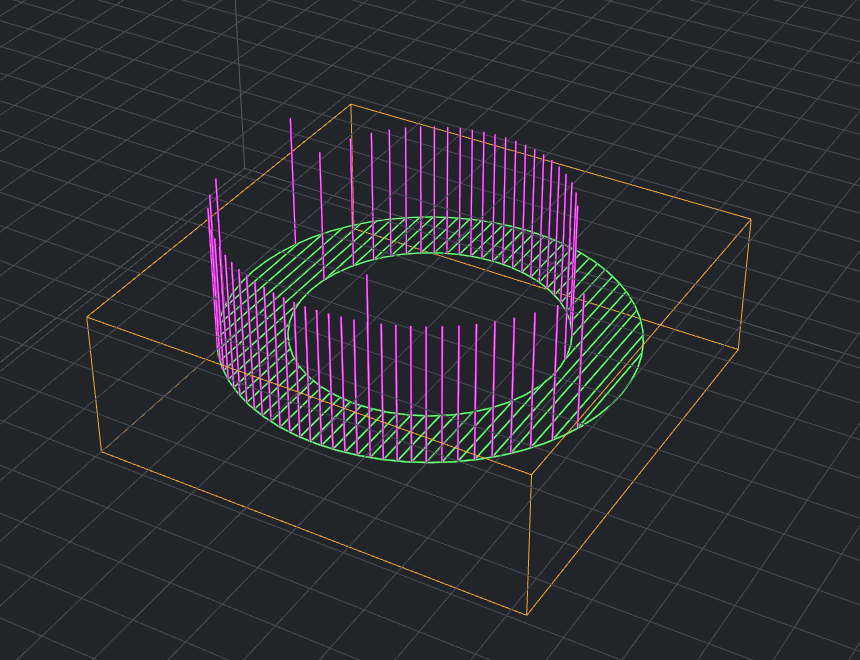

[Documentation](../README.md) / [CAM](README.md)

# Pocket, Profile, Drill and Engrave

These are tree operations (`core.cam.Operation`), not independent pipeline
stage presets. They share a tool group, selection system, start/end depth
sources and execution order. Geometry is generated from the placed STL;
cutting faces must be horizontal and selected edge chains constant-Z.

## Shared fields and defaults

| Field | New-operation behaviour | Meaning |
|---|---|---|
| Kind | Chosen in Add operation menu | Pocket, Profile, Drill or Engrave |
| Name | Kind's title | Human-readable tree/log/output label; rename for clarity |
| Enabled | On | Off skips the operation |
| Geometry | Empty | Operation-owned face/edge references; generation requires a selection |
| Start | Pocket: Material surface + 0; others: Model top + 0 | Pocket falls back to model top until stock is allocated; not safe approach height |
| End | Pocket: machining selection minimum Z + 0; Profile/Drill: Model bottom + 0 | **Engrave defaults to Model top - 0.2 mm** |
| Stepdown | Tool max DOC when added, otherwise 1 mm | Requested vertical increment; capped at positive tool max DOC during generation |
| Pocket stepover | 40% | Offset/raster spacing as percentage of cutter diameter; wall-parallel spacing is limited to 50% for meeting-front coverage |
| Pocket strategy | Wall-parallel contours | Topology-aware offsets; Raster lines remains available |
| Cutting direction | Machine default | Inherit Climb/Conventional/Meander, or override per operation |
| Stay down between contours | On | Wall-parallel pockets: nearby loops use checked same-depth cutting-feed links; unsafe/disconnected links retract |
| Low / Standard / High / Slotting feed | Tool default (0) | Override each band's percentage of base tool feed; Low <40%, Standard 40–70%, High >70% below slot, Slotting ≈95–100% |
| Profile side | Outside | Outside, Inside or On |
| Stock to leave | 0 mm | Radial allowance used by Pocket/Profile; not axial depth allowance |

Choose realistic end depths explicitly; an automatically created operation
is not a safe default machining plan. For stepdown `s`, generation uses up to
`ceil((start-end)/s)` passes, shortening the last one to reach End. More than
10,000 passes is rejected. Empty paths, invalid depths, nonpositive tool
radius/stepdown, unsupported geometry and missing tools fail instead of
silently switching to another strategy.

The emitter begins each depth pass with a safe-Z XY position and vertical
plunge. Wall-parallel pockets can then stay down between nearby contours when
the full cutter-centre link is inside the permitted region. Other paths or
blocked/disconnected links retract before positioning and plunging. No ramp,
helix, lead-in,
lead-out or cutter-compensation cycle is inserted. Avoid geometry/tooling
that cannot tolerate that entry. Tool cutting feed is adjusted by estimated engagement-band factors; plunge
feed remains separate. Positive machine `max_feed` caps emitted cutting,
link and plunge feed. Tool RPM still requires manual verification; there is
no general spindle capability capping or chip-load optimizer.
See [engagement/feed controls](engagement-and-feeds.md).

## Pocket

**Purpose:** clear a selected closed XY region to an end depth.

Select a horizontal face boundary or a closed set of feature edges. Include
island/hole boundaries when they should remain excluded from clearing; the
kernel determines nesting from the supplied loops, not from an unselected
whole CAD solid.

### Bounds and automatic removal height

The red lines are annotations in the supplied example, not the app's selection
colour. The intended pocket is the annular region **between the outer flange
rim and the boss**, from the material surface down to the flange top—not
through to the part's bottom.

Two ways to select it:

1. **Faces:** click the exposed annular floor face. Its outside boundary limits
   the pocket; the raised boss is retained as an island.
2. **Edges:** choose Select edges, click the outer flange's top rim and the
   boss's outer rim. Closed projected loops bound the annulus, even when the
   rims have different Z heights. Do not select the boss's whole top face as
   a substitute for its outer edge: a face contributes all its boundaries.

New Pocket operations start at **Material surface** and end at **Machining
selection → Minimum Z**. For a boss top at Z0, flange top at Z-15 and part
bottom at Z-30, the selected region is cleared only to **Z-15**. Depths update
as the selection or placement changes. Numeric offsets allow axial allowance;
changing to an explicit source allows a deliberate manual override. Existing
saved operations retain their original sources rather than silently changing
cutting depths; click **Use pocket selection depths** to set both sources at
once, or choose the new sources individually. This button replaces both depth
definitions and resets their offsets to zero.

The actual selected floor is yellow. The blue boss remains an island; the
amber outline is the original stock. Here the lowest selected Z is -15.

A generated wall-parallel pass clears the annulus and retains its centre.
Green shows concentric cutting loops; entry/retract and linking moves are
hidden in this image for clarity. The final pass is at Z-15, leaving the base
down to Z-30 intact. This is a path preview, not a
stock-removal or fixture simulation.

For a selected horizontal floor face, hole boundaries descending **below** the
floor do not create stock islands above those holes. Raised boundaries (such
as the boss) remain protected. This avoids leaving uncut stock columns above
bolt holes during floor clearing. Explicit edge loops remain user-defined
island boundaries. This is a limited 2.5D boundary rule, not general retained-
solid collision detection; inspect islands and entries carefully.

The cutter-centre region is inset by **radius + Stock to leave**. The default
**Wall-parallel contours** strategy repeatedly offsets the complete region,
including island walls. On the illustrated circular flange/boss this creates
concentric closed paths rather than straight raster lines. On a square pocket
with a circular island, fronts change shape and split into mixed straight/curved
contours where they meet the other wall. Paths are clipped by the region's
changing topology, not allowed to continue blindly through the island.

Nominal spacing is `diameter × stepover / 100`: a 6 mm tool at 40% uses 2.4 mm.
Contour spacing is capped at 50% diameter (with a log message) so two advancing
fronts cannot leave a wide uncut strip when they disappear between offsets.
Each depth repeats the XY contours. Nearby loops are ordered together and
connected at cutting feed when Stay down is enabled and the complete link
passes clearance checks. Depth/operation/tool changes and blocked/disconnected
links retain safe-Z entries. These are not a continuous spiral or fitted
`G2/G3` controller arcs.

**Raster lines** retains straight-line clearing plus wall boundary passes.
It honours its full stepover range. Operation-driven scan lines are oriented
using estimated remaining material, rather than assuming fixed +X is always
climb. Meander alternates successive one-sided cutting hands; neutral slots do
not set the hand.
See [toolpath strategy and direction](toolpaths.md) for the full rules.

Restrictions and checks:

- All required boundaries must be closed; open chains are rejected.
- Insetting that leaves no region produces a “pocket too small” error.
- Stepover must be >0 and ≤100% (the GUI offers 1–100%).
- Pocket offsets use Shapely/GEOS so fronts can merge, split and disappear.
  Invalid/self-intersecting loops or overlapping non-nested selections are
  rejected rather than silently repaired into a different removal region.
  Very narrow regions can disappear after cutter compensation; inspect output.
- An offset region existing does not prove the cutter can access it with safe
  entry or that the retained material/fixtures are collision-free.

**Example:** Start 0, End -6, stepdown 1.5, radial stock 0.2 with a 6 mm tool
leaves the cutter centre 3.2 mm from the selected retained boundaries and
uses four depth passes. It does not reserve an axial 0.2 mm floor allowance;
set End to -5.8 if that is required.

Not implemented: adaptive clearing, trochoidal motion, rest machining,
automatic rough/finish stock tracking, helical entry or machining from a full
3D stock-removal simulation.

## Profile

**Purpose:** follow closed boundaries with optional radial cutter compensation.

| Side | Centreline behaviour |
|---|---|
| Outside | Away from material by radius + radial stock; outer boundaries grow, holes shrink |
| Inside | Into material by radius + radial stock; outer boundaries shrink, holes grow |
| On | Follow selected line directly; radial stock is not applied |

The outside/inside meaning is based on loop nesting/material, not merely
clockwise versus counterclockwise input. Multiple selected cube edges can
join into a closed contour. A single open edge does not become a complete
outside profile automatically; use constant-Z Engrave when following an open
line is appropriate.

The generator copies the compensated XY path to each depth pass. It does not
derive a new wall surface at every Z from a general 3D part. Thus tapered,
undercut or changing-width geometry is not a general supported profiling case.

**Example:** an outside square boundary and 6 mm endmill use a centreline about
3 mm outside each retained straight wall at zero stock allowance. A 0.3 mm
allowance increases that offset to 3.3 mm. That can still place the cutter
inside the allocated raw blank: the vertical entry must be evaluated, not
assumed to be in air.

Climb/conventional/meander requests follow the machine default or operation
override; actual clearing hand is chosen from estimated remaining material.
Full-slot paths do not define the cutting hand. The assumed spindle is M3. See [direction rules](toolpaths.md).

Not implemented: holding tabs, bridges, lead-ins/outs,
controller G41/G42 compensation, and
fixture-aware routing. Breaking through the bottom may release the part;
workholding is your responsibility.

## Drill

**Purpose:** drill at the centres of selected circular horizontal rims.

Each selected loop is fit to a circle in XY. It must contain at least eight
points. The radial spread tolerance is the greater of 0.01 mm and roughly
1% of mean radius. A rectangular face is not a hole just because it has a
centroid. The cutter diameter may not exceed the selected hole diameter by
more than the small numeric tolerance; a smaller pilot drill is allowed.

At each depth step, output rapids to safe Z, positions XY and plunges at the
tool plunge feed. Subsequent steps repeat with safe-height retracts. These
are explicit straight moves, not `G81/G83` canned cycles. With multiple holes,
execution is pass-major: holes at the current depth are visited before the
next depth step.

Check that the tool is truly suitable for drilling. A stored type label alone
does not validate centre-cutting capability, runout, flute length or material
parameters. A coarse or irregular STL circle may fail fitting; repair/refine
the source rather than bypassing the shape check.

Not implemented: helical boring, tapping, automatic spot drilling, dwell,
controller-specific peck cycles or exact analytic hole selection from STEP.

## Engrave

**Purpose:** follow open/closed constant-Z edge chains or horizontal face
boundaries at user-defined cutting depths.

Engrave follows the selected XY line without radial compensation. A V-bit
label and V angle do not automatically calculate carving depth or width;
this is line-following engraving, not variable-depth V-carving. Selection
must have constant Z, but depth sources/offsets determine where the copied
XY line is actually cut.

New Engrave operations default to a shallow **-0.2 mm relative to model top**.
Verify this for your cutter/material. Deeper End values can create multiple
stepdown passes. To trace only a single open edge, select that feature chain;
selecting a whole face engraves all its boundary loops.

Not implemented: text/font import, projected curves over 3D surfaces,
variable-Z engraving, ballnose surface following or collision-aware linking.

## Output and safety checklist

For every operation, verify geometry, side, actual tool diameter, resolved
start/end Z, entry depth, max DOC, feeds/RPM, safe height, retained material,
and whether through-cutting releases the part. Toolpath generation is not a
substitute for independent machine-aware simulation and an air cut.

[Depth selection](selection-and-depths.md) · [Stock checks](stock-and-safety.md)
