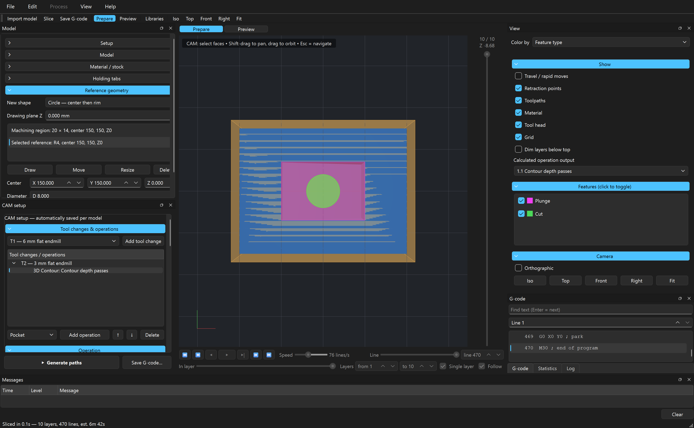

[Documentation](../README.md) / [CAM](README.md)

# Drawn reference geometry

The **Reference geometry** pane, at the bottom of the **Model** dock under
Material / stock and Holding tabs (CAM only), draws circles and axis-aligned
rectangles on a chosen XY plane. Shapes can then be moved and resized.
They are owned by the model's CAM setup. They are saved construction outlines, not new
mesh faces, stock or retained material. Operations can select their boundaries
or use them only for height references.

Current actual capture (isolated library, `examples/wedge-pocket.stl`, top view):
saved outlines are cyan. The shape selected in this pane is **bright lime with
a translucent filled interior**; operation-selected outlines are **magenta with
a filled interior**. The overlays draw above model/stock shading so selection
is visible even when an outline lies on a model face. Earlier captures with
a yellow, outline-only editor focus show the previous highlight style.

This earlier actual capture shows the pane in its previous place inside the CAM
setup panel, with *Draw reference* and *Stop / cancel* buttons; drawing and
picking behave as described here. Outlines picked by the current operation are magenta. Some demonstration
outlines extend beyond the blank: drawing them does not authorise machining
outside material or prove a safe cutting/workholding plan.

## Construction methods

| Method | First click | Second click | Result |
|---|---|---|---|
| Circle — center then rim | Center | Any point on circumference | Radius is the XY distance between clicks |
| Circle — diameter endpoints | Point on circle | Opposite endpoint of diameter | Center is the midpoint; radius is half the distance |
| Rectangle — center then corner | Center | Any corner | Full width/height are twice the absolute X/Y differences |
| Rectangle — opposite corners | First corner | Diagonally opposite corner | Bounds are the minimum/maximum clicked X/Y coordinates |

“From edge” therefore means two opposite diameter endpoints for circles, or two
opposite corners for rectangles. Rectangles remain aligned to the work X/Y axes.

1. Import the model and choose CAM. A tool/operation is not required to draw.
2. Select a method under **New shape** and set **Drawing plane Z**; default is 0.
3. Press **Draw**. The button stays highlighted while drawing. Click the two
   points in Prepare; top view is often simplest. A magenta cross marks the
   first point and the status text asks for the second.
4. The completed outline appears in the list (selected) and in the view.
   Drawing stays active for another shape.
5. Press **Esc** in the view or click the highlighted **Draw** again to stop.
   Changing the method or Z cancels an unfinished shape. Orbit/pan remain
   available while drawing. Starting another tool (Move, Resize, holding tabs,
   face/edge picking) also ends drawing.

Clicks intersect the camera ray with the selected Z plane; they do **not** snap
to mesh edges or copy a clicked face's Z. A plane viewed edge-on or behind the
camera cannot accept a point. Coincident circle clicks and zero-width/height
rectangles are rejected; choose another second point or cancel. A partial
first point is not saved as geometry.

## Coordinates and ownership

All dimensions and coordinates are millimetres in the current CAM **work
coordinate system**. Each outline stores its own Z. Changing Drawing plane Z
only affects the next construction, not existing outlines.

References belong to the model's CAM setup, independently of tools/process
presets. They persist across save/reopen and workflow changes. Like manually
allocated stock, their coordinates remain fixed when model placement changes:
**they do not follow model translation, rotation or scaling**. Inspect alignment
after moving the model. Source fingerprint invalidation applies to the saved
CAM setup as before.

These are Prepare construction overlays, not Preview stock surfaces. They can
be shown through the model/stock so that the reference remains visible; visible
reference lines are not evidence of physical clearance.

## Selecting an outline

1. Stop drawing and select the operation.
2. Use **Select edges** and click anywhere on the desired outline. Any side of
   a rectangle selects the entire closed rectangle; a circle is one closed rim.
3. Default **Pick from → Part + material + references** considers all three.
   Use **Reference geometry only** when outlines overlap part or material edges.
4. **Select faces** can also pick the interior of a closed reference outline;
   it still references the same complete boundary, not a new triangle surface.

In mixed picking, edges compete by screen distance, with existing part/material
priority on ties. Faces prefer the real part; the reference-only filter makes
an overlapping reference interior accessible. Picking/highlights and contour
construction run in the compute process; GUI drawing only intersects a ray
with a plane and validates small scalar dimensions.

The outline appears by name in the operation's selection list. Leave it
checked for machining, or uncheck it to retain it only as a height reference.
Select its row and **Use selected reference** for Start/End; both extrema equal
the outline's constant Z, with the usual editable offset. Unchecked outlines
do not affect *Machining selection* maximum/minimum depths.

## Using references for machining

- **Pocket:** a drawn closed boundary defines the removal region, subject to
  normal cutter clearance, stock limits, depth/air-cut planning and tabs.
- **Profile:** Outside/Inside/On and roughing clearance apply as with other rims.
- **Slot / Engrave:** follow the closed outline at the operation depths.
- **Drill:** circular references can locate hole centers under the existing
  circular-rim checks. Rectangles are rejected as drill geometry.
- **Mixed with material boundaries:** the blank supplies the outer envelope;
  a selected reference rim is retained as an inner boundary, alongside existing
  conservative part-section protection. Use height-only if a reference should
  supply Z without changing this region.

Drawing at Z-3 does not automatically make a safe operation from Z0 to Z-3.
Inspect Start/End, material, tool reach, entry strategy and stock checks. A flat
Pocket selection retains the normal material-surface start fallback. Sketches
do not automatically allocate or enlarge stock or protect their interior as
physical material unless the operation's boundary rules explicitly do so.

## Moving and resizing

Select a shape in the list. It is drawn **yellow** in the view, and its center
and size appear under the buttons:

- **Center X / Y / Z** and **Diameter** (circle) or **Width / Height**
  (rectangle) can be typed. Values apply when a field is confirmed (Enter, arrow
  or leaving the field). A zero or invalid size is rejected and the previous
  values return.
- **Move** (checkable): click in the view to put the shape's center there. The
  click is taken on the shape's own Z plane, so Z does not change.
- **Resize** (checkable): click a new rim point (circle) or corner (rectangle);
  the center stays.

Move and Resize stay active for repeated clicks until Esc or the highlighted
button is clicked again; only one of Draw, Move and Resize is active at a time.
They need a selected shape.

Moving or resizing keeps the shape's ID, name and construction method, so
operations that machine it or use it for Start/End follow the new position and
size on the next generation. The CAM output is marked out of date. Inspect the
changed boundaries and depths before regenerating.

## Deletion and limitations

Select an unused outline in the list and **Delete selected**. A confirmation
(default **No**) has **Don't show this again**: answering **Yes** with it ticked
deletes later unused references without asking. Switch the question back on in
**Settings → Messages → Confirm deleting reference geometry**. Answering No is
never remembered. Deletion is blocked while an operation uses that
outline for machining, height-only picking or an active Start/End link. Remove
those picks and unlink the depth sources first. Stable IDs mean removing one
outline cannot redirect another operation to a different shape.

Circles are polygonal with a maximum **0.01 mm chord error**, at least 64
segments and a maximum budget of 8,192 segments; excessive size fails rather
than silently coarsening. Output is not a fitted G2/G3 circle. There are no
constraints/snaps, drag handles, rotated rectangles, trim/segment editing,
arbitrary sketch planes or full CAD/3D cutter compensation. Redraw an outline
to change its construction method or its kind. All usual approximate 2.5D simulation and
fixture/holder limitations remain.
