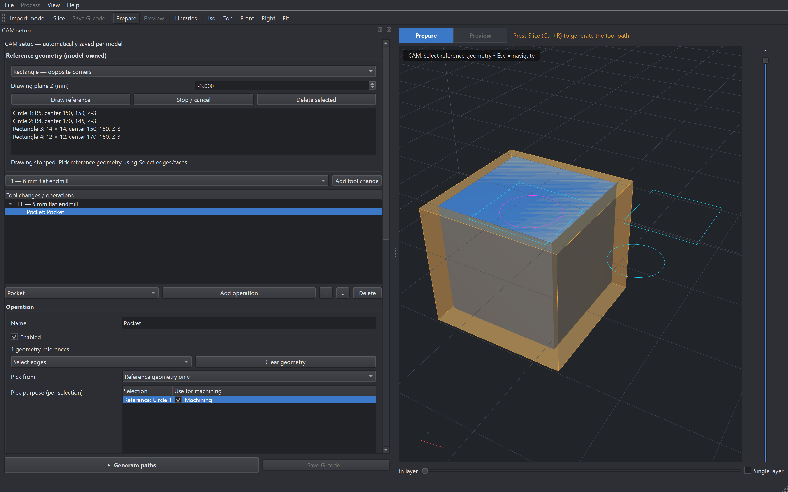

[Documentation](../README.md) / [CAM](README.md)

# Drawn reference geometry

**CAM setup → Reference geometry (model-owned)** draws circles and axis-aligned
rectangles on a chosen XY plane. They are saved construction outlines, not new
mesh faces, stock or retained material. Operations can select their boundaries
or use them only for height references.

This actual Prepare capture uses an isolated library and the example cube.
Cyan outlines are references; the selected circle is magenta. Some demonstration
outlines extend beyond the blank: drawing them does not authorise machining
outside material or prove a safe cutting/workholding plan.

## Construction methods

| Method | First click | Second click | Result |
|---|---|---|---|
| Circle — center then rim | Center | Any point on circumference | Radius is the XY distance between clicks |
| Circle — diameter endpoints | Point on circle | Opposite endpoint of diameter | Center is the midpoint; radius is half the distance |
| Rectangle — center then corner | Center | Any corner | Full width/height are twice the absolute X/Y differences |
| Rectangle — opposite corners | First corner | Diagonally opposite corner | Bounds are the minimum/maximum clicked X/Y coordinates |

“From edge” therefore means two opposite diameter endpoints for circles, or two
opposite corners for rectangles. Rectangles remain aligned to the work X/Y axes.

1. Import the model and choose CAM. A tool/operation is not required to draw.
2. Select a construction method and set **Drawing plane Z (mm)**; default is 0.
3. Press **Draw reference**, then click the two points in Prepare. Top view is
   often simplest. A magenta cross marks the first point; the status text asks
   for the second point.
4. The completed outline appears in cyan and its dimensions/center/Z appear in
   the saved-reference list. Drawing stays active for another shape.
5. Press **Stop / cancel** or Escape to leave drawing mode. Changing the method
   or Z cancels an unfinished shape. Orbit/pan remain available while drawing.

Clicks intersect the camera ray with the selected Z plane; they do **not** snap
to mesh edges or copy a clicked face's Z. A plane viewed edge-on or behind the
camera cannot accept a point. Coincident circle clicks and zero-width/height
rectangles are rejected; choose another second point or cancel. A partial
first point is not saved as geometry.

## Coordinates and ownership

All dimensions and coordinates are millimetres in the current CAM **work
coordinate system**. Each outline stores its own Z. Changing Drawing plane Z
only affects the next construction, not existing outlines.

References belong to the model's CAM setup, independently of tools/process
presets. They persist across save/reopen and workflow changes. Like manually
allocated stock, their coordinates remain fixed when model placement changes:
**they do not follow model translation, rotation or scaling**. Inspect alignment
after moving the model. Source fingerprint invalidation applies to the saved
CAM setup as before.

These are Prepare construction overlays, not Preview stock surfaces. They can
be shown through the model/stock so that the reference remains visible; visible
reference lines are not evidence of physical clearance.

## Selecting an outline

1. Stop drawing and select the operation.
2. Use **Select edges** and click anywhere on the desired outline. Any side of
   a rectangle selects the entire closed rectangle; a circle is one closed rim.
3. Default **Pick from → Part + material + references** considers all three.
   Use **Reference geometry only** when outlines overlap part or material edges.
4. **Select faces** can also pick the interior of a closed reference outline;
   it still references the same complete boundary, not a new triangle surface.

In mixed picking, edges compete by screen distance, with existing part/material
priority on ties. Faces prefer the real part; the reference-only filter makes
an overlapping reference interior accessible. Picking/highlights and contour
construction run in the compute process; GUI drawing only intersects a ray
with a plane and validates small scalar dimensions.

The outline appears by name under **Pick purpose (per selection)**. Leave it
checked for machining, or uncheck it to retain it only as a height reference.
Select its row and **Use selected reference** for Start/End; both extrema equal
the outline's constant Z, with the usual editable offset. Unchecked outlines
do not affect *Machining selection* maximum/minimum depths.

## Using references for machining

- **Pocket:** a drawn closed boundary defines the removal region, subject to
  normal cutter clearance, stock limits, depth/air-cut planning and tabs.
- **Profile:** Outside/Inside/On and roughing clearance apply as with other rims.
- **Slot / Engrave:** follow the closed outline at the operation depths.
- **Drill:** circular references can locate hole centers under the existing
  circular-rim checks. Rectangles are rejected as drill geometry.
- **Mixed with material boundaries:** the blank supplies the outer envelope;
  a selected reference rim is retained as an inner boundary, alongside existing
  conservative part-section protection. Use height-only if a reference should
  supply Z without changing this region.

Drawing at Z-3 does not automatically make a safe operation from Z0 to Z-3.
Inspect Start/End, material, tool reach, entry strategy and stock checks. A flat
Pocket selection retains the normal material-surface start fallback. Sketches
do not automatically allocate or enlarge stock or protect their interior as
physical material unless the operation's boundary rules explicitly do so.

## Deletion and limitations

Select an unused outline in the saved-reference list and **Delete selected**.
Confirmation is required. Deletion is blocked while an operation uses that
outline for machining, height-only picking or an active Start/End link. Remove
those picks and unlink the depth sources first. Stable IDs mean removing one
outline cannot redirect another operation to a different shape.

Circles are polygonal with a maximum **0.01 mm chord error**, at least 64
segments and a maximum budget of 8,192 segments; excessive size fails rather
than silently coarsening. Output is not a fitted G2/G3 circle. There are no
constraints/snaps, rotated rectangles, trim/segment editing, numeric XY/dimension
editing, arbitrary sketch planes or full CAD/3D cutter compensation. Redraw an
outline to change its construction. All usual approximate 2.5D simulation and
fixture/holder limitations remain.
