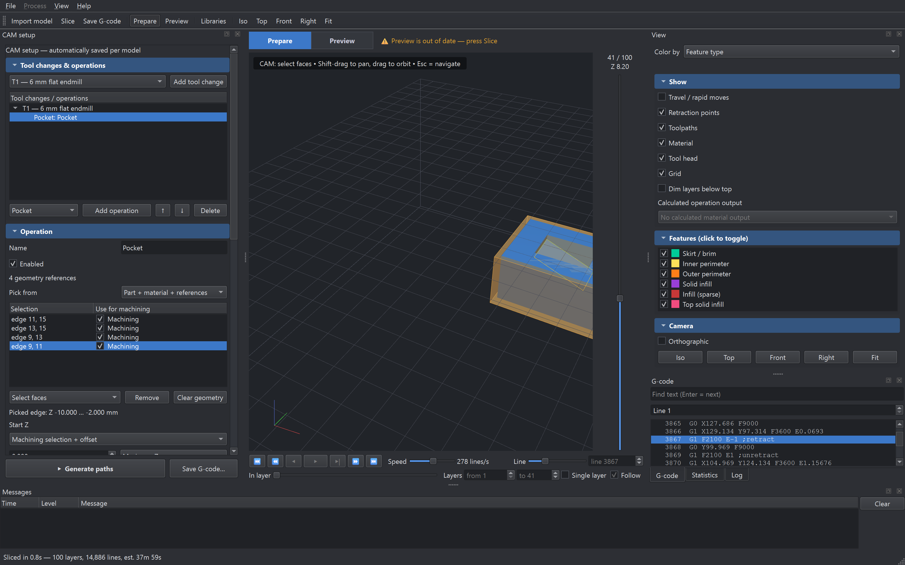
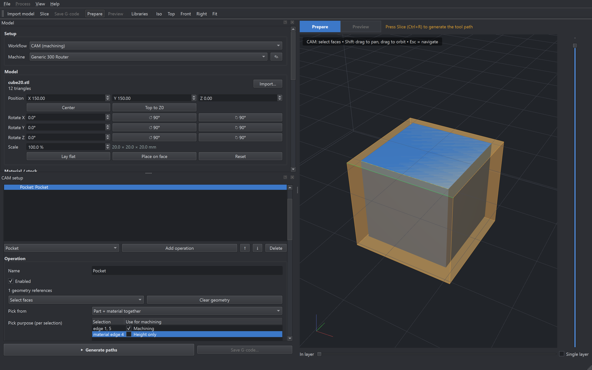
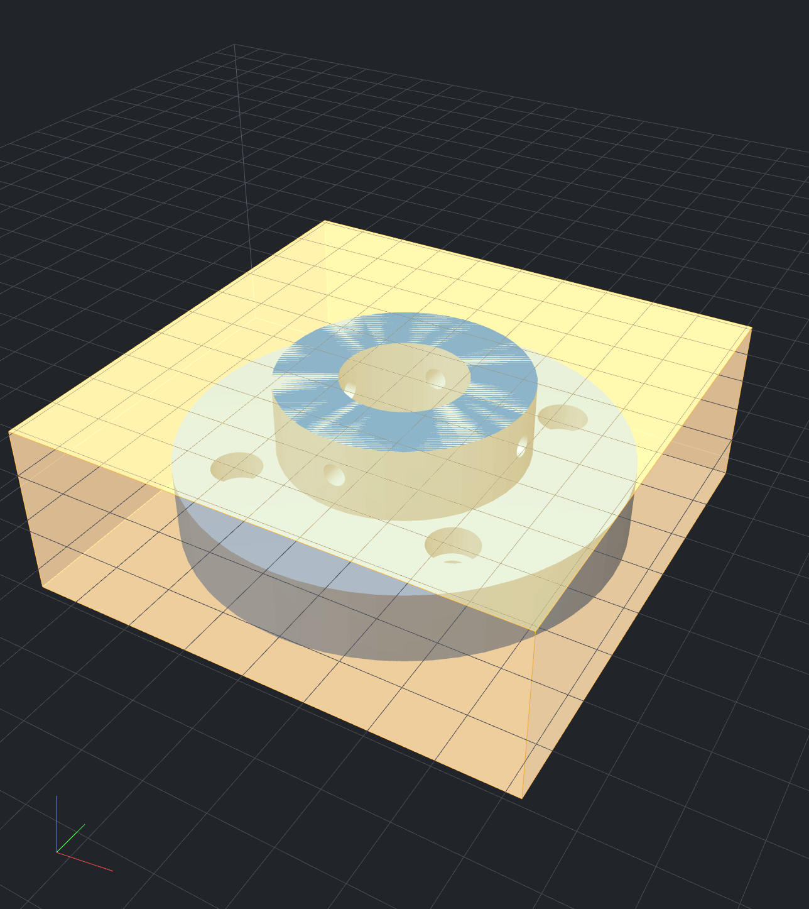
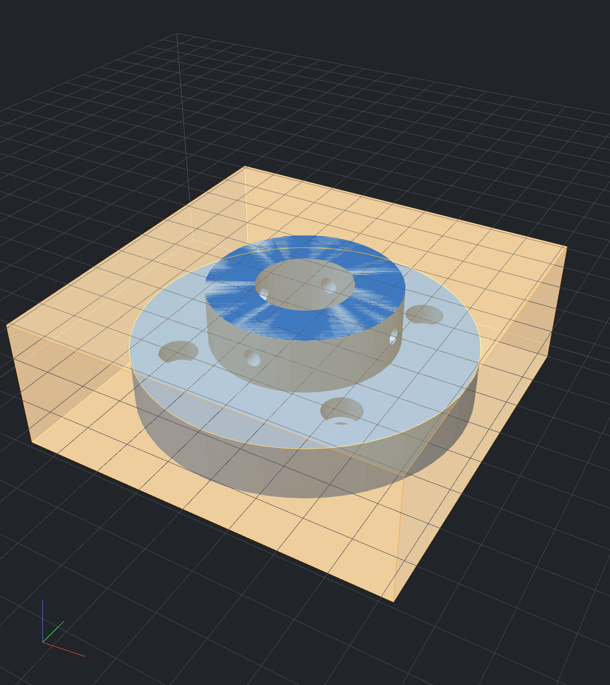
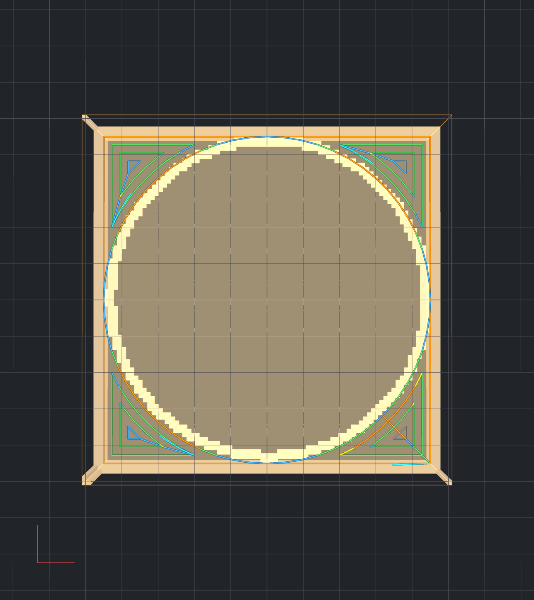
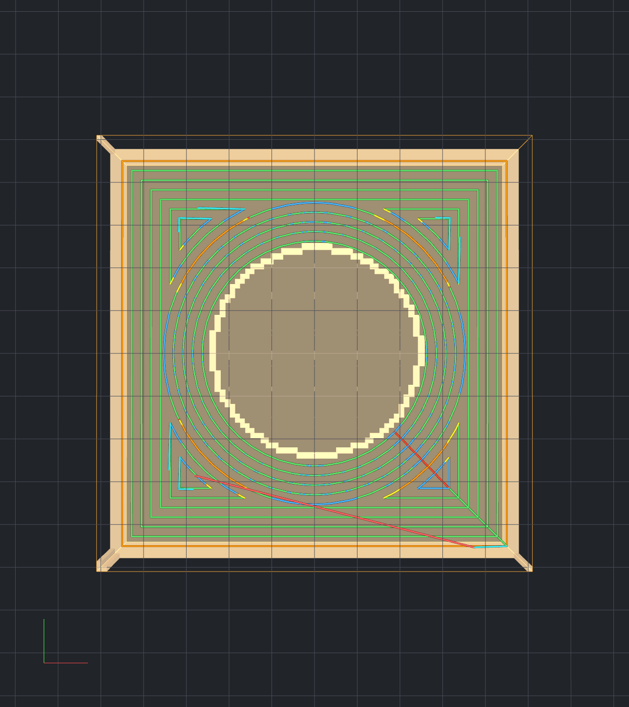
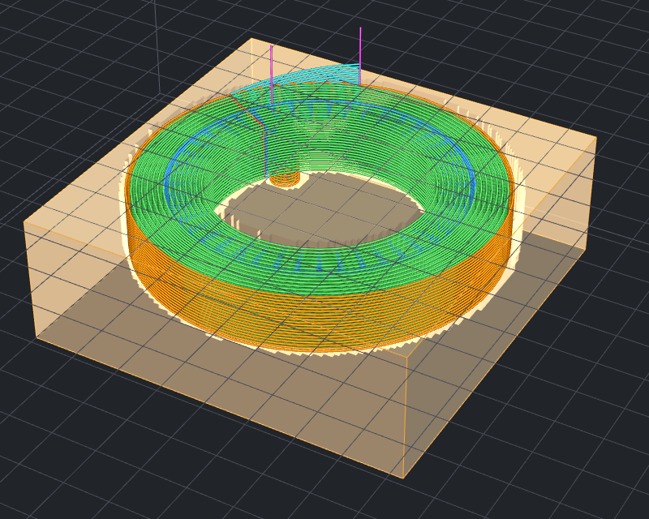

[Documentation](../README.md) / [CAM](README.md)

# Geometry selection and linked depths

## What is selectable?

STL stores triangles, not CAD faces, edges or analytic circles. The application
reconstructs a limited topology after placement:

- **Face:** a connected group of coplanar triangles. Disconnected patches in
  the same plane are separate faces. A curved surface is not one analytic face.
- **Feature edge:** a boundary or a crease exceeding the current 30° threshold.
  Ordinary coplanar triangle seams are omitted.
- **Edge chain:** feature segments continue through degree-two vertices;
  branches stop chains. A cube edge stops at its corners; a faceted circular
  rim can form one closed chain.

The allocated **material blank** also exposes its six rectangular faces and
twelve straight edges. These are live stock references, not STL triangle ids;
resizing or moving the blank updates them. They refer to the original allocated
blank, not a calculated operation-output height field.

A shallow crease below the threshold may not be selectable as a feature edge.
Very coarse meshes may not approximate a circle well enough for drilling.
This is not a replacement for exact B-rep/CAD topology.

## Selecting cutting geometry

1. Select an operation in the CAM tree. Its geometry count and settings appear;
   **face picking activates automatically**. Reopening a setup selects its first
   operation rather than leaving all selection controls disabled.
2. Leave **Pick from: Part + material + references** (default), then keep
   **Select faces** or switch to **Select edges**. Pick both types directly in
   the same operation. *Part only* / *Material only* are optional filters for
   ambiguous overlaps, not mutually exclusive operation types; switching a
   filter never clears existing selections.
3. Click an element to add it; click it again to remove it.
4. Every pick is a row of the full-width selection list. Leave **Use for
   machining** checked for cutting boundaries; uncheck any row that should
   supply only a height.
5. Under the list: the face/edge pick mode, **Remove** (drops the selected row,
   whether machining or height-only) and **Clear geometry** (removes all cutting
   references; height-only picks and Start/End links stay). A row that defines
   Start or End Z cannot be removed until that depth uses another source.

Selected part faces/edges highlight yellow; selected material faces/edges
highlight **green**, drawn over the material surface so they remain visible. The operation owns its selections;
switching to another operation displays that operation's geometry. Merely
selecting another tree node does not copy geometry between operations.

This capture shows one checked part edge and an unchecked material edge
used only for End Z. Reference-drawing controls and the expanded default filter
label were added later; these per-selection checkboxes are unchanged.
Older flange examples below show the previous global-purpose
dropdown and yellow material highlights; their boundary examples still apply.

A miss now displays a message rather than silently leaving the selection
unchanged. Edge picking allows a small screen-space tolerance and checks
visibility along the candidate edge's pixel (important in orthographic views).
Small click jitter does not orbit the camera before hit testing.

Clicking different triangles of the same reconstructed face resolves to the
same face reference. A different segment of the same feature chain resolves
to that chain. Selected individual edges can be assembled into a closed
contour when their endpoints meet. Open branches or incomplete selections
cannot define a pocket/profile boundary.

Picking is click-on-release with a small drag tolerance. Drag to orbit rather
than accidentally accumulating selections; Shift-drag/right-drag pans. Esc
returns to navigation. Leave selection mode to drag the model in XY. Place on
face and CAM picking are separate, mutually exclusive actions.

Topology, hit evaluation and selection highlights are computed outside the UI
process. A short delay is expected after a pick or placement edit; requests
for old scenes/operations are discarded rather than applied to the current one.

## Selecting material boundaries

By default **Pick from → Part + material + references** accepts part/material and drawn outlines
without switching modes. Click the part edge, then a material edge to add
both to the same Pocket. Yellow outlines and translucent face fill show the
selections. Edge picking chooses the closest screen-space edge across both
geometries; a face click over the part prefers the part through the transparent
blank. Click outside the part to pick the material face. Use the optional
*Part only* or *Material only* filters only when overlapping picks are
ambiguous. In a top view where top/bottom material edges coincide, the nearer
edge wins.

- A top/bottom material face supplies a closed rectangle. For Pocket, a single
  horizontal material edge identifies that blank rim; you need not click all
  four sides. A selected part rim becomes the retained inner boundary. A
  circular part edge already forms a rim; a straight rectangular edge uses
  its adjacent horizontal face's closed outline when available. Otherwise
  complete the part's closed boundary explicitly.
- Profile still needs a face or complete closed edge loop. A single material
  edge remains an open line for Slot/Engrave.
- Side faces and vertical edges can be picked as **height references** (minimum
  or maximum Z), but not as cutting geometry for a 2.5D operation. This does
  not implement side milling.
- **Use selected reference** and both *Selected geometry* / *Machining selection* depth
  sources accept material references. They stay linked to blank top/bottom
  and size, rather than freezing the picked coordinates.
- Picking fails clearly if material is unallocated. Changing the blank marks
  CAM output stale; regenerate before export.

### Material-boundary Pocket

With material bounds selected, Pocket uses the blank as the outside removal
envelope. It automatically protects the part's cross-sections at all requested
depths, including inserted tab-top passes. Section holes are filled
conservatively: an unselected bore inside a boss is **not** automatically
machined. Use a separate part-selected operation for those internal features.
The operation's Material boundary limit controls the blank edge and roughing
clearance controls part walls, with the same contour/raster strategy,
engagement planning, tabs and Area order as other pockets.

### Clear between the part and material edges

Select the **part's outer rim** and **one horizontal material edge** in the
same Pocket, leaving mixed picking on. The material rim is the outside
boundary; selected part rims (or part-face footprints) are retained inner
boundaries. They are not just height hints or ignored in favour of the model
section. The pocket clears the space **between** them, with roughing clearance
on the part side and Material boundary limit on the blank side. Several
selected part loops are retained islands, not alternating XOR cut regions.

Actual capture: one part flange edge at Z-15 plus one top material edge at Z0
in a single Pocket. Start/End use selection maximum/minimum (0 to -15).
The material outside the selected flange rim is cleared to -15; stock inside
that rim remains for later operations. Yellow Conflict segments still need
review. This example is illustrative, not a calibrated machining recipe.

If a part face/edge should supply **only a depth**, uncheck its **Use for
machining** row and click **Use selected reference** for Start Z or End Z. For example,
select just the material top face as the cutting envelope and link End to the
flange floor in height-only mode. That clears the blank to the floor while
automatic part-section protection retains the boss; it does not retain the
whole flange footprint above that floor.

This corrects the earlier material-envelope behaviour that could ignore a
selected part rim as a boundary. If an older mixed selection used a part face
solely for End Z, convert it to a height-only reference before regeneration.

These actual captures use the example flange part, 6 mm stock margin and a
3 mm demonstration tool. End is linked to the Z-15 flange floor. Yellow
Conflict segments mark the existing mixed-hand warning at square-to-round
transitions; this is not a warning-free machining recipe. Material display
sampling remains approximate.

Selecting only the blank top face supplies no lower End automatically; set
End explicitly or use a lower part/stock height reference. A facing pass above
the model top can clear the whole blank plane. Deeper stock-boundary pockets
use a conservative union of part sections over the entire depth range, so a
part that widens below the floor can limit clearance for all passes. They are
not an adaptive 3D rest-machining strategy or a general solid collision check.
Profile/Slot/Engrave retain their normal side/depth rules; a stock reference is
not permission to ignore tool reach, fixtures, or workholding checks.

## Drawn reference outlines

Use **CAM setup → Reference geometry** to construct circles from a center/rim
or opposite diameter endpoints, and rectangles from a center/corner or opposite
corners. Their complete outlines can be picked with Select edges, or by clicking
inside with Select faces. Use **Reference geometry only** for overlaps; normal
mixed picking also considers drawings. Cyan outlines turn magenta when selected,
independently of green material selections. Per-selection machining checkboxes
and Start/End links work the same way. See
[drawn reference geometry](reference-geometry.md) for Z planes, fixed work
coordinates, persistence and machining limits.

## Cutting geometry versus height-only geometry

A horizontal face may define the operation boundary, while another face
provides a bottom height. To avoid cutting both faces:

1. Pick both edges/faces. Each gets its own row in the selection list.
2. Keep the cutting boundary checked under **Use for machining**.
3. Uncheck the other row: it becomes **Height only** and is excluded from
   toolpath boundaries and *Machining selection* depth extremes.
4. Select that height-only row and press **Use selected reference** next to
   Start Z or End Z. You can select either row later without picking again.

Purpose is stored per reference and survives saving/reopening the model setup.
Changing a checkbox does not erase an existing Start/End link. Older linked
height references also appear as unchecked rows. Rechecking a row includes it
in machining again; inspect the changed boundary before regenerating.

**Use selected reference** uses that row (or the last viewport pick if no row
is selected) as a live reference and resets that depth's numeric offset to zero. Set the
offset afterwards. The minimum/maximum dropdown determines which extreme is
used. A reference used for depth need not be horizontal; a vertical face can
supply either its top or bottom Z. Cutting geometry has stricter requirements.

## Start and end depth fields

Every operation has independent Start Z and End Z definitions:

| Source | Numeric field means | Evaluation |
|---|---|---|
| Model top + offset | Offset in mm | Highest placed model vertex Z + offset |
| Model bottom + offset | Offset in mm | Lowest placed model vertex Z + offset |
| Absolute Z | World/work-coordinate height | Numeric value directly |
| Selected geometry + offset | Offset in mm | Reference minimum or maximum Z + offset |
| Material surface + offset | Offset in mm | Allocated stock top Z; falls back to model top when unallocated |
| Machining selection + offset | Offset in mm | Minimum/maximum Z over all current cutting references |

New Pocket operations use **Machining selection, Maximum Z** for Start and
**Machining selection, Minimum Z** for End. Selecting a counterbore's upper
rim at Z-15 and its lower rim at Z-21 therefore cuts exactly Z-15…-21; a
selected floor at Z-15 stops removal at -15, not the model bottom at -30.
When the selection is flat (one floor face, or rims at a single height) the
maximum equals the minimum, so generation takes Start from the **material
surface** instead and logs that choice; the Start offset still applies.
Selecting only an upper rim at Z0 supplies no removal depth; add the lower
boundary or set a specific end reference. Empty machining selections cannot
resolve this source.

With **Remove air cutting** (default, [Settings](../settings.md)) the Start is
also lowered to the highest Z where the operation's cutter sweep still meets
material left by earlier operations. A bolt-hole pocket entered after the
flange floor was cleared to Z-15 begins at Z-15 even when its Start field
resolves to the Z0 material surface. The lowered start, skipped passes and
skipped operations are logged; switch the setting off to keep every requested
pass. The estimate uses planar cutter sweeps of **earlier operations in this
setup only**; material removed by a previous program or by hand is unknown.

Actual capture: the counterbore pocket (selected from its Z-15 and Z-21 rims)
stacks its passes from Z-15 downward after the flange pocket; nothing is
cut in the air above it.

Existing saved depth definitions are preserved. **Use pocket selection depths**
explicitly switches both fields to these defaults and resets offsets; it is
available on Pocket operations. See the
[illustrated annular pocket example](operations.md#bounds-and-automatic-removal-height).

The minimum/maximum selector affects geometry references and the machining
selection source. It is irrelevant to
an absolute height or the explicit Model top/bottom sources. The resolved
start/end values are shown below the fields. A Geometry source without a
reference is an error, not an implicit zero.

**Start** is the cutting-depth reference, not the safe rapid height. Each
pass normally cuts a stepdown below Start, ending at End. End must be at or
below Start. For a 20 mm part placed from -20 to 0, Start=Model top and
End=Model top + (-3) produce depths -1, -2, -3 with a 1 mm stepdown. The final
pass is shortened when the total depth is not an exact multiple of the step.
Equal start/end currently produces one pass at that height; inspect whether
that is useful for the intended operation.

### Example: pocket ending at a picked floor

Suppose the top is Z0 and the intended floor face is Z-6:

- Select the pocket boundary as cutting geometry.
- Pick the floor, uncheck its machining checkbox, and Use selected reference for End.
- End source becomes Selected geometry, offset 0.
- Start=Model top, stepdown=1.5 mm gives -1.5, -3, -4.5, -6.
- To leave 0.2 mm of axial stock, change End's offset to **+0.2**, giving -5.8.

The operation Stock to leave field is **radial** compensation; it does not
replace the axial End offset.

## Placement and changed geometry

References store triangle/vertex indices, not frozen world coordinates.
Translation/rotation/scale re-evaluates their Z values and boundaries. Absolute
Z does not follow geometry. Model-top/bottom sources follow the entire placed
model rather than a selected feature.

Rotating a cutting face away from horizontal can invalidate a 2.5D operation,
even though its depth reference still resolves. Source-file geometry changes
invalidate saved setups through a mesh fingerprint. Never assume a reference
is still semantically correct after remeshing or replacing a model.

## Selection errors

- **Select machining geometry first:** operation has no cutting references.
- **Select closed edges or a horizontal face:** a required boundary is open.
- **Horizontal face / constant-Z edges required:** selected cutting geometry
  does not satisfy the restrictions of Profile, Slot, Engrave or Drill. Sloped
  edges are valid boundaries for Pocket, 3D Waterfall and 3D Contour
  ([3D operations](3d-operations.md)).
- **Reference no longer exists:** geometry topology/indices no longer match;
  reselect rather than guessing another index.
- **Depth has no geometry reference:** use a real pick or choose another source.

Continue with the [operation reference](operations.md).
