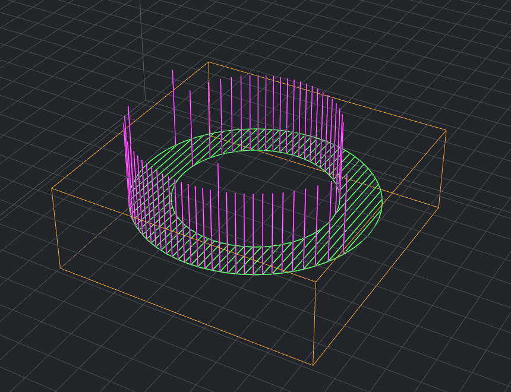
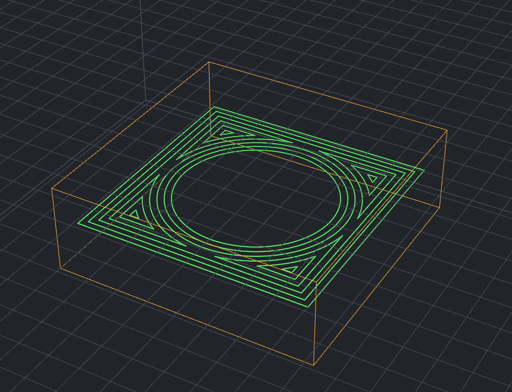

[Documentation](../README.md) / [CAM](README.md)

# Wall-following toolpaths and cutting direction

Pocket **strategy** determines the XY geometry of clearing passes. **Cutting
direction** determines how those paths are traversed. They are separate
settings: selecting Climb does not by itself convert raster lines to contours.

## Wall-parallel contours (default Pocket strategy)

The selected closed removal area includes an outer boundary and any retained
islands. The generator:

1. Validates closed polygons and nesting. Exact duplicate loops are deduplicated;
   self-intersections and overlapping non-nested boundaries are errors.
2. Offsets the entire region inward by cutter radius plus radial allowance,
   giving valid cutter-centre boundaries.
3. Emits those closed boundaries and repeatedly offsets the remaining region
   inward by the stepover distance. Island fronts expand into the pocket as
   outer fronts contract.
4. Handles fronts touching, splitting into disconnected regions or vanishing
   using Shapely/GEOS polygon topology. It does not keep shrinking an isolated
   outer polygon after it has crossed an island.
5. Repeats the resulting XY paths at each requested depth pass, with safe-height
   retract/position/plunge between separate paths.

For the flange and cylindrical boss, every cutting contour is a circular-style
loop, concentric with the walls:

The paths follow the tessellated STL wall shape. Output uses closed sequences
of `G1` line segments, **not** analytic circles emitted as `G2/G3`. On straight
walls they are straight segments; circular walls produce polygonal approximations
at source/offset resolution. No automatic spiral, helix or stay-down linking
is implied. The screenshot hides linking/entry motion to show cutting contours.

### Square boundary and circular island

This constructed example uses a square outer boundary and circular retained
island. Early passes follow the square and circle separately. As fronts reach
the opposing wall, they join/split into corner-region contours combining
straight walls with curved island offsets. This is the required transition
between shapes—not an assumption that the whole pocket must be circular or
square. Disconnected remaining regions are handled independently.

### Stepover and limits

Stepover is a percentage of diameter; default 40%. Contour generation limits
spacing to at most **50% diameter** and logs the cap for larger requests.
This bounds gaps where two fronts vanish between offset samples. Raster can
still use up to 100% spacing. Smaller stepover means more loops and longer
calculation/output. Guards reject more than 10,000 offset levels or more than
two million contour vertices rather than creating an unbounded job.

Shapely is a runtime dependency (`python -m pip install -e .` or install updated
requirements). Robust 2D offsets are not a 3D retained-part/fixture collision
proof, chip-load model or rest-machining system.

## Machine default and per-operation override

**Libraries → CAM machine → Toolpaths → Default cutting direction** stores:

| Setting | Meaning |
|---|---|
| **Climb** (default) | Apply climb contour winding for the assumed clockwise `M3` spindle |
| Conventional | Reverse the climb contour winding |
| Meander | Alternate adjacent paths; contour loops alternate CCW/CW, raster lines alternate forward/reverse |

Pocket/Profile operation **Cutting direction** defaults to **Machine default**.
Choose an explicit value to override only that operation. Changing machines or
editing a machine's default affects inheriting operations on regeneration,
not already exported code. Choices persist in machine JSON and CAM setup state.

The field is deliberately labelled Meander (alternating paths); it is not a
new constant-engagement machining strategy or a synonym for a spiral.

### Winding convention: clockwise spindle

With `M3` clockwise rotation:

- Inside a pocket's outer wall: **Climb = CCW**.
- Around a retained island/external profile: **Climb = CW**.
- Pocket island boundaries and outer boundaries therefore have opposite winding.
- Conventional reverses those directions.
- Meander alternates absolute CCW/CW winding in generated-loop order, beginning
  CCW, irrespective of boundary type. It intentionally does not preserve one
  cutting hand around every retained surface.

For Profile, Outside/On use the retained-side convention derived from loop
nesting. Inside flips that convention for internal-wall compensation. For
On-line paths, actual engagement is ambiguous; inspect the assumed side before
using a direction label as a machining guarantee.

During clearing a cutter can engage material on both sides, especially at entry
or narrow regions. Winding alone does not guarantee pure climb engagement on
every tooth throughout a pass. This setting does not infer spindle direction
from arbitrary custom G-code: **M4/reverse-spindle posts are not automatically
compensated**. Verify controller orientation, rotation and material side.

### Raster and other operations

Raster mode keeps parallel scan lines plus contour boundary passes. Climb uses
forward scan order, Conventional reverse, and Meander alternating scan order.
The finishing boundary loops use the contour winding rules. Scan direction
is not an analytical climb/conventional engagement proof against every wall.

Drill has no XY contour handedness. Engrave follows selected curves without
retained-side knowledge; the Pocket/Profile direction control is disabled for
these operations. Legacy single-tool CLI profiles inherit the machine default.

## Existing projects and migration

Older saved setups without a strategy field use the new **Wall-parallel
contours** default after updating. Select Raster lines explicitly if you want
the previous behaviour. Missing cutting-direction fields inherit the machine;
old machine profiles without the new field resolve to Climb. Existing depth
definitions are retained independently of the new path strategy.

Inspect regenerated output rather than assuming it is byte-identical to a
previous raster program. Review stepdown, stock allowances, entries, winding,
remaining regions and stock warnings before exporting.

## Raster comparison

Raster is still useful for deliberate straight-line clearing. This earlier
capture includes magenta entry/retract motion, unlike the contour-only images
above. All are toolpath inspections, not material-removal simulations.

[Operation settings](operations.md) · [Depth selection](selection-and-depths.md) ·
[Stock checks and limitations](stock-and-safety.md)
