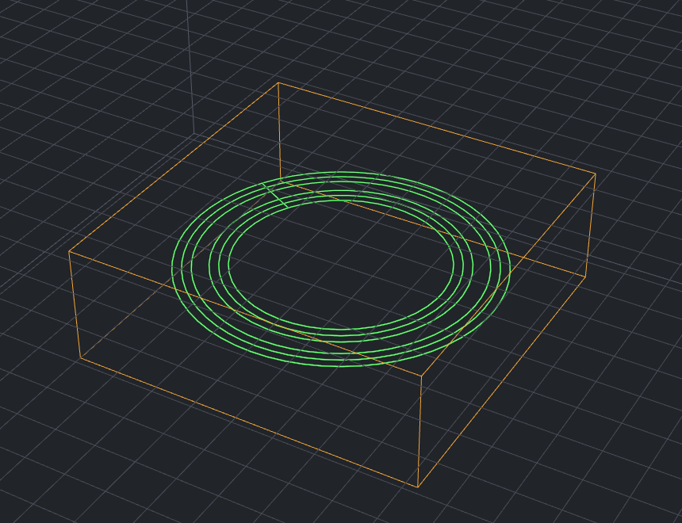

[Documentation](../README.md) / [CAM](README.md)

# Clearing toolpaths and cutting direction

Pocket **strategy** determines the XY geometry of clearing passes. **Cutting
direction** determines how those paths are traversed. They are separate
settings: selecting Climb does not by itself convert raster lines to contours.

## Trochoidal clearing

Choose **Trochoidal** in **Cutting strategy** for Pocket or 3D Waterfall.
At each depth the cutter starts with a small circle near the center of each
connected cutting area, choosing an interior point with room for entry. It
works outward through concentric circles. Stepover controls the radial
spacing between circles (capped at 50% of the tool diameter).

Where a full circle would cross a wall or island, only its in-bounds arcs
are cut. Final wall and island passes clean up the boundary. **Stay down
between contours** allows short feed links only when they fit inside the
cutter-clearance region. If a longer straight move to the next arc is
already clear of stock at the cutting depth, **Short retracts within cleared
material** lets the tool stay down for that move too. A blocked move still
requires a retract.

The circles are emitted as short `G1` moves, not `G2/G3` arcs. This is
center-out circular clearing, not adaptive constant-engagement machining.
The planner still classifies engagement from the actual remaining material.

## Wall-parallel contours (default clearing strategy)

The selected closed removal area includes an outer boundary and any retained
islands. The generator:

1. Validates closed polygons and nesting. Exact duplicate loops are deduplicated;
   self-intersections and overlapping non-nested boundaries are errors.
2. Offsets the entire region inward by cutter radius plus radial allowance,
   giving valid cutter-centre boundaries.
3. Emits those closed boundaries and repeatedly offsets the remaining region
   inward by the stepover distance. Island fronts expand into the pocket as
   outer fronts contract.
4. Handles fronts touching, splitting into disconnected regions or vanishing
   using Shapely/GEOS polygon topology. It does not keep shrinking an isolated
   outer polygon after it has crossed an island.
5. Orders nearby loops together and moves each closed loop's seam to the
   nearest point without changing its cutting direction. Short same-depth
   links are checked against the complete cutter-clearance region.
6. With **Stay down between contours** enabled (default), traverses valid links
   at cutting feed rather than retracting/replunging for each loop. Each new
   depth/operation/tool still begins with a safe-height entry.

For the flange and cylindrical boss, every cutting contour is a circular-style
loop, concentric with the walls:

The paths follow the tessellated STL wall shape. Output uses closed sequences
of `G1` line segments, **not** analytic circles emitted as `G2/G3`. On straight
walls they are straight segments; circular walls produce polygonal approximations
at source/offset resolution. The screenshot shows short green cutting-feed
connections between adjacent loops; initial entry and safe-height rapid moves
are hidden for clarity. This is connected contour clearing, not a mathematically
continuous spiral, helix or ramp.

### Square boundary and circular island

This constructed example uses a square outer boundary and circular retained
island. Early passes follow the square and circle separately. As fronts reach
the opposing wall, they join/split into corner-region contours combining
straight walls with curved island offsets. This is the required transition
between shapes—not an assumption that the whole pocket must be circular or
square. Disconnected remaining regions are handled independently.

### Stay-down ordering and link checks

The old offset-generation order alternated outer and inner boundary fronts.
Execution now chooses nearby loops instead of jumping across the pocket width.
Seams may be inserted along a contour segment to minimize the connection distance;
closed-loop shape is retained. The subsequent engagement plan chooses winding
from remaining material; Meander alternates successive one-sided hands rather
than counting neutral full-slot loops.

Every permitted connector is a straight **G1 at the tool's cutting feed**, not
a rapid at cutting depth. Its entire centreline must lie inside the removal
region offset by cutter radius plus stock allowance, including all islands.
This is stronger than checking only endpoints or a rectangular bounding box.
If no direct admissible next-loop connection exists, the emitter retracts to
safe Z, positions and plunges as before. Disconnected pockets never acquire a
cutting bridge through the material between them. This is direct-link routing,
not a search for a curved path around every obstruction.

Permissions are limited to one depth pass. The emitter also verifies the
expected preceding XY endpoint, falling back to a retract if path edits have
made that link metadata stale. No permission carries into another depth pass,
operation or tool change. Profiles, Raster, Drill and Engrave retain their own
entry/retract behaviour; this option currently applies to wall-parallel pockets.

Disable **Stay down between contours** to force a safe-height entry for every
loop; proximity ordering still reduces unnecessary XY travel. The setting is
saved on the operation. Older operations without this field default to enabled.
The log reports stay-down links and required safe-height entries per depth pass.

A feed connector may intentionally cut remaining pocket material. This does
not simulate previously removed stock, tool engagement, holders or fixtures,
and does not guarantee pure climb engagement during a connection. Verify
entries, links and all warnings before machining.

### Stepover and limits

Stepover is a percentage of diameter; default 40%. Contour generation limits
spacing to at most **50% diameter** and logs the cap for larger requests.
This bounds gaps where two fronts vanish between offset samples. Raster can
still use up to 100% spacing. Smaller stepover means more loops and longer
calculation/output. Guards reject more than 10,000 offset levels or more than
two million contour vertices rather than creating an unbounded job.

Shapely is a runtime dependency (`python -m pip install -e .` or install updated
requirements). Robust 2D offsets are not a 3D retained-part/fixture collision
proof, chip-load model or rest-machining system.

## Machine default and per-operation override

**Libraries → CAM machine → Toolpaths → Default cutting direction** stores:

| Setting | Meaning |
|---|---|
| **Climb** (default) | Orient one-sided clearing against the remaining material, assuming `M3` |
| Conventional | Request the opposite remaining-material hand |
| Meander | Alternate the hand of successive one-sided passes; neutral slots do not choose/advance it |

Pocket/Profile/3D Waterfall **Unlock cutting direction**, immediately below
the lead/plunge feed unlock, defaults to unchecked: the disabled box then shows
the machine's direction that will be used. Check it to choose an explicit
direction for that operation. Unchecking restores inheritance.
Previously saved explicit directions reopen with the checkbox checked. Changing machines or
editing a machine's default affects inheriting operations on regeneration,
not already exported code. Choices persist in machine JSON and CAM setup state.

The field is deliberately labelled Meander (alternating paths); it is not a
new constant-engagement machining strategy or a synonym for a spiral.

### Winding convention: clockwise spindle

With `M3`, **uncut material on the right of travel is climb**, and on the
left is conventional. A full-width slot has no unique hand. The planner now
subtracts completed cutter sweeps and selects subsequent direction from the
remaining material—not from the winding of that first slot.

A finishing pass against an outside retained island is normally CW for climb;
a finishing pass inside an outer retained wall is normally CCW. Those wall
examples must **not** be blindly applied to intermediate clearing loops.
For the annular outside-to-inside case, uncut material lies inward after the
neutral first slot, so subsequent climb passes are **CW**. Meander alternates
one-sided hands, not a slot-index-based CW/CCW rule.

See [remaining-material direction and engagement feeds](engagement-and-feeds.md)
for the estimator, neutral entries, mixed-side warnings and inspection tools.

During clearing a cutter can engage material on both sides, especially at entry
or narrow regions. Winding alone does not guarantee pure climb engagement on
every tooth throughout a pass. This setting does not infer spindle direction
from arbitrary custom G-code: **M4/reverse-spindle posts are not automatically
compensated**. Verify controller orientation, rotation and material side.

### Raster and other operations

**Cutting strategy → Raster lines X / Y** keeps parallel scan lines along
the chosen work-coordinate axis plus contour boundary passes. In an
operation-driven setup, the same remaining-material analysis can reverse open
scan lines when the next uncut side requires it. A scan's label or initial
ordering alone is not a proof of climb engagement.

Drill has no XY contour handedness. Engrave follows selected curves without
retained-side knowledge; the Pocket/Profile direction control is disabled for
these operations. Engrave still receives estimated engagement/feed factors.
Legacy single-tool CLI profiles inherit a wall-based machine direction without
the operation removal/engagement plan; they do not claim slot-aware clearing.

## Existing projects and migration

Older saved setups without a strategy field use the new **Wall-parallel
contours** default after updating. Legacy `raster` reopens as **Raster lines Y**,
preserving its previous axis; Raster lines X is also available. Missing cutting-direction fields inherit the machine;
old machine profiles without the new field resolve to Climb. Existing depth
definitions are retained independently of the new path strategy.

Inspect regenerated output rather than assuming it is byte-identical to a
previous raster program. Review stepdown, stock allowances, entries, winding,
remaining regions and stock warnings before exporting.

## Raster comparison

Raster is still useful for deliberate straight-line clearing. This earlier
capture includes magenta entry/retract motion, unlike the contour-only images
above. All are toolpath inspections, not material-removal simulations.

[Operation settings](operations.md) · [Depth selection](selection-and-depths.md) ·
[Stock checks and limitations](stock-and-safety.md)
