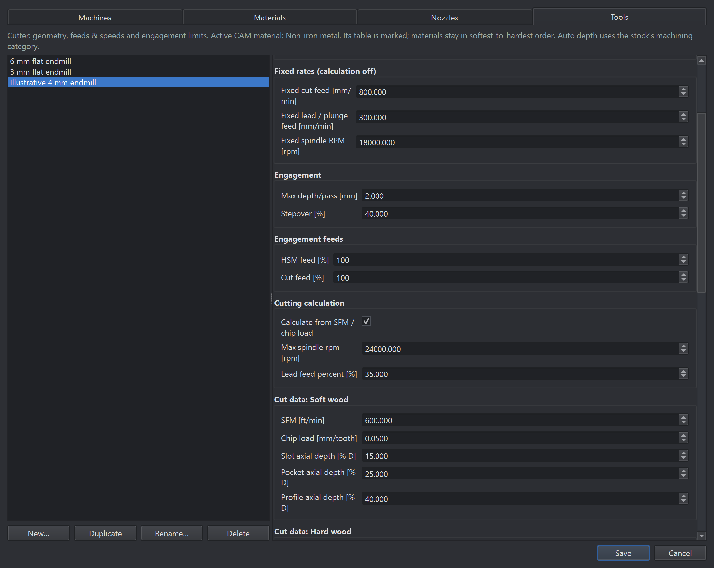

[Documentation index](README.md) / [Development](development.md)

# Structural cleanup and UI-options audit

## Changes made

- Implementations now live in subsystem directories; see the
  [repository map](development.md#repository-map). Each Python source file
  defines at most one class, including private rendering/worker helpers.
- Named module constants and tables live in their owning directory's
  `<directory>_constants.py`. This includes schemas, starter-profile/process
  specifications, stage parameter lists, machining materials, feature colours,
  geometry tables, G-code templates and editor bindings.
- Profile-schema selection, simple process summaries, numeric conversions and
  repeated CAM override bindings use tables. Geometry, safety checks and
  state-dependent machining branches remain explicit rather than being forced
  into an opaque dispatch table.
- Thin old-path exports preserve existing imports and plugin entry points.
  These are API surfaces, not duplicate implementations. JSON schemas, library
  IDs, stage IDs, model-state keys and settings locations have not changed.
- Built-in discovery walks subsystem packages recursively and registers only
  classes defined in the scanned module. Compatibility exports therefore do
  not register stages twice. External plugin discovery locations are unchanged.

### Removed unused definitions

Ten standalone functions, six methods and two obsolete classes had no remaining
application/test/tool callers or documentation references:

| Previous module | Removed definitions |
|---|---|
| `core.features` | `assign_layers_by_z`, `assign_layers_by_depth`, `compute_layer_z`, `classify_perimeters`, `mode_value`, `_point_segment_distance` |
| `core.gcode` | `parse_lines` (program construction remains available through `GCodeProgram.from_lines`) |
| `core.infill_gen` | `Raster`, `chain_polylines`, `bead_area`, `width_from_area` |
| `core.placement` | `Placement.reset_rotation` |
| `core.profiles` | `LibrarySet.library_kinds` |
| `core.sim` | `SimResult.travelling` |
| `gui.camera` | `Camera.copy_from` |
| `gui.process_editor` | `Section.is_expanded` |
| `gui.widgets` | `Worker` (the application uses the spawned compute service) |

Qt callbacks, discovery hooks and supported public loading/parsing APIs were
not deleted merely because their names do not occur at direct call sites.
Extensions importing the removed conveniences must update their own calls.

## Material order and default loading

Tool cutting tables retain this fixed order, regardless of active stock:

1. Soft wood
2. Hard wood
3. Soft plastic
4. Hard plastic
5. Non-iron metal
6. Steel

The active material is still named in the hint and marked in its group title;
its table no longer jumps to the top. This is a category display order, not a
certified hardness ranking of every grade within those categories.

Generated editors use the same `resolve_params` / `Param.coerce` path as backend
parameter resolution. Missing or null fields use their declared defaults;
numeric/boolean/choice strings are converted consistently. Invalid choices
raise validation errors instead of showing the first item while retaining a
different stored value. Global boolean preferences use the same scalar
conversion, including message switches. Existing preference range/default
recovery remains in place.

Hand-built CAM rate controls obtain their initial values from `Operation`;
new-operation preference fallbacks read the shared application defaults.
Starter libraries are constructed from declarative specifications with fresh
mutable values on every call. Reset/default forms continue to use their owning
schema; there is no new global cutting recipe.

Deliberate differences remain: legacy operations retain explicit depth, new GUI
operations enable material-based auto depth, and illustrative starter presets
can specify values different from schema defaults. Active machine/tool/material
limits and saved overrides still determine effective output.

## UI audit — findings only, controls retained

The audit covered profile forms, all built-in stage parameters, Settings and
message switches, manual CAM/stock/tab/placement/support controls and display
menus. The five profile schemas contain 108 entries (105 visible); nine stage
schemas contain 54 entries. None of these 14 schemas repeats a parameter key
within its own form. Repeated names in different ownership scopes are not by
themselves duplicates.

The following are existing inactive, descriptive or potentially misleading
options. **No option below was automatically removed, hidden or implemented.**

| Location / option | Current finding | Suggested follow-up, requiring a separate decision |
|---|---|---|
| CAM machine → `units` | Stored `inch` does not convert geometry, rates or output; default output is millimetres / G21. | Highest-priority clarification or a qualified unit-conversion implementation. Do not rely on this selector for inch output. |
| CAM machine → `rapid_z` | Stored, but does not control emitted Z rapid feed. G0 behaviour remains controller-owned. | Label as reserved, or implement a clearly defined motion policy. |
| CAM machine → `origin`: `front-left-bottom` / `front-left-top` | Both currently use the same XY rectangle; neither sets controller offsets or changes the top-at-Z0 model convention. | Clarify or consolidate only after deciding intended origin semantics. |
| CAM tool → `stepover` | Stored; tree operations start at their own 40% value rather than inheriting this field. | Decide whether new operations should inherit it or whether it should be descriptive. |
| CAM tool → `type`, `vangle` | Stored classification/angle; no full ball/conical cutter geometry, V-carving depth or shape-aware compensation. | Keep metadata clearly distinguished from implemented cutter-shape support. |
| FDM material → `min_layer_time` | Stored; no minimum-layer-time slowdown or dwell. | Mark reserved or implement and test cooling-aware scheduling. |
| FDM nozzle → `min_layer_height`, `max_layer_height` | Stored recommendations, not validated/clamped by the layer stage. | Decide on warning versus enforcement; do not silently change requested layers. |

### Overlap that is intentional, not orphaned

| Controls that can look duplicated | Why both remain |
|---|---|
| Fixed tool RPM/feed/lead rates and SFM/chip-load tables | Fixed rates apply with calculation off; operation unlocks can override either mode. Axial tables remain relevant independently of the SFM switch. |
| Tool maximum depth, material axial percentage and operation depth unlock | A ceiling, an automatic request and an explicit override respectively. The override does not bypass the positive tool cap. |
| Tool/machine/operation engagement feed factors | Ownership differs: HSM/Cut inherit tool values, High/Slot machine values, operations can override. |
| Machine safe Z / clearance and global lead / short-travel clearances | Different motion phases and legacy fallback paths; they are not interchangeable settings. |
| FDM Support and CAM Material / stock | One shared UI slot, different workflow-owned model state. |
| Show → Material, material-output selector and Toolpaths | Visibility, selected operation snapshot and independent path visibility. |
| Legacy `cam_profile` side/stock/depth parameters and CAM tree operation fields | Legacy silhouette CLI/API still uses the former. Normal model-owned tree generation uses operation fields instead; the normal CAM UI is the tree. |
| Hidden machine `stock_resolution` and legacy tool High/Slot factors | Existing compatibility fields, already hidden before this cleanup; current owners are global Settings and machine defaults respectively. |

For detailed behavioural limits, see
[implemented versus descriptive settings](profiles-and-state.md#implemented-versus-descriptive-settings).
No inactive setting should be treated as machine protection or a qualified
machining/workholding recipe.

## Regression checks

Tests enforce the one-class rule, local constant naming, unique schema keys,
valid defaults, shared stage tables, independent starter data, old-path class
identity, recursive discovery, fixed material order, saved cutting-data refresh
and consistent UI/preference default conversion. Full generation, tabs, mixed
picking, remaining material, no-retract entries, FDM and compute-process tests
remain part of the normal suite.
