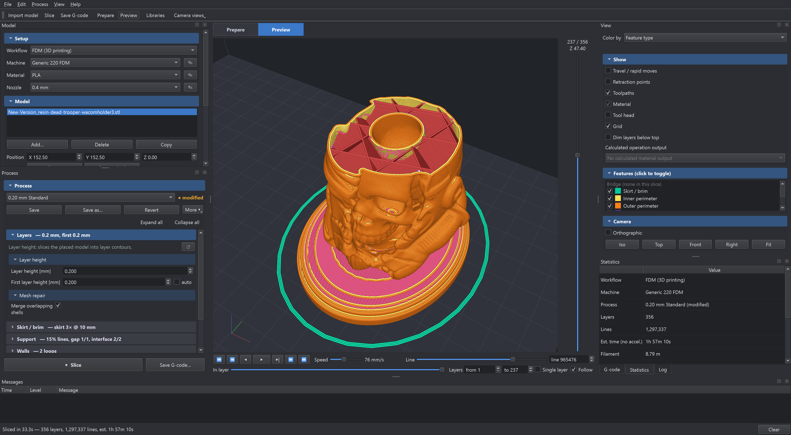

[Documentation](../README.md) / [FDM](README.md)

# Layers

**Where:** Process → Layers. **Stage:** `fdm_slice` (core).
**Input:** placed STL mesh. **Output:** ordered layers, original outline loops
and working contours for later stages.

## Settings

| Setting | Default | Meaning |
|---|---|---|
| Layer height | 0.2 mm | Height of every layer after the first |
| First layer height | `auto` | Explicit first height, or the normal height when auto |
| Merge overlapping shells | Off | Under **Mesh repair**: combine overlapping closed solid shells during slicing |

Both explicit heights accept 0.01–2.0 mm in the stage schema. That range is a
software input range, not a nozzle recommendation. Nozzle min/max layer
heights are not automatically enforced here. Start with values suitable for
your nozzle, material, printer and desired resolution.

CLI `--layer-height` is a per-job override and wins over the process's normal
height. The first-layer setting still resolves separately: `auto` follows the
resolved normal height; an explicit first height stays explicit.

## Geometry and placement

The model is placed before slicing. FDM places its bottom at the Z field,
normally zero. Z > 0 retains **empty layers under the model** rather than
shifting the first model contour back to the plate. This lets support begin at
the bed and grow up to a lifted part.

For example, a model lifted 3 mm with 0.2 mm layers has many layers without
part outlines before the part begins. Support or skirt may still occupy those
layers. Turning support off will not lower the part or remove the need to
support it physically.

The process never controls centring, rotation or scale. Older references to a
Layers “centre on bed” option are obsolete; use Model → Position/Center.

## Overlapping shells

Two closed solids in an STL can overlap even when there are no open edges.
The normal even–odd slice rule can read the overlap as a hole. If slicing
finds overlapping closed solids, it reports the affected layer count and Z
range in **Messages**. The pop-up can be managed under **Settings → Messages**.

To repair the slice, turn on **Layers → Mesh repair → Merge overlapping shells**
and slice again. The slicer combines the solids on affected layers instead
of cancelling their overlap; inward-wound cavities still subtract material.
Review the affected layers in Preview and regenerate any automatic support
blocks you created before enabling the option.

This changes the toolpath, not the STL or the Prepare model. Leave the option
off if the resulting shape is not what you want. This is not a general mesh
repair: it does not close open edges or repair self-intersections within a
single shell. For those cases, edit a copy in a mesh editor, repair the mesh
there and import the corrected STL.

## Effects and inspection

Smaller layers generally create more contours, more G-code and longer
computation. They also change shell thickness in millimetres and the physical
size of support gaps defined in layer counts. Check:

- the first material-bearing layer and its height;
- empty layers below lifted models;
- features near the STL's top and thin horizontal surfaces;
- requested support gap distances after changing layer height;
- actual extruded line widths and flow caps in output.

A four-layer top shell at 0.2 mm is nominally 0.8 mm; changing to 0.1 mm halves
that thickness unless you increase the count. A one-layer support gap changes
similarly. Unequal first-layer height means the first physical interval may
not match a simple count × normal-height calculation.

## Computation time

The slicer filters triangles by their Z range in batches of planes before
computing intersections. Solid-fill clipping batches raster lookups without
changing sample spacing. Travel routing remembers waypoint visibility within
a layer to avoid repeating polygon tests. These are computation changes,
not print-speed settings.

With open-space avoidance enabled, routing can still dominate slicing time
on detailed outlines. Check the **Speed & travel** stage time in the log;
setting the detour budget to zero is a useful comparison, but changes the
paths. These optimizations run in the existing compute process, not a thread
pool.

## Troubleshooting

“No mesh loaded” means import failed or a job was built without geometry.
Unexpected empty lower layers usually mean the model is lifted. Missing
contours may indicate an open/degenerate mesh or features smaller than the
geometry kernel can preserve. Do not compensate for missing geometry solely
by reducing height; verify the STL and inspect [walls](walls.md) too.

[Exact parameter reference](../reference/stage-settings.md#fdm_slice)
