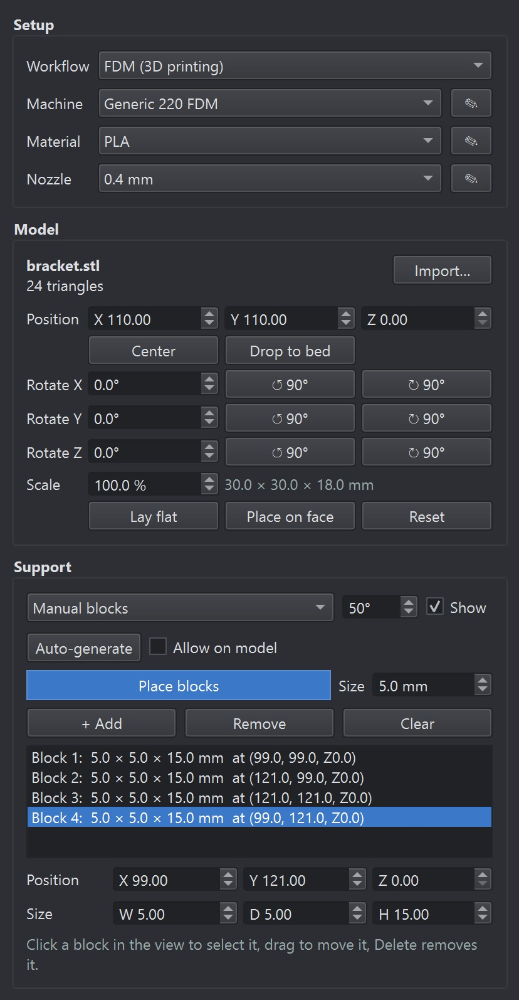

[Documentation](../README.md) / [FDM](README.md)

# Support generation and manual blocks

Support has two independent sets of settings:

- **Model → Support:** where support belongs to this model, overhang angle,
  edge reach, hole filling and manual blocks. Saved per model.
- **Process → Support:** how those supports print: density/pattern, line
  width, XY separation, Z gaps and dense interfaces. Saved in a process.

Changing a process does not change model support state. The support stage is
core; it always reads the model mode, including when an older saved pipeline
marks the stage disabled. Default mode **None** generates no support.

The image is illustrative; old layouts may place some fields differently.

## Model support settings

| Setting | Default | Meaning |
|---|---|---|
| Mode | None | None, Touching build plate, Everywhere, or Manual blocks |
| Overhang angle | 50° | Angle from vertical used for automatic unsupported-region detection |
| Show overhangs | UI option | Tints candidate downward faces red; not a toolpath simulation |
| Extend past edge | 1 mm | Reach beyond a supported part edge, including into holes |
| Fill holes ≤ | 0 mm² (off) | Treat holes up to this area as filled when building support masks |

**Touching build plate** keeps columns with no part underneath, so support
stands only on the bed. **Everywhere** also permits columns resting on the
model, respecting the bottom gap. **Manual blocks** restricts support to the
editable boxes; it is not simply automatic overhang detection with a painted
on/off flag.

## Automatic detection and edge handling

The placed model is sliced into shared-grid occupancy masks. A layer cell
that extends beyond support from the preceding layer by more than roughly
`layer_height × tan(overhang_angle)` is a candidate. Candidate specks smaller
than the process minimum area are ignored. Columns grow downward with the
chosen placement rule, model clearance and gaps.

The GUI accepts overhang angles 0–89° (whole degrees), extension 0–20 mm
(two decimal places), and hole-fill thresholds 0–100,000 mm² (whole mm²).
These are input bounds, not recommendations for printable support.

The extension grows the support footprint outward with a round/octagonal
raster dilation. It is measured to the outside of printed support, not just
a line centre. Because the computation is rasterized, the exact boundary is
quantized (often around a few tenths of a millimetre). Zero extension stops
at the model boundary. Extension never creates support on its own when no
eligible support region exists.

Hole boundaries count as edges too: support reaches into the hole far enough
to support adjacent perimeters. Optional area-based hole filling bridges
under small openings without intentionally running columns up inside the
part's hole. Larger openings remain open and follow normal overhang support.
Do not use hole filling to compensate for invalid hole-wall geometry.

## Process style settings

| Setting | Default | Meaning / trade-off |
|---|---|---|
| Density | 15% | Sparse support-body line density |
| Pattern | Lines | Lines or Grid; Grid adds a crossing family |
| XY distance | 0.8 mm | Horizontal separation from the model; too large reduces edge support |
| Top Z gap | 1 layer | Empty layers below an overhang; larger is easier to separate but less supportive |
| Bottom Z gap | 1 layer | Separation where support stands on model geometry |
| Top interface layers | 2 | Denser roof layers below the gap |
| Bottom interface layers | 2 | Denser floor layers where columns start |
| Interface density | 70% | Dense roof/floor line density |
| Minimum area | 1 mm² | Ignore smaller automatic overhang islands |
| Line width | `auto` | Nozzle/job width unless overridden |

Bottom interfaces apply on the **bed as well as the model**. Support standing
on the bed begins on the first layer; the bottom gap does not lift it away
from the bed. Interface paths are tagged `support_interface`, body paths
`support`, with separate process speed requests. Set an interface count to
zero to omit that interface region.

Gaps are layer counts, not millimetres. One layer at 0.2 mm nominally differs
from one at 0.1 mm. Inspect actual boundaries after changing layer heights,
first-layer height or line width. Interface density is not a soluble-material
system; this is single-material support geometry.

## Auto-generating editable blocks

1. Put the model in its intended orientation/scale first.
2. Select Manual blocks and choose **Block size**.
3. Set **Allow on model** if generated support may rest on model surfaces.
4. Press **Auto-generate**. Heavy work runs in the compute process and can be
   cancelled. The result is a tiled set of editable boxes.
5. Inspect the tiles, then delete/move/resize unwanted areas and slice again.

Block size initially defaults to **5 mm**, remembers its last value, and the
GUI accepts 0.5–500 mm in 0.1 mm precision. Allow on model changes automatic
block generation, not the stored support printing density or interface style.

Each tile receives an extent from the support inside it. Small tiles allow
finer edits but produce more list entries and overlay geometry. Block size
is the tiling/placement size, not the final support line spacing. Re-running
Auto-generate recreates a set from the automatic result; do not expect manual
edits to serve as constraints for a new automatic solution.

## Placing and editing blocks

**Place blocks** is a repeated pick-and-place tool. Set Block size, enable the
tool, then click in Prepare:

- Bed or upward-facing surface: fill vertically to the next model face above.
- Downward-facing overhang viewed from below: fill from the surface/bed below
  to that overhang.
- No suitable vertical gap: no block is placed (clicking the top of a part
  does not create a tower above it).

**Remove blocks** highlights the hovered block red and deletes on click.
Both tools stay active for repeated clicks; Esc exits. They are exclusive
with Place on face. Select a block in the list or view to highlight it yellow;
drag it in XY or edit centre X/Y, bottom Z, width, depth and height. Add,
Delete selected and Clear provide list-based editing; Delete in the view
removes the selected block. **+ Add** specifically creates a 10 × 10 mm
footprint centred beneath the model, from Z0 to its maximum Z; it does not
use Block size or solve a local vertical gap like pick-and-place does.

Support is generated **inside the boxes where the model is above them**,
with model clearance and Z gaps. A box is not a solid printed cuboid and it
is not a general “force extrusion everywhere” primitive. A box that misses
relevant model regions can produce no support.

Blocks move with model translation and are saved per model path. Rotation
or scaling makes them geometrically unreliable and removes them; generate
or place them again. Choosing another process never does this.

## Inspection and failure modes

Inspect the lowest support layer, floor interface, column bodies, roof
interface, top gap and hole rims. Look from underneath; a plan view can hide
missing columns. A floating part without support is still floating even if
the GUI allows slicing. If support is absent, verify mode, block locations,
model height, minimum area, XY gap and overhang angle before increasing density.

Very small unsupported details may disappear at the raster resolution.
Support geometry, cosmetic red overhang tint and physical printability are
not equivalent. There is no mechanical stability, bridging or removal-force
simulation. Start with a small test part for a new support style.

[Exact process reference](../reference/stage-settings.md#fdm_support) ·
[CLI support examples](../cli.md)
