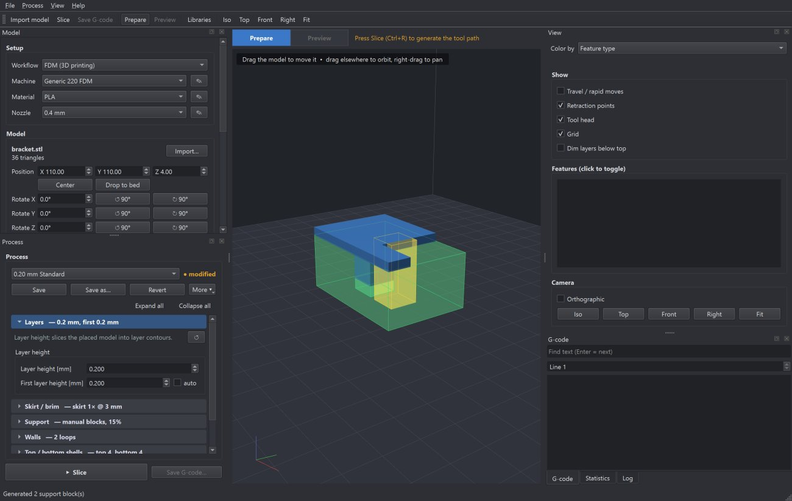
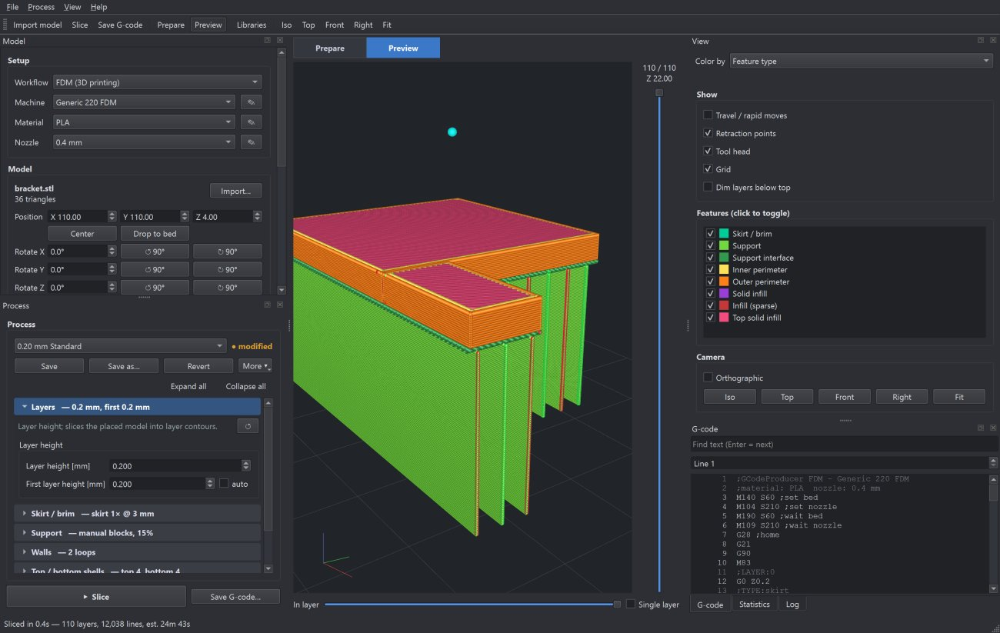
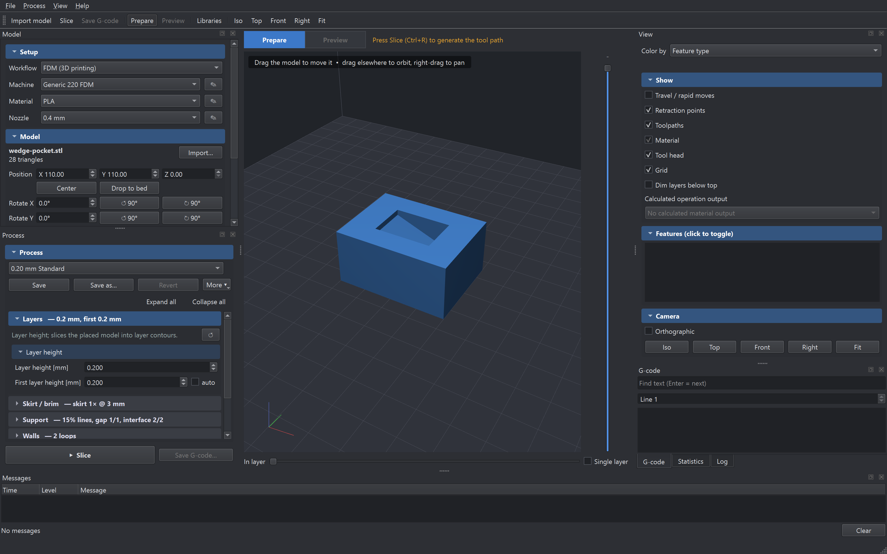
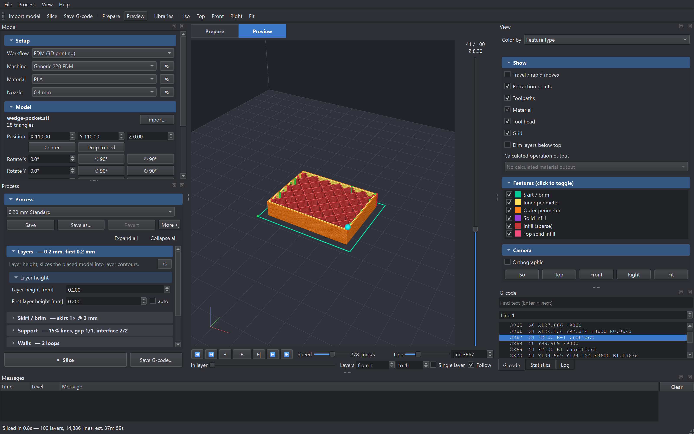

[Documentation index](README.md)

# Interface, placement and preview

## Workspace and docks

The toolbar provides import, workflow actions, Prepare/Preview switching,
camera views and Libraries. The **Model** dock contains setup, import,
placement and one workflow-specific options slot. That slot displays **Support**
for FDM or **Material / stock** for CAM; moving its containing UI area preserves
the relationship. The second left dock contains FDM **Process** settings or
the **CAM setup** tree. Right-hand docks expose view options, G-code,
statistics and the log.

The **Messages** dock at the bottom keeps to the list: its counts appear in the
dock title (*Messages — 0 errors, 1 warnings*) and **Clear** sits beside the
list, so no row is spent below it.

Move, float or close docks using their title bars. Restore hidden docks through
**View**. Layout and window geometry are remembered using Qt settings. A
missing dock is not evidence that its feature is disabled.

Screenshots may precede current labels; the workflow-specific guides describe
the current controls.

## Setup and import

The **Messages** dock along the bottom lists every warning and error with
time and level; hide it from the **View** menu. Pop-ups offer *Don't show
this again*, switchable back in Settings → Messages; see
[messages](settings.md#messages-and-the-messages-panel).

**File → Settings… (Ctrl+,)** holds [global preferences](settings.md) that
affect generated output for every model: air-cut removal, material grid
resolution and cell limit, conflict colouring and the warning dialog.

Choose the workflow before configuring a machine. FDM offers allowed material
and nozzle profiles. CAM tools are added in the tool-change tree rather than
selected as a single global tool. Profile edit buttons open Libraries on the
relevant entry. Changing machines refreshes the permitted consumables; a saved
CAM tool that is no longer available causes generation to fail instead of
silently substituting another cutter.

Import with `Ctrl+O`, drop an STL on the window, or use **File → Recent models**.
Only one model is loaded at a time. The import label shows the filename and
triangle count. Binary and ASCII STL are welded to shared vertices; STL units
are not self-describing, so verify displayed dimensions in millimetres.

## Position and orientation

| Control | Meaning and behaviour |
|---|---|
| X / Y | Centre of the transformed model's bounding box, not its minimum corner or a machine work offset |
| Center | Places the XY centre at the machine work-area centre, respecting centre-origin settings |
| Z, FDM | Bottom of model above bed; nonnegative. Zero rests on the bed |
| Z, CAM | Top of model; normally zero. Negative values recess the whole part below the surface |
| Drop to bed / Top to Z0 | Restores the workflow's Z anchor to zero without resetting rotation or XY |
| Rotate X/Y/Z | Euler angles; buttons rotate ±90° about world axes |
| Scale | Uniform percentage; displayed size updates from the transformed mesh |
| Lay flat | Uses the largest grouped planar area to choose a downward orientation |
| Place on face | Activates picking; click a face to rotate its normal downward; Esc cancels |
| Reset | Restores rotation, scale and Z, then centres XY using the active workflow convention |

Placement is model state, not FDM process state. FDM and CAM placements are
remembered separately. Changing presets must not move a model or alter its
support blocks. Moving FDM models moves their support blocks; rotation or
scaling invalidates those blocks and removes them. CAM references use mesh
indices and are re-evaluated after placement; an operation may become invalid
if its selected cutting geometry is no longer horizontal.

Dragging the model in ordinary Prepare mode changes XY. Dragging empty space
orbits. Selecting a CAM operation automatically activates face picking. Switch to
Select edges to pick rims; a reopened setup selects its first operation so
picking is immediately usable. During CAM selection, dragging over the model
orbits instead of moving it; leave selection mode before dragging the part. Model placements outside
the work volume are orange and show a warning. The CAM volume extends below
Z0; the FDM volume extends above it. Stock and extra adhesion paths are not
made safe merely because the model itself fits.

## Prepare and Preview

Both views use the **same camera**, machine rectangle, grid, origin and
work-volume dimensions. Slicing does not automatically re-fit the camera.
Switching views therefore should not change scale or framing. Use **Fit**
when you deliberately want a different framing.

Prepare displays geometry, support block overlays and CAM selections. FDM
can tint overhangs red. The FDM plate becomes translucent from below. CAM has
no opaque surface hiding the negative-Z part; the stock outline is amber.
Preview displays generated moves and, in CAM, the selected calculated material
output. The outline remains the original blank; translucent surfaces show the
height-field result after the chosen operation. **Show → Material** defaults
on and **Calculated operation output** selects Initial material or each
completed process. These are approximate 2.5D results, not physical simulation.
See [material state and leads](cam/material-state-and-leads.md).

Edits to placement, machine, process, consumables or CAM stock/setup make the
preview **out of date**. Regenerate before relying on it. CAM export is blocked
until paths are regenerated after edits; a program with safety warnings needs
additional confirmation to export.

## Material boundary selection

CAM operations default to **Pick from → Part + material + references** alongside
Select faces/edges. Select a part rim and a material edge in one Pocket to
clear the space between them, without switching selection types. One horizontal
material edge identifies the blank rim; selected part loops are retained inner
boundaries. *Part only* / *Material only* remain optional pick filters. Side
faces and vertical edges can supply linked height references; references
follow blank edits. See
[material boundaries](cam/selection-and-depths.md#selecting-material-boundaries)
for stock-envelope Pocket behaviour and 2.5D limits.

## Draw reference geometry

In the **Reference geometry** pane at the bottom of the Model dock (CAM), draw
circles by center/rim or diameter endpoints and rectangles by center/corner or
opposite corners on a chosen Z plane, then move or resize the selected shape by
typing its center/size or with the **Move** / **Resize** click tools. **Draw**,
Move and Resize are highlighted while active; click again or press Esc to stop.
Saved outlines are cyan, the shape selected in the pane yellow, outlines picked
by the operation magenta; material selection remains green. They are selectable boundaries or per-selection height-only
references. Use **Reference geometry only** to pick through overlaps. Outlines
stay fixed in CAM work coordinates when the model is moved. See
[reference geometry](cam/reference-geometry.md) for construction, persistence,
operation rules and limitations.

## Collapsible panes

Every panel is built from the same collapsible pane as the FDM process sections
(Layers, Skirt / brim, Walls, …): Setup, Model, Support, Material / stock,
Holding tabs, Reference geometry, Process, CAM tool changes and Operation, the
View dock's Show / Features / Camera, Settings → Messages and the groups of
every generated form (library profiles, global settings). Click a header to
collapse or expand it; the arrow shows the state. Panes nested inside another
pane (setting groups within a process section, Engagement feeds within an
Operation) use a quieter header. Collapsed/expanded state of the named panes
is remembered with the window layout.

Lists with actions are laid out the same way everywhere: the list first, its
buttons directly underneath, then the fields of the selected entry (support
blocks, holding tabs, reference geometry).

## CAM holding tabs

In **Material / stock → Holding tabs — model**, choose **Place tabs** and
click side walls to retain rectangular rails to the stock's X/Y edges.
**Remove tabs** repeatedly removes clicked rails; selecting a row edits its
width, height or direction. Esc returns to navigation. No operation needs to
be selected. Purple volumes appear in both views with Show → Material. Tabs
are saved with the model and split paths according to Area order, preserving
leads; see [holding tabs](cam/holding-tabs.md) for setup and safety limits.

## Inspecting generated paths

The playback bar under the Preview is the same for FDM and CAM (and matches
GCodeTools). It plays the program line by line, drawing it up to the cursor.

| Control | Action |
|---|---|
| ⏮ / ⏭ | Jump to the start; End shows the whole program |
| ⏪ / ⏩ | Previous / next layer (FDM layer or CAM depth pass); the cursor goes to the end of that layer |
| ◀ / ▶\| | Previous / next move (comments and blank lines are skipped) |
| ▶ / ⏸ | Play / pause (Space). Playing at the end restarts from the start |
| Speed | 1 to 50,000 lines per second, logarithmic |
| Line slider and *line* box | Position in the whole program |
| In layer | Position within the top visible layer |
| Layers *from* / *to* | Lowest and highest visible layer |
| Single layer | Show only the top visible layer |
| Follow | While scrubbing or playing, the top visible layer follows the cursor |

- The vertical slider beside the view is the same *to* layer (PgUp / PgDn).
- Double-clicking a G-code line moves the cursor there; the view, the G-code
  list and the status line always show the cursor's line.
- Playback stops when leaving Preview or regenerating. Layer and playback
  controls are disabled in Prepare but stay outside the viewport so their
  labels do not resize the 3D area when changing views.
- Colour by feature, movement kind, speed or layer. Feature checkboxes hide or
  show categories; hover a CAM entry such as *HSM*, *Conflict* or *Collision*
  for its meaning. Hidden paths still exist in exported G-code.
- CAM moves flagged by the planner or the stock checks are recoloured
  **Conflict** (yellow) or **Collision** (magenta) when the global setting
  allows it; see [global settings](settings.md#conflict-and-collision-colouring).
- Double-click a move to select its G-code line; double-click a line to locate
  the corresponding move in 3D.
- Statistics summarize lines, layers, motion bounds and time. FDM also reports
  filament length and an estimated mass using material density.

Time is an idealized feed-based estimate, not an acceleration/controller-aware
simulation. Toolpaths are not proof of extrusion quality, dimensional accuracy,
cutter clearance or successful workholding.

## Keyboard and mouse reference

| Input | Action |
|---|---|
| Ctrl+O | Import model |
| Ctrl+R | Slice / generate paths |
| Ctrl+S | Save generated G-code (subject to CAM checks) |
| Ctrl+1 / Ctrl+2 | Prepare / Preview |
| Left drag | Orbit; ordinary Prepare model drag moves the model |
| Right / middle drag | Pan |
| Shift+left drag | Pan, including CAM picking mode |
| Wheel | Zoom |
| F | Fit view |
| 1 / 2 / 3 / 4 in viewer | Isometric / top / front / right |
| PgUp / PgDn | Next / previous layer index |
| Space (Preview) | Play / pause playback |
| Left / Right (Preview) | Previous / next move |
| Home / End | First / last layer index |
| Esc | Exit active picking/placement tool |
| Delete / Backspace | Delete selected manual support block in its editing context |

## Generation, progress and cancellation

The action reads **Slice** for FDM and **Generate paths** for CAM. It shares
its height with **Save G-code…** and takes about 70 % of the row. While a job
is running, it becomes **Cancel**. Heavy geometry work and toolpath preparation
run in a persistent spawned compute process. The GUI receives progress/log
signals and chunked program results. Cancelling stops the compute process;
a later task starts it again. Cancellation does not undo settings edits.

Read the Log after each generation. Caps, ignored settings, template problems,
unsupported geometry and stock warnings are explained there. For failure
recovery see [troubleshooting](troubleshooting.md).
