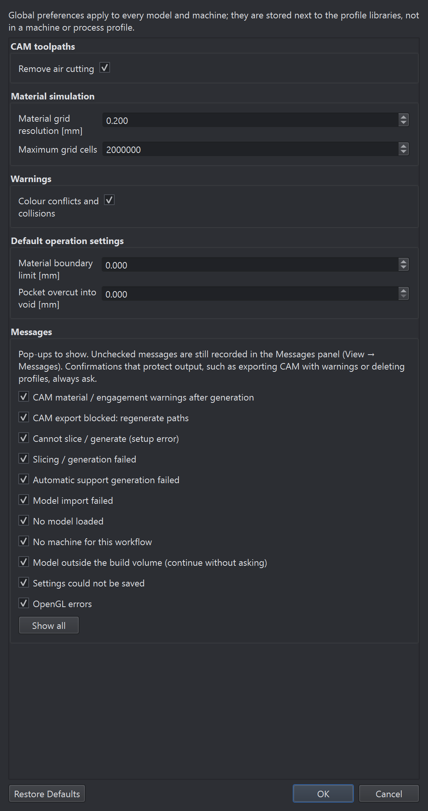
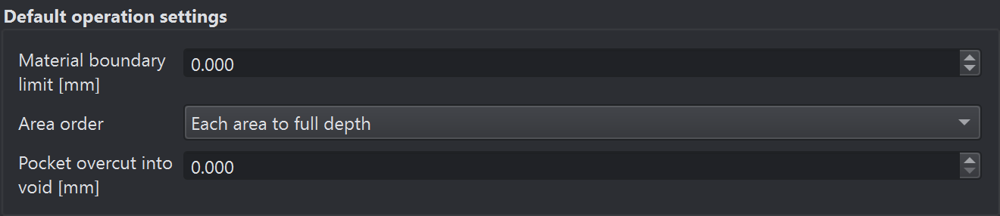
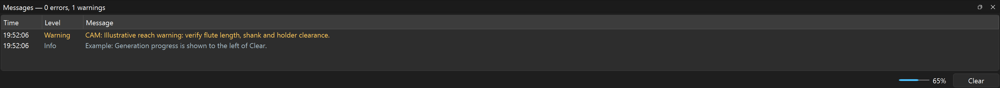

[Documentation](README.md)

# Global settings

**File → Settings… (Ctrl+,)** opens preferences that apply to every model,
machine and process. They are stored as `settings.json` next to the profile
libraries (`~/.gcodeproducer`, or `GCODEPRODUCER_LIBRARY`), not in QSettings
window state and not in a machine or process profile, because they change
generated output. The CLI reads the same file; `gcodeproducer settings`
lists the current values and `--pref KEY=VALUE` overrides one for a single run.

| Setting | Default | Effect |
|---|---|---|
| Remove air cutting | On | CAM operations start at the first depth that still holds material (estimated from earlier operations in the same setup), pocket contours lying entirely in removed material are dropped, and operations/passes with nothing left to cut are skipped. Everything skipped is logged. |
| Short retracts within cleared material | On | Between entries, stay at the current depth when the move and ramp start are clear of current material (e.g. the next depth pass of a pocket: no retract at all); otherwise retract only to *Short retract clearance* above the current material along the travel, then rapid down to the ramp start, instead of safe Z + feeding down through air. Needs allocated stock (without it, safe Z is used). Fixtures and clamps are not modelled: turn this off if anything stands above the material. |
| Short retract clearance | 1 mm | Height of short rapid travels above the highest current material under the cutter along the move. |
| Lead-in start above material | 0.5 mm | Where a lead-in ramp begins above the current local material (also the rapid-down target). A plain plunge stops its rapid at the short retract clearance and feeds from there. |
| Material grid resolution | 0.2 mm | Height-field cell size for current-material contact checks, lead entry heights and the Material display. |
| Maximum grid cells | 2,000,000 | Memory guard. If `width × depth / resolution²` exceeds it the grid is coarsened and a warning is issued. |
| Colour conflicts and collisions | On | Moves flagged by the planner/stock checks are recoloured as the **Conflict** and **Collision** features in Feature colour mode. |
| Material boundary limit (Default operation settings) | 0 mm | Initial value for new operations' *Material boundary limit* (see [Pocket](cam/operations.md#overcut-into-void-material)). |
| Pocket overcut into void (Default operation settings) | 0 mm | Initial overcut for new Pocket operations. Existing operations keep their saved values. |
| Area order (Default operation settings) | Each area to full depth | New operations finish each disconnected area before the next. Select *Each depth across all areas* to visit every area at each depth. Each saved operation has its own override; see [multiple areas](cam/operations.md#multiple-machining-areas). |
| Messages | all shown | Which pop-ups appear; see below. |

Changing a setting marks an existing CAM result stale; regenerate before
exporting. **Restore Defaults** resets the dialog, and OK saves it. A corrupt
or missing settings file silently falls back to defaults at start-up.
Settings forms and CLI parameters share scalar/choice conversion: for example,
saved `"false"` is false, not a truthy nonempty string. Null fields use declared
defaults; invalid preference choices recover to their defaults. See
[shared default loading](cleanup-and-ui-audit.md#material-order-and-default-loading).

### Default operation settings

These fields seed new operations only. Saved operation values do not change
when global defaults change.

## Messages and the Messages panel

Every warning and error — pop-up or not — is recorded in the **Messages**
panel, docked at the bottom of the window a few lines tall. Hide or show it
with **View → Messages**; drag it elsewhere like any dock (the layout is
remembered). Rows are coloured by level, hover for the full text, and
**Clear** (bottom right, beside the generation progress bar) empties it. The error/warning counts are shown in
the dock title, e.g. *Messages — 1 errors, 2 warnings*. CAM job warnings (stock, engagement, reach, tool,
lead) are listed once per generation; pipeline log lines containing
`WARNING:` are added too. The full detail remains in the **Log** dock.

Each warning/error pop-up has a **Don't show this again** checkbox. Ticking
it turns that message type off in **Settings → Messages** (saved
immediately); **Show all** or **Restore Defaults** turns them back on. A
suppressed message still appears in the Messages panel and briefly in the
status bar, and the action it reports still happens or is still blocked —
for example an out-of-date CAM export is still refused.

For the *outside the build volume — slice anyway?* question, ticking the box
together with **Yes** means "continue without asking"; a **No** answer is
never remembered. Confirmations that protect output or data — exporting CAM
with warnings, deleting profiles/processes, discarding unsaved changes — have
no such checkbox and always ask. Deleting **reference geometry** is the one
deletion that can be remembered: Yes with the box ticked deletes later unused
references without asking, until *Confirm deleting reference geometry* is
switched back on here. References still in use are never deleted. The previous *Show warning dialog after
generation* setting migrates to the *CAM material / engagement warnings*
message switch.

## Air-cut removal: what it knows and does not know

The estimate subtracts the planar cutter sweeps of earlier operations at each
recorded depth. It does not know material removed by a previous program, by
hand, or by a tool change outside this setup, and it ignores rapid moves and
lead ramps. An operation lowered to a later start therefore relies on the
earlier operations actually having run. A path is dropped only when its
**entire** cutter sweep meets no remaining material; partially engaged paths
are kept and their engagement classified normally. When a dropped path broke
a stay-down chain the next path makes its own entry (short retract above the
current material, or safe Z when short retracts are off).

## Material grid resolution

The previous per-machine `stock_resolution` field is ignored and hidden;
the global value replaces it. Small tools (diameter below twice the grid
cell) trigger a warning because sub-cell contacts can be missed. Finer grids
are slower and use more memory: a 300 × 300 mm blank at 0.1 mm is 9 million
cells and is coarsened by the default cell limit. Raise the limit knowingly.

## Conflict and collision colouring

- **Conflict** (yellow): cut segments inside a path that the planner could not
  keep on the requested climb/conventional hand because remaining material
  switches sides. They are cut at the measured engagement feed; the colour is
  a review aid, and the warning text still appears.
- **Collision** (magenta): moves named by a `Line N:` stock finding — rapid or
  spindle-off contact with current material, unclassified feed contact,
  motion below the blank bottom, an entry deeper than the tool's depth per
  pass, or contact with a protected [holding tab](cam/holding-tabs.md). Setup-level findings (unallocated stock, safe Z, part containment)
  have no single move and are not coloured.

Colouring does not alter the G-code. A program with coloured moves must be
corrected, not exported with the warning confirmed.
